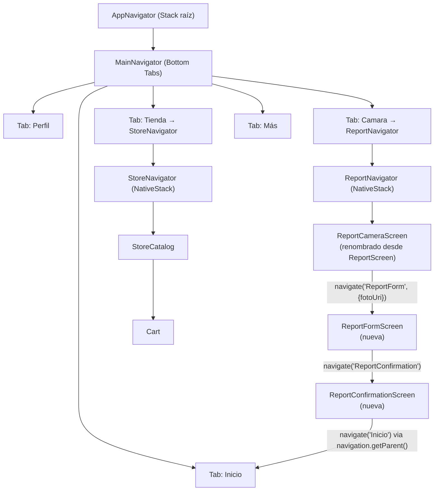
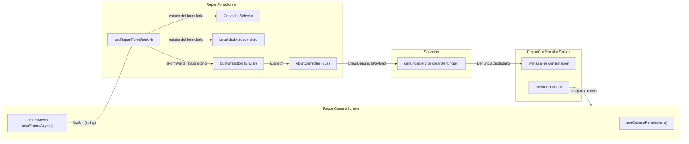

# Documento de Diseño Técnico

## Funcionalidad: Creación de Reporte Ambiental (`environmental-report-creation`)

---

## Overview

Esta funcionalidad extiende la `Pantalla_Camara` existente (`ReportScreen`) para completar el flujo de creación de un reporte ambiental. El flujo cubre cuatro etapas: solicitud de permiso de cámara → captura de fotografía → llenado del formulario → confirmación de envío.

La implementación introduce un stack de navegación dedicado (`ReportNavigator`), dos pantallas nuevas (`ReportFormScreen`, `ReportConfirmationScreen`), dos componentes reutilizables (`LocalidadAutocomplete`, `GravedadSelector`) y un hook de estado del formulario (`useReportForm`). Todo el envío de datos al servidor se delega al servicio existente `denunciaService.crearDenuncia`, sin modificar su firma.

**Principios guía:**
- No se inventan campos nuevos en `CrearDenunciaPayload`; se usan los campos existentes.
- No se llama a `updateUserPoints` al enviar el reporte.
- No se modifica `denunciasService.ts`.
- Se usan exclusivamente los tokens de `theme.ts` para colores y espaciado.
- Se reutilizan `CustomButton` y `Header`.

---

## Architecture

### Diagrama de navegación



### Diagrama de flujo de datos



---

## Components and Interfaces

### Tipos de navegación

```typescript
// src/navigation/types.ts  (archivo nuevo)
import type { NativeStackScreenProps } from '@react-navigation/native-stack';

export type ReportStackParamList = {
  ReportCamera: undefined;
  ReportForm: { fotoUri: string };
  ReportConfirmation: undefined;
};

export type ReportCameraScreenProps = NativeStackScreenProps<
  ReportStackParamList,
  'ReportCamera'
>;
export type ReportFormScreenProps = NativeStackScreenProps<
  ReportStackParamList,
  'ReportForm'
>;
export type ReportConfirmationScreenProps = NativeStackScreenProps<
  ReportStackParamList,
  'ReportConfirmation'
>;
```

### `ReportNavigator` (nuevo stack)

Sigue exactamente el patrón de `StoreNavigator` en `MainNavigator.tsx`.

```typescript
// Dentro de MainNavigator.tsx
const ReportStack = createNativeStackNavigator<ReportStackParamList>();

const ReportNavigator = () => (
  <ReportStack.Navigator screenOptions={{ headerShown: false }}>
    <ReportStack.Screen name="ReportCamera" component={ReportCameraScreen} />
    <ReportStack.Screen name="ReportForm"   component={ReportFormScreen} />
    <ReportStack.Screen name="ReportConfirmation" component={ReportConfirmationScreen} />
  </ReportStack.Navigator>
);
```

El tab `"Camara"` en `MainNavigator` se cambia de `component={ReportScreen}` a `component={ReportNavigator}`.

### `ReportCameraScreen` (refactor de `ReportScreen`)

`ReportScreen.tsx` se renombra a `ReportCameraScreen.tsx`. Cambios respecto a la versión actual:

1. Recibe props de navegación tipadas con `ReportCameraScreenProps`.
2. La función `takePicture` navega a `ReportForm` al completarse:
   ```typescript
   const takePicture = async () => {
     if (!cameraRef.current) return;
     try {
       const photo = await cameraRef.current.takePictureAsync({ quality: 0.8 });
       if (photo?.uri) {
         navigation.navigate('ReportForm', { fotoUri: photo.uri });
       } else {
         setCapturError('No se pudo obtener la URI de la fotografía.');
       }
     } catch {
       setCaptureError('La captura no pudo completarse. Inténtalo nuevamente.');
     }
   };
   ```
3. Manejo de permiso denegado permanentemente: cuando `permission.granted === false && permission.canAskAgain === false`, se muestra un mensaje adicional con botón que ejecuta `Linking.openSettings()` (de `react-native`).
4. Estado local `captureError: string | null` para mostrar error inline si `takePictureAsync` falla.

**API de `useCameraPermissions` en expo-camera v57:**
- `permission.granted` — booleano; `true` si el acceso está concedido.
- `permission.canAskAgain` — booleano; `false` cuando el permiso fue denegado permanentemente.
- `requestPermission()` — llama al diálogo del sistema.
- `takePictureAsync(options?)` — retorna `Promise<CameraCapturedPicture | undefined>` con campo `uri: string`.

### `ReportFormScreen` (pantalla nueva)

Pantalla principal del formulario. Recibe `fotoUri` como parámetro de ruta.

**Responsabilidades:**
- Mostrar miniatura de la foto (mínimo 80×80 dp).
- Orquestar `GravedadSelector`, `LocalidadAutocomplete`, y el campo de calle/altura.
- Consumir `useReportForm(fotoUri)` para todo el estado y lógica de envío.
- Deshabilitar el botón de envío mientras `!isFormValid` o `isSubmitting`.
- Mostrar `ActivityIndicator` y mensajes de error.

### `ReportConfirmationScreen` (pantalla nueva)

Pantalla de confirmación post-envío exitoso.

**Responsabilidades:**
- Mostrar mensaje de éxito con texto exacto: *"¡Muchas gracias por tu reporte! Si el mismo es correcto, recibirás 600 Eco Points"*.
- Botón "Continuar" que navega al tab `Inicio` usando `navigation.getParent()?.navigate('Inicio')`.
- **No** llamar a `updateUserPoints`.

### `GravedadSelector` (componente nuevo)

```typescript
// src/components/GravedadSelector.tsx

type Gravedad = 'LEVE' | 'MODERADA' | 'GRAVE';

interface GravedadSelectorProps {
  value: Gravedad | null;
  onChange: (gravedad: Gravedad) => void;
}
```

Renderiza tres chips horizontales. Cada chip muestra la etiqueta y cambia de apariencia al ser seleccionado. Colores usando tokens existentes:

| Gravedad  | Fondo no seleccionado | Fondo seleccionado | Texto seleccionado |
|-----------|----------------------|--------------------|--------------------|
| LEVE      | `COLORS.fondoTarjeta` | `COLORS.botonPrincipal` | `COLORS.blanco` |
| MODERADA  | `COLORS.fondoTarjeta` | `COLORS.textoAdvertencia` | `COLORS.blanco` |
| GRAVE     | `COLORS.fondoTarjeta` | `COLORS.error` | `COLORS.blanco` |

Solo permite una selección activa (las otras dos mantienen el estilo no seleccionado).

### `LocalidadAutocomplete` (componente nuevo)

```typescript
// src/components/LocalidadAutocomplete.tsx

interface LocalidadAutocompleteProps {
  value: string | null;          // localidad actualmente seleccionada
  inputText: string;             // texto del campo visible
  onSelect: (localidad: string) => void;
  onChangeText: (text: string) => void; // notifica cambios que invalidan la selección
}
```

**Lista de localidades (constante exportable):**

```typescript
// src/constants/localidades.ts
export const LOCALIDADES = [
  'Champagnat',
  'Del Viso',
  'Fátima',
  'La Lonja',
  'Luis Lagomarsino',
  'Manuel Alberti',
  'Manzanares',
  'Manzone',
  'Pilar',
  'Pilar Sur',
  'Presidente Derqui',
  'San Francisco',
  'Villa Astolfi',
  'Villa Rosa',
  'Zelaya',
] as const;

export type Localidad = (typeof LOCALIDADES)[number];
```

**Lógica de normalización:**

```typescript
// src/utils/normalizeText.ts
export const normalizeText = (text: string): string =>
  text
    .normalize('NFD')
    .replace(/[\u0300-\u036f]/g, '')
    .toLowerCase();
```

**Lógica de filtrado:**

```typescript
export const filtrarLocalidades = (query: string): string[] => {
  if (query.length < 3) return [];
  const normalizedQuery = normalizeText(query);
  return LOCALIDADES.filter(loc =>
    normalizeText(loc).includes(normalizedQuery)
  );
};
```

**Comportamiento del dropdown:**
- Se muestra cuando `query.length >= 3` y hay resultados (o mensaje de "no encontrado").
- Se cierra al seleccionar una localidad (`onSelect`) o al perder el foco.
- Si el usuario edita el texto después de haber seleccionado, se llama `onChangeText` que invalida la selección en `useReportForm`.

### `useReportForm` (hook nuevo)

```typescript
// src/hooks/useReportForm.ts

interface ReportFormState {
  fotoUri: string;
  gravedad: 'LEVE' | 'MODERADA' | 'GRAVE' | null;
  calleAltura: string;
  localidad: string | null;
  localidadInputText: string;
}

interface UseReportFormReturn {
  state: ReportFormState;
  errors: Partial<Record<keyof ReportFormState, string>>;
  isFormValid: boolean;
  isSubmitting: boolean;
  retryCount: number;
  setGravedad: (g: 'LEVE' | 'MODERADA' | 'GRAVE') => void;
  setCalleAltura: (text: string) => void;
  setLocalidad: (loc: string) => void;
  clearLocalidad: (text: string) => void;  // invalida selección y actualiza inputText
  submit: () => Promise<void>;
  reset: () => void;  // solo llamado en éxito o cancelación explícita
}
```

---

## Data Models

### Mapeo formulario → `CrearDenunciaPayload`

El contrato del servicio existente no se modifica. Los campos del formulario se mapean así:

| Campo del formulario | Campo en `CrearDenunciaPayload` | Valor / Lógica |
|---------------------|-------------------------------|----------------|
| `fotoUri`           | `fotoUri`                     | URI local directa |
| `gravedad + localidad` | `descripcion`              | `"[LEVE|MODERADA|GRAVE] - [calle y altura]"` |
| `calleAltura + localidad` | `ubicacion`            | `"[calleAltura], [localidad]"` |
| (generado)          | `titulo`                      | `"Reporte ambiental - [localidad]"` |
| (fijo)              | `categoria`                   | `'BASURAL'` |

> **Decisión de diseño:** La `categoria` es fija en `'BASURAL'` en esta versión del flujo. El campo `descripcion` incluye la gravedad como prefijo para preservar esa información en el servidor sin agregar campos nuevos al payload. El campo `ubicacion` concatena calle/altura y localidad para mantener la ubicación completa en un solo campo legible.

### Estructura de estado local del formulario

```typescript
// Estado interno de useReportForm
type FormState = {
  fotoUri: string;                         // no mutable después de inicializar
  gravedad: 'LEVE' | 'MODERADA' | 'GRAVE' | null;
  calleAltura: string;                     // vacío por defecto
  localidad: string | null;               // null hasta que se seleccione de la lista
  localidadInputText: string;             // texto visible en el campo
};

type SubmitState = {
  isSubmitting: boolean;
  retryCount: number;                      // 0..3; al llegar a 3 se bloquea
  lastError: string | null;
};
```

---

## Correctness Properties

*Una propiedad es una característica o comportamiento que debe ser verdadero en todas las ejecuciones válidas del sistema — esencialmente, un enunciado formal sobre lo que el sistema debe hacer. Las propiedades sirven de puente entre especificaciones legibles por personas y garantías de corrección verificables automáticamente.*

### Property 1: La captura conserva la URI sin modificarla

*Para cualquier* URI no nula y no vacía retornada por `takePictureAsync`, el estado del formulario debe conservar esa misma URI (por igualdad de referencia) sin alteraciones mientras el flujo permanezca activo.

**Validates: Requirements 2.2, 2.3**

---

### Property 2: La validación de `calleAltura` rechaza entradas sin dígito numérico

*Para cualquier* string `s`, la función de validación de `calleAltura` debe retornar `false` si y solo si `s` es vacío, está compuesto únicamente por whitespace, o no contiene al menos un carácter del conjunto `[0-9]`.

**Validates: Requirements 5.2**

---

### Property 3: `filtrarLocalidades` retorna subconjunto de las 15 localidades permitidas

*Para cualquier* string `query` de longitud ≥ 3, todos los elementos del array retornado por `filtrarLocalidades(query)` deben pertenecer al conjunto fijo `LOCALIDADES`, y todos deben contener `normalizeText(query)` como subcadena de `normalizeText(elemento)`.

**Validates: Requirements 6.3, 6.11**

---

### Property 4: `filtrarLocalidades` retorna vacío para queries cortos

*Para cualquier* string `query` de longitud 0, 1 o 2, `filtrarLocalidades(query)` debe retornar un array vacío.

**Validates: Requirements 6.2**

---

### Property 5: `normalizeText` produce resultado idempotente e invariante ante tildes

*Para cualquier* string `s`, `normalizeText(normalizeText(s)) === normalizeText(s)` (idempotencia). Además, para cualquier par de strings donde `a` es `b` con tildes reemplazadas por sus equivalentes ASCII, `normalizeText(a) === normalizeText(b)`.

**Validates: Requirements 6.3, 6.6**

---

### Property 6: El formulario es válido si y solo si todos los campos están completos

*Para cualquier* estado del formulario, `isFormValid` debe retornar `true` si y solo si `fotoUri` es no nula y no vacía, `gravedad` es uno de `{LEVE, MODERADA, GRAVE}`, `calleAltura` pasa la validación del Requisito 5.2, y `localidad` es no nula y pertenece a `LOCALIDADES`.

**Validates: Requirements 7.2, 4.3, 6.10**

---

### Property 7: Los datos del formulario se preservan después de un envío fallido

*Para cualquier* estado del formulario válido antes de llamar a `submit()`, si la llamada a `crearDenuncia` lanza un error (de red, timeout o respuesta de error del servidor), el estado del formulario después del intento debe ser byte-a-byte igual al estado anterior al intento.

**Validates: Requirements 8.5, 10.1, 10.2**

---

### Property 8: `isSubmitting=true` impide iniciar un nuevo envío concurrente

*Para cualquier* estado con `isSubmitting === true`, una segunda llamada a `submit()` debe ser ignorada sin modificar el estado ni llamar a `crearDenuncia` una segunda vez.

**Validates: Requirements 8.2**

---

### Property 9: `retryCount` nunca supera 3

*Para cualquier* secuencia de `n` llamadas fallidas consecutivas a `submit()`, `retryCount` al finalizar debe ser `min(n, 3)`. Cuando `retryCount === 3`, `isFormValid` debe retornar `false` (el botón se deshabilita) independientemente de los valores de los otros campos.

**Validates: Requirements 10.3**

---

### Property 10: El envío exitoso no modifica `user.points`

*Para cualquier* envío exitoso del formulario (crearDenuncia resuelve sin error), el valor de `user.points` en `AuthContext` antes y después del envío debe ser igual, y `updateUserPoints` no debe haber sido invocada.

**Validates: Requirements 9.3**

---

## Error Handling

| Situación | Comportamiento del sistema |
|-----------|--------------------------|
| `takePictureAsync` retorna `undefined` o lanza | Mostrar `captureError` inline en `ReportCameraScreen`; no navegar |
| Permiso denegado (`canAskAgain=false`) | Mostrar mensaje + botón `Linking.openSettings()` |
| Formulario incompleto al tocar "Enviar" | Mostrar mensajes de error por campo; no llamar a `crearDenuncia` |
| Error de red o timeout (30 s) | Preservar estado del formulario; mostrar error; incrementar `retryCount` |
| Error HTTP del servidor (4xx/5xx) | Ídem al error de red |
| `retryCount === 3` | Deshabilitar botón; mostrar "No es posible completar el envío en este momento" |
| Respuesta exitosa del servidor | Limpiar estado; navegar a `ReportConfirmation` |
| Cancelación explícita del usuario | Limpiar estado; navegar de regreso |

### Implementación del timeout de 30 segundos

```typescript
// Dentro de useReportForm.submit()
const controller = new AbortController();
const timeoutId = setTimeout(() => controller.abort(), 30_000);

try {
  const result = await denunciaService.crearDenuncia(payload);
  clearTimeout(timeoutId);
  // navegar a confirmación
} catch (err) {
  clearTimeout(timeoutId);
  const isTimeout = err instanceof Error && err.name === 'AbortError';
  const message = isTimeout
    ? 'El servidor no respondió a tiempo. Tus datos están guardados, podés reintentar.'
    : 'El envío no pudo completarse. Tus datos están guardados, podés reintentar.';
  setLastError(message);
  setRetryCount(prev => Math.min(prev + 1, 3));
}
```

> **Nota:** `denunciaService.crearDenuncia` usa `clienteApi` internamente; para que el `AbortController` funcione, `clienteApi` debe aceptar y propagar la señal `signal`. Si `clienteApi` no lo soporta, el timeout se implementa con `Promise.race` entre la llamada al servicio y un `Promise` que rechaza tras 30 segundos.

---

## Testing Strategy

### Tests unitarios (ejemplo/integración de componentes)

Se usan para casos concretos, flujos E2E ligeros y comportamientos de renderizado:

- Verificar que `ReportCameraScreen` muestra el mensaje de permiso cuando `permission.granted=false`.
- Verificar que `ReportCameraScreen` muestra el botón de Settings cuando `canAskAgain=false`.
- Verificar que `GravedadSelector` renderiza las tres opciones y una sola queda activa al seleccionar.
- Verificar que `LocalidadAutocomplete` muestra "No se encontraron localidades" para un query sin coincidencias.
- Verificar ejemplos concretos de filtrado: `'pil'` → `['Pilar', 'Pilar Sur']`, `'fat'` → `['Fátima']`.
- Verificar el texto exacto del mensaje en `ReportConfirmationScreen`.
- Verificar que `navigation.getParent()?.navigate('Inicio')` se invoca al presionar "Continuar".

### Tests de propiedades (property-based testing)

Se usa **[fast-check](https://github.com/dubzzz/fast-check)** (compatible con Jest/Vitest en proyectos TypeScript).

Cada property test corre mínimo **100 iteraciones**. El tag de referencia sigue el formato:
`Feature: environmental-report-creation, Property N: <texto>`

```typescript
// Ejemplo de estructura de test de propiedad
import fc from 'fast-check';

// Feature: environmental-report-creation, Property 2: validación de calleAltura
it('calleAltura inválida: strings sin dígito numérico', () => {
  fc.assert(
    fc.property(
      fc.stringMatching(/^[^\d]+$/),  // strings sin dígitos
      (s) => {
        expect(validateCalleAltura(s)).toBe(false);
      }
    ),
    { numRuns: 100 }
  );
});

// Feature: environmental-report-creation, Property 3: filtrado es subconjunto
it('filtrarLocalidades retorna subconjunto válido', () => {
  fc.assert(
    fc.property(
      fc.string({ minLength: 3, maxLength: 20 }),
      (query) => {
        const results = filtrarLocalidades(query);
        return results.every(loc => LOCALIDADES.includes(loc as Localidad));
      }
    ),
    { numRuns: 100 }
  );
});
```

**Propiedades a implementar como tests:**

| Nro. | Función bajo test | Librería | Iteraciones |
|------|------------------|----------|-------------|
| P1 | `useReportForm` — conservación de URI | fast-check | 100 |
| P2 | `validateCalleAltura` | fast-check | 100 |
| P3 | `filtrarLocalidades` — subconjunto y contenido | fast-check | 100 |
| P4 | `filtrarLocalidades` — vacío para queries cortos | fast-check | 100 |
| P5 | `normalizeText` — idempotencia y equivalencia de tildes | fast-check | 100 |
| P6 | `isFormValid` — completitud | fast-check | 100 |
| P7 | `useReportForm.submit` — preservación ante fallo | fast-check | 100 |
| P8 | `useReportForm.submit` — no concurrencia | fast-check | 100 |
| P9 | `useReportForm` — límite de reintentos | fast-check | 100 |
| P10 | `useReportForm.submit` — no modifica `user.points` | fast-check | 100 |

---

## Lista de archivos a crear o modificar

### Archivos nuevos

| Ruta | Responsabilidad |
|------|----------------|
| `src/navigation/types.ts` | `ReportStackParamList` y tipos de props de navegación |
| `src/screens/citizen/ReportCameraScreen.tsx` | Cámara + permisos (refactor de `ReportScreen`) |
| `src/screens/citizen/ReportFormScreen.tsx` | Formulario: gravedad, calle/altura, localidad, foto |
| `src/screens/citizen/ReportConfirmationScreen.tsx` | Pantalla de éxito |
| `src/components/GravedadSelector.tsx` | Chips de gravedad LEVE/MODERADA/GRAVE |
| `src/components/LocalidadAutocomplete.tsx` | Campo con dropdown de localidades |
| `src/constants/localidades.ts` | Array `LOCALIDADES` y tipo `Localidad` |
| `src/utils/normalizeText.ts` | `normalizeText()` y `filtrarLocalidades()` |
| `src/hooks/useReportForm.ts` | Hook de estado, validación, envío y reintentos |

### Archivos modificados

| Ruta | Cambio |
|------|--------|
| `src/navigation/MainNavigator.tsx` | Agregar `ReportNavigator`; cambiar tab `Camara` de `ReportScreen` a `ReportNavigator` |
| `src/screens/citizen/ReportScreen.tsx` | Renombrar a `ReportCameraScreen.tsx` (o mantener el archivo como re-export para compatibilidad) |
