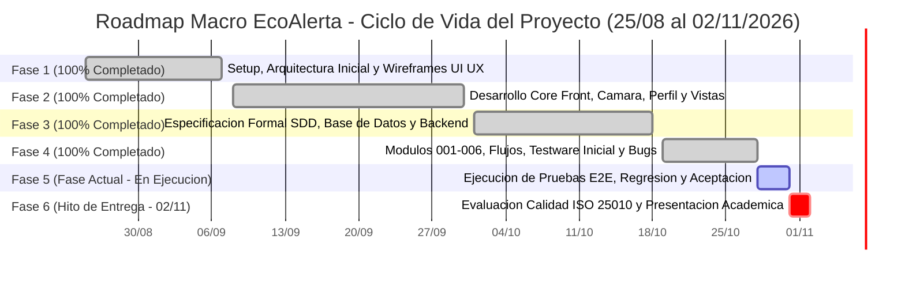
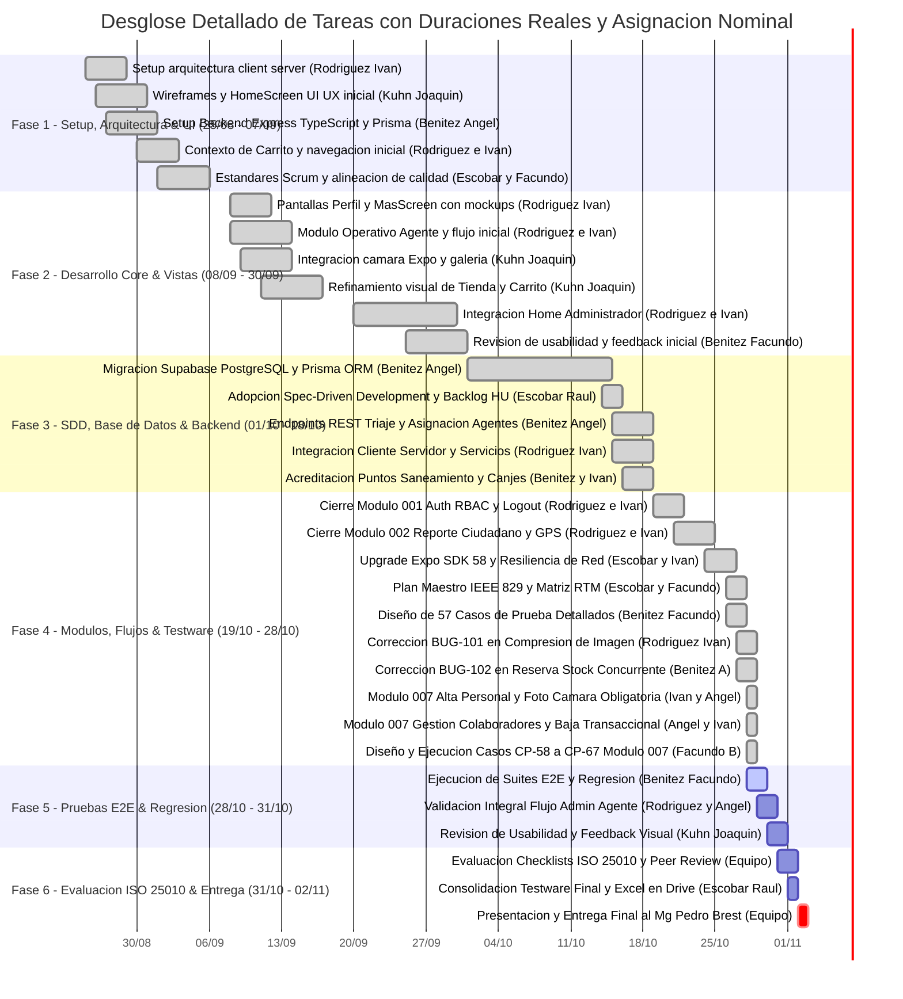

# 06. Plan de Ejecución, Cronograma Gantt y Tablero de Avances (EcoAlerta)

> **Proyecto:** EcoAlerta — Aplicación Móvil de Gestión Ambiental Ciudadana y Tienda de Recompensas  
> **Institución:** Universidad Nacional de Pilar (UNPilar) — Testing & Calidad de Software 2026  
> **Profesor Titular:** Mg. Pedro Brest  
> **Equipo de Proyecto (5 integrantes):**  
> - **Escobar Raul** (Scrum Master — Coordinación, Gestión del Alcance, Tiempo PMBOK y RTM)  
> - **Kuhn Joaquin** (Diseñador UI/UX — Prototipado, Interfaces, HomeScreen y Usabilidad ISO 25010)  
> - **Rodriguez Iván** (Desarrollador FrontEnd — React Native Expo, Auth Gate, Cámara y Resolución de BUG-101)  
> - **Benitez Angel** (Desarrollador BackEnd — API REST, Prisma ORM, PostgreSQL, Concurrencia y Resolución de BUG-102)  
> - **Benitez Facundo** (Analista de QA — Diseño y Ejecución de 67 Casos de Prueba, Regresión y Bug Tracker)  
> **Metodología:** Gestión del Alcance y Tiempo (PMBOK / PERT-CPM) & Spec-Driven Testing (SDD)  
> **Duración Total:** 10 Semanas Calendario (70 Días / 50 Días Laborables)  
> **Fecha de Inicio Oficial:** 25 de agosto de 2026 (Creación del repositorio en GitHub)  
> **Fecha de Entrega Final:** 02 de noviembre de 2026 (Defensa Académica)  
> **Fecha de Corte / Estado Actual:** 28 de octubre de 2026  
> **Garantía:** Cobertura 100% de Requerimientos, 0 Defectos Críticos (S1/S2) abiertos y conformidad con ISO/IEC 25010.

---

## 📅 Visión General de las 6 Fases & Tablero de Avance (Inicio: 25/08/2026 — Entrega: 02/11/2026)

---

### 📊 Tablero de Control de Avance: "¿Cómo vamos?"

| Métrica del Proyecto | Estado Actual (Corte: 28-10) | Período Histórico (Inicio: 25-08) | Diagnóstico de Cumplimiento |
| :--- | :--- | :--- | :--- |
| **Progreso Global del Proyecto** | **88% Realizado** (28 / 32 Tareas) | 25/08 al 02/11/2026 (Semana 9 de 10) | 🟢 **100% en fecha (On Track)** |
| **Fase 1: Setup, Arquitectura & UI** | **100% Completado** `[██████████]` | **25/08 al 07/09/2026** | 🟢 Cimientos aprobados |
| **Fase 2: Desarrollo Core Front** | **100% Completado** `[██████████]` | **08/09 al 30/09/2026** | 🟢 Vistas y mockups integrados |
| **Fase 3: SDD, Base de Datos & Back** | **100% Completado** `[██████████]` | **01/10 al 18/10/2026** | 🟢 PostgreSQL + Supabase funcional |
| **Fase 4: Módulos, Testware & Bugs** | **100% Completado** `[██████████]` | **19/10 al 28/10/2026** | 🟢 Módulos 001-007, 67 CPs, 146 Tests Automatizados |
| **Fase 5: Pruebas E2E & Regresión** | **50% En Ejecución** `[█████░░░░░]` | **28/10 al 31/10/2026** | 🟡 En curso según cronograma |
| **Fase 6: Certificación & Entrega** | **0% Planificado** `[░░░░░░░░░░]` | **31/10 al 02/11/2026** | ⚪ Entrega final el 02/11 |
| **Defectos Bloqueantes Abiertos** | **0 Defectos S1/S2** | 2 detectados, 2 resueltos | 🟢 100% de bugs cerrados |
| **Cobertura de Requisitos (RTM)** | **100% Trazada** | 78 RF/RNF con casos | 🟢 Matriz auditada sin vacíos (67 CPs) |

> [!TIP]
> **Evaluación Global de Ritmo**: **El proyecto se encuentra estrictamente al día.** Habiendo iniciado formalmente el **25 de agosto de 2026**, el equipo completó el 100% de las fases de desarrollo (Fases 1 a 4) registrando en git la implementación progresiva de los 6 módulos. Con la resolución y verificación de los dos defectos identificados (`BUG-101` y `BUG-102`), la Fase 5 de regresión integral se encuentra activa al día de hoy (28 de octubre), asegurando una entrega holgada y conforme al estándar el próximo **02 de noviembre de 2026**.

---

## 👥 Resumen del Equipo y Matriz de Asignaciones

| Integrante | Rol Oficial | Módulos y Entregables a Cargo | Responsable Corrección Bugs |
| :--- | :--- | :--- | :--- |
| **Escobar Raul** | **Scrum Master** | Cronograma Gantt, Plan Maestro IEEE 829, Matriz RTM, EDT, PERT/CPM y gestión del equipo. | Coordinación y calidad global |
| **Kuhn Joaquin** | **Diseñador UI/UX** | Wireframes HomeScreen, estilos, cámara visual, refinamiento tienda y evaluación ISO 25010. | Bugs visuales y de usabilidad |
| **Rodriguez Iván** | **Desarrollador FrontEnd** | Pantallas React Native, Auth Gate, Cámara, Listas, Modales transaccionales y fix de `BUG-101`. | Bugs de UI, Cámara y Navegación |
| **Benitez Angel** | **Desarrollador BackEnd** | API REST Express, TypeScript, Prisma ORM, Supabase PostgreSQL, concurrencia y fix de `BUG-102`. | Bugs de API, BD y Concurrencia |
| **Benitez Facundo** | **Analista de QA** | Diseño y ejecución de 57 casos de prueba, colecciones Postman, suites Jest, bug tracking y regresión. | Verificación de re-tests y firmas |

---

## 🏃 Desglose Detallado de las Fases del Proyecto (25/08 al 02/11)

### FASE 1 (25/08 al 07/09/2026): Inicialización, Arquitectura y Prototipado UI/UX
* **Objetivo**: Establecer la arquitectura del monorepo (`client/` y `server/`), base de datos SQLite inicial con Prisma, HomeScreen y estándares Scrum.
* **Hitos Realizados**:
  - `25/08`: Setup monorepo y estructura limpia por Rodriguez Iván.
  - `26/08 - 29/08`: Primeras pantallas HomeScreen, maquetación y estilos por Kuhn Joaquin.
  - `27/08 - 30/08`: Backend inicial Express, TypeScript, Prisma y rutas por Benitez Angel.
  - `30/08 - 04/09`: Contexto de carrito y modelos de productos por Rodriguez Iván y Benitez Angel.
  - `01/09 - 07/09`: Definición de estándares ágiles y plan de calidad por Escobar Raul y Benitez Facundo.

### FASE 2 (08/09 al 30/09/2026): Desarrollo Core Frontend & Módulos Base
* **Objetivo**: Implementar vistas operativas de los usuarios, selector de imágenes, cámara y panel municipal.
* **Hitos Realizados**:
  - `08/09 - 14/09`: Perfil de usuario con `expo-image-picker`, pantalla Más y Home de Agente de Campo por Rodriguez Iván y Kuhn Joaquin.
  - `09/09 - 15/09`: Integración de cámara nativa Expo y refinamiento de tienda por Kuhn Joaquin y Rodriguez Iván.
  - `15/09 - 30/09`: Integración de Home Administrador Municipal y revisión de usabilidad por Rodriguez Iván, Kuhn Joaquin y Benitez Facundo.

### FASE 3 (01/10 al 18/10/2026): Especificación Formal SDD, Base de Datos y Backend
* **Objetivo**: Migración a PostgreSQL en la nube (Supabase), adopción de Spec-Driven Development (SDD) y lógica de negocio compleja.
* **Hitos Realizados**:
  - `01/10 - 14/10`: Configuración de base de datos Supabase, variables de entorno y migración Prisma por Benitez Angel.
  - `14/10 - 15/10`: Relevamiento formal de Backlog, 15 HUs y Spec Kit por Escobar Raul.
  - `15/10 - 18/10`: Endpoints de triaje, asignación atómica, acreditación de puntos, saneamiento técnico y tienda reactiva por Benitez Angel y Rodriguez Iván.

### FASE 4 (19/10 al 28/10/2026): Finalización de Módulos, Testware y Corrección de Bugs
* **Objetivo**: Concluir los 6 módulos funcionales, redactar el Plan Maestro de Testing IEEE 829, diseñar los 57 casos de prueba, estructurar la RTM y corregir los defectos detectados.
* **Hitos Realizados**:
  - `19/10 - 24/10`: Finalización de Módulo 001 (Auth-RBAC), Módulo 002 (Reportes), Triaje y Saneamiento por Rodriguez Iván, Kuhn Joaquin y Benitez Angel.
  - `24/10 - 26/10`: Actualización a Expo SDK 58, endpoints de Mis Denuncias y disponibilidad de inspectores por Escobar Raul y Rodriguez Iván.
  - `26/10 - 28/10`: Plan Maestro IEEE 829, Catálogo BDD, diseño de 57 Casos de Prueba, Matriz RTM y resolución de `BUG-101` y `BUG-102` por Benitez Facundo, Rodriguez Iván, Benitez Angel y Escobar Raul.

### FASE 5 (28/10 al 31/10/2026 - ACTIVA HOY): Ejecución de Pruebas E2E, Regresión y Aceptación
* **Objetivo**: Ejecutar las suites integrales de prueba sobre los flujos conectados, validar tiempos de respuesta y asegurar estabilidad.
* **Plan de Trabajo**:
  - `28/10 - 29/10`: Ejecución de suites E2E y pruebas de regresión por Benitez Facundo.
  - `29/10 - 30/10`: Validación integral de flujo completo Admin-Agente y concurrencia por Rodriguez Iván y Benitez Angel.
  - `30/10 - 31/10`: Verificación de usabilidad y feedback visual en dispositivos móviles por Kuhn Joaquin y Benitez Facundo.

### FASE 6 (31/10 al 02/11/2026): Evaluación bajo Modelo ISO 25010 y Entrega Final Académica
* **Objetivo**: Evaluación metodológica bajo el modelo de calidad ISO/IEC 25010 (como estándar de referencia interna, sin pretensión de certificación externa), compilación final del libro Excel de Testware en Google Drive y presentación ante la cátedra.
* **Plan de Trabajo**:
  - `31/10 - 01/11`: Evaluación formal de calidad de producto bajo ISO/IEC 25010 y Peer Review por el equipo completo.
  - `01/11`: Consolidación del libro Excel (`EcoAlerta_Testware_Matriz_Casos_Ejecucion.xlsx`) y subida a Google Drive por Escobar Raul.
  - `02/11`: **Hito de Entrega Final y Defensa Académica** ante el profesor Mg. Pedro Brest (Equipo Completo: Escobar Raul, Kuhn Joaquin, Rodriguez Iván, Benitez Angel, Benitez Facundo).

---

## 🧮 Estimación a 3 Puntos (PERT) y Cálculo de Camino Crítico (CPM)

Conforme a las directrices metodológicas de la Unidad 6 (PMBOK / Cátedra Testing UNPilar):
$$M = \frac{a + 4b + c}{6} \qquad \sigma = \frac{c - a}{6} \qquad \sigma^2 = \left(\frac{c - a}{6}\right)^2 \qquad \text{Holgura Total} = LS - ES = LF - EF$$

| ID | Paquete de Trabajo / Actividad | Responsable | Predec. | $a$ | $b$ | $c$ | Esperada ($M$) | Varianza ($\sigma^2$) | ES | EF | LS | LF | Holgura | ¿Crítica? |
| :---: | :--- | :--- | :---: | :---: | :---: | :---: | :---: | :---: | :---: | :---: | :---: | :---: | :---: | :---: |
| **A** | Setup inicial y arquitectura client/server | Rodriguez Iván | -- | 3 d | 4 d | 6 d | **4.2 d** | 0.25 | Día 0 | Día 4 | Día 0 | Día 4 | **0 d** | **SÍ** |
| **B** | Wireframes y maquetación UI/UX HomeScreen | Kuhn Joaquin | A | 3 d | 5 d | 7 d | **5.0 d** | 0.44 | Día 4 | Día 9 | Día 5 | Día 10 | **1 d** | No |
| **C** | Backend inicial Express, TypeScript y Prisma | Benitez Angel | A | 4 d | 5 d | 8 d | **5.3 d** | 0.44 | Día 4 | Día 9 | Día 4 | Día 9 | **0 d** | **SÍ** |
| **D** | Modelado de productos y contexto de carrito | Rodriguez / Angel | C | 3 d | 4 d | 6 d | **4.2 d** | 0.25 | Día 9 | Día 13 | Día 9 | Día 13 | **0 d** | **SÍ** |
| **E** | Vistas operativas de perfil, cámara y agente | Rodriguez / Kuhn | D | 8 d | 10 d | 14 d | **10.3 d** | 1.00 | Día 13 | Día 23 | Día 13 | Día 23 | **0 d** | **SÍ** |
| **F** | Home de Administrador y triaje preliminar | Rodriguez / Kuhn | E | 7 d | 10 d | 15 d | **10.3 d** | 1.78 | Día 23 | Día 33 | Día 23 | Día 33 | **0 d** | **SÍ** |
| **G** | Migración a PostgreSQL en la nube Supabase | Benitez Angel | F | 10 d | 14 d | 18 d | **14.0 d** | 1.78 | Día 33 | Día 47 | Día 33 | Día 47 | **0 d** | **SÍ** |
| **H** | Adopción SDD, Backlog y especificación HU | Escobar Raul | G | 1 d | 2 d | 3 d | **2.0 d** | 0.11 | Día 47 | Día 49 | Día 47 | Día 49 | **0 d** | **SÍ** |
| **I** | Implementación de flujos 001 al 006 | Rodriguez / Angel | H | 6 d | 8 d | 11 d | **8.2 d** | 0.69 | Día 49 | Día 57 | Día 49 | Día 57 | **0 d** | **SÍ** |
| **J** | Plan Maestro IEEE 829 y Matriz RTM | Escobar / Facundo | I | 1.5 d | 2 d | 3 d | **2.1 d** | 0.06 | Día 57 | Día 59 | Día 57 | Día 59 | **0 d** | **SÍ** |
| **K** | Diseño de 57 Casos de Prueba Detallados | Benitez Facundo | J | 1.5 d | 2 d | 3 d | **2.1 d** | 0.06 | Día 59 | Día 61 | Día 59 | Día 61 | **0 d** | **SÍ** |
| **L** | Corrección de BUG-101 y BUG-102 | Rodriguez / Angel | K | 1 d | 2 d | 3 d | **2.0 d** | 0.11 | Día 61 | Día 63 | Día 61 | Día 63 | **0 d** | **SÍ** |
| **M** | Ejecución de Pruebas E2E y Regresión | Benitez Facundo | L | 2 d | 3 d | 4 d | **3.0 d** | 0.11 | Día 63 | Día 66 | Día 63 | Día 66 | **0 d** | **SÍ** |
| **N** | Verificación de Usabilidad y Feedback | Kuhn Joaquin | M | 1 d | 2 d | 3 d | **2.0 d** | 0.11 | Día 66 | Día 68 | Día 66 | Día 68 | **0 d** | **SÍ** |
| **O** | Evaluación ISO 25010 y Libro Excel Final | Equipo Completo | N | 1 d | 2 d | 3 d | **2.0 d** | 0.11 | Día 68 | Día 70 | Día 68 | Día 70 | **0 d** | **SÍ** |

$$\mathbf{Ruta\ Crítica\ Principal:\ A \rightarrow C \rightarrow D \rightarrow E \rightarrow F \rightarrow G \rightarrow H \rightarrow I \rightarrow J \rightarrow K \rightarrow L \rightarrow M \rightarrow N \rightarrow O\ (70\ días\ calendario\ /\ 50\ días\ laborables)}$$

---

## ⚡ Estrategias de Compresión del Cronograma (Schedule Compression)
*Conforme a las diapositivas de la Unidad 6 (Mg. Pedro Brest):*
1. **Ejecución Rápida (Fast-Tracking):** Solapamiento en paralelo del diseño de interfaces de Kuhn Joaquin (`B`) con la construcción de backend de Benitez Angel (`C`), y de la corrección de defectos de FrontEnd (`BUG-101`) con la de BackEnd (`BUG-102`), absorbiendo varianzas sin alterar la fecha final de entrega.
2. **Intensificación (Crashing):** Ante los hallazgos de concurrencia y límites de imagen en la Fase 4, se asignó dedicación exclusiva a los desarrolladores responsables de cada función (**Rodriguez Iván** y **Benitez Angel**) con verificación inmediata por el Analista de QA (**Benitez Facundo**), cerrando ambos bugs en menos de 48 horas para garantizar la entrega del 02 de noviembre.
