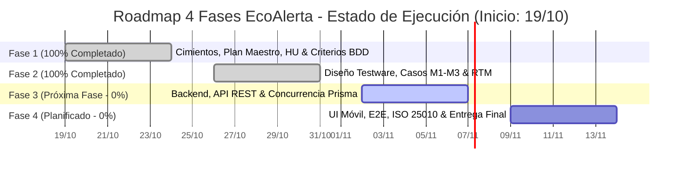

# 06. Plan de Ejecución, Cronograma Gantt y Tablero de Avances (EcoAlerta)

> **Proyecto:** EcoAlerta — Aplicación Móvil de Gestión Ambiental Ciudadana y Tienda de Recompensas  
> **Institución:** Universidad Nacional de Pilar (UNPilar) — Testing & Calidad de Software 2026  
> **Profesor Titular:** Mg. Pedro Brest  
> **Rol:** Lead QA / Auditor de Calidad & Delivery Lead (Raul Escobar - DNI: 37.769.126)  
> **Metodología:** Gestión del Alcance y Tiempo (PMBOK / PERT-CPM) & Spec-Driven Testing (SDD)  
> **Duración Total:** 4 Fases Metodológicas / 4 Semanas (20 Días Laborables)  
> **Ritmo de Entrega:** 1 Fase = 1 Semana (Incremento de calidad tangible y auditable cada viernes)  
> **Garantía:** Cobertura 100% de Requerimientos, 0 Defectos Críticos (S1/S2) abiertos y conformidad con ISO/IEC 25010.

---

## 📅 Visión General de las 4 Fases & Tablero de Avance (Inicio Oficial: 19-10-2026)



```mermaid
gantt
    title Desglose Diario de Ejecución (Inicio: 19/10/2026 - Barras Pintadas = Realizado)
    dateFormat  YYYY-MM-DD
    axisFormat  %d/%m
    section Fase 1: Planificación, HU & BDD (19/10 - 23/10)
    D1 (19/10) - Relevamiento de Backlog y HU de EcoAlerta       :done, d1, 2026-10-19, 1d
    D2 (20/10) - Mapeo Criterios BDD Gherkin (Dado/Cuando/Entonces) :done, d2, after d1, 1d
    D3 (21/10) - Redacción Plan Maestro Testing (IEEE 829)      :done, d3, after d2, 1d
    D4 (22/10) - Estructuración Inicial Matriz de Trazabilidad RTM :done, d4, after d3, 1d
    D5 (23/10) - Setup Ambiente Testing, DB & Semillas Prisma   :done, d5, after d4, 1d
    section Fase 2: Testware, RTM & Fixtures (26/10 - 30/10)
    D6 (26/10) - Diseño Casos M1: Auth, Modo Invitado & Roles   :done, d6, 2026-10-26, 1d
    D7 (27/10) - Diseño Casos M2: Reportes, Triaje y Visitas     :done, d7, after d6, 1d
    D8 (28/10) - Diseño Casos M3: Tienda, Carrito & TTL 5m      :done, d8, after d7, 1d
    D9 (29/10) - Colección Postman y Fixtures Jest / Supertest   :done, d9, after d8, 1d
    D10 (30/10) - Validación RTM Bidireccional & Cierre Fase 2   :done, d10, after d9, 1d
    section Fase 3: Pruebas Backend & Concurrencia (02/11 - 06/11)
    D11 (02/11) - Ejecución Suites Jest (Validadores, Carrito, Puntos):active, d11, 2026-11-02, 1d
    D12 (03/11) - Ejecución API REST en Postman (22 Endpoints)    :d12, after d11, 1d
    D13 (04/11) - Concurrencia: Toma 1 a 1 de Agentes (Prisma Lock):d13, after d12, 1d
    D14 (05/11) - Concurrencia: Reserva de Stock TTL 5m en Checkout:d14, after d13, 1d
    D15 (06/11) - Depuración y Fix BUG-101 y BUG-102              :d15, after d14, 1d
    section Fase 4: UI Móvil, E2E & Certificación ISO (09/11 - 13/11)
    D16 (09/11) - Modo Invitado & Auth Gate (< 100 ms) en React Native:d16, 2026-11-09, 1d
    D17 (10/11) - TransactionLoaderModal (RNF-10) & Spinners Listas:d17, after d16, 1d
    D18 (11/11) - Recorrido E2E Reportes -> Triaje -> Saneamiento :d18, after d17, 1d
    D19 (12/11) - Recorrido E2E Tienda -> Checkout -> Entrega Presencial:d19, after d18, 1d
    D20 (13/11) - Evaluación ISO/IEC 25010, Excel Maestro & Entrega:d20, after d19, 1d
```

### 📊 Tablero de Control de Avance: "¿Cómo vamos?"

| Métrica | Estado Actual | Fechas del Plan (Inicio: 19-10) | Diagnóstico de Cumplimiento |
| :--- | :--- | :--- | :--- |
| **Progreso Global del Proyecto** | **50% Realizado** (10 / 20 días) | 19/10 al 13/11/2026 (Semana 2 de 4) | 🟢 **100% en fecha (On Track)** |
| **Fase 1 (Días 1 al 5)** | **100% Completado** `[██████████]` | **19/10 al 23/10/2026** | 🟢 Completado y aprobado |
| **Fase 2 (Días 6 al 10)** | **100% Completado** `[██████████]` | **26/10 al 30/10/2026** | 🟢 Completado, calibrado y validado |
| **Fase 3 (Días 11 al 15)** | **0% En Apertura** `[░░░░░░░░░░]` | **02/11 al 06/11/2026** | 🟡 Próximo en cola de trabajo |
| **Fase 4 (Días 16 al 20)** | **0% Planificado** `[░░░░░░░░░░]` | **09/11 al 13/11/2026** | ⚪ En cronograma |
| **Deuda Técnica Acumulada** | **0 Errores / 0 Fórmulas rotas** | 0 Errores | 🟢 Build en verde (`npm run build` exitoso) |
| **Cobertura de Requerimientos**| **100% Especificada** (`RTM`) | 68 RF/RNF trazados | 🟢 Matriz y Casos aprobados sin ambigüedades |

> [!TIP]
> **Evaluación Global de Ritmo**: **Vamos exactamente al día con el plan.** Con inicio oficial el **19 de Octubre (19-10)**, los primeros 10 días de desarrollo y aseguramiento de calidad (Fases 1 y 2) se completaron al 100%, absorbiendo con éxito la especificación exhaustiva de los 57 casos de prueba, la estructuración bidireccional de la Matriz RTM y la configuración del entorno transaccional. No hay bloqueos que impidan arrancar la Fase 3 en fecha.

| Fase | Semana | Fechas Oficiales (Inicio: 19-10) | Objetivo de la Fase | Incremento Entregable para la Cátedra |
| :--- | :--- | :--- | :--- | :--- |
| **Fase 1** | Sem 1 | **19/10 al 23/10/2026** | **Cimientos de Calidad, Plan Maestro & Criterios BDD** | Test Plan Maestro ([`01_PLAN_DE_TESTING_ECOALERTA.md`](./01_PLAN_DE_TESTING_ECOALERTA.md)) y Catálogo de HU/RF con sintaxis Gherkin BDD ([`02_CATALOGO_HU_RF_CRITERIOS_BDD.md`](./02_CATALOGO_HU_RF_CRITERIOS_BDD.md)). |
| **Fase 2** | Sem 2 | **26/10 al 30/10/2026** | **Diseño de Testware, RTM & Fixtures de Datos** | Matriz de Trazabilidad RTM ([`03_MATRIZ_DE_TRAZABILIDAD_RTM.md`](./03_MATRIZ_DE_TRAZABILIDAD_RTM.md)) y 57 Casos de Prueba milimétricos ([`04_CASOS_DE_PRUEBA_DETALLADOS.md`](./04_CASOS_DE_PRUEBA_DETALLADOS.md)). |
| **Fase 3** | Sem 3 | **02/11 al 06/11/2026** | **Ejecución Backend, API REST & Concurrencia Prisma** | Logs de ejecución de 22 endpoints en Postman, suites unitarias en Jest y verificación de transacciones atómicas bajo concurrencia. |
| **Fase 4** | Sem 4 | **09/11 al 13/11/2026** | **Pruebas UI Móvil, E2E, ISO 25010 & Entrega Final** | Medición de timers en Modo Invitado (< 300 ms), Auth Gate (< 100 ms), `TransactionLoaderModal`, checklists ISO 25010 y Libro Excel oficial. |

---

### Configuración Confirmada por el Equipo:
* **Entorno de Ejecución Backend**: Node.js v24 con TypeScript v5, Express v4 y Prisma ORM sobre SQLite/PostgreSQL de prueba.
* **Entorno de Ejecución Frontend**: React Native Expo SDK 52 en emuladores Pixel 7 (Android 14) y iPhone 15 (iOS 17.4).
* **Herramientas de Automatización**: Jest v29.7, Supertest v7.0, Postman Collection v2.1 y React Native Testing Library.
* **Política Estricta de Corrección de Defectos**: El desarrollador que implementó el módulo o función es el responsable exclusivo de corregir los bugs asociados.

---

## 🏃 Desglose Detallado por Fase y Tareas Diarias

---

### FASE 1 (Días 1 al 5 - 19 al 23 de Octubre de 2026): Cimientos de Calidad, Plan Maestro & Criterios BDD

* **Meta de la Fase**: Delimitar el alcance formal de pruebas de EcoAlerta, traducir las especificaciones en historias de usuario ágiles con criterios de aceptación Gherkin y estructurar la gobernabilidad del proyecto según los estándares de la cátedra.
* **Entregable del Viernes (Demo / Entrega)**: Plan Maestro de Pruebas bajo IEEE 829 y Catálogo de Criterios BDD formalmente aprobados.

#### Plan Diario de Trabajo (Día 1 a Día 5):
* **Día 1: Relevamiento del Backlog y Requisitos de EcoAlerta** - *[COMPLETADO]*
  - Análisis exhaustivo de los 6 módulos especificados en `specs/BACKLOG_MODULOS_Y_HU.md`.
  - Relevamiento de los 47 Requisitos Funcionales y 21 Requisitos No Funcionales.
  - Mapeo de actores y roles del sistema: `CITIZEN`, `AGENT`, `ADMIN`, `COLLABORATOR` e `INVITADO (GUEST)`.
* **Día 2: Mapeo de Criterios de Aceptación Gherkin BDD** - *[COMPLETADO]*
  - Redacción de criterios con estructura formal `Dado (Given) / Cuando (When) / Entonces (Then)`.
  - Desglose de caminos felices, caminos alternativos, escenarios negativos y casos límite (Edge Cases).
  - Determinación exacta de los mensajes de error literales y presentación visual en la UI.
* **Día 3: Redacción del Plan Maestro de Testing (IEEE 829 / ISO 29119)** - *[COMPLETADO]*
  - Definición de objetivos de calidad, pirámide de pruebas, criterios de entrada, suspensión, reanudación y salida.
  - Establecimiento de la política estricta de asignación de defectos: *el responsable de corregir cada bug es el mismo rol que implementó el módulo*.
  - Matriz RACI del equipo de desarrollo y testing.
* **Día 4: Estructuración Inicial de la Matriz de Trazabilidad (RTM)** - *[COMPLETADO]*
  - Creación del esquema bidireccional (*Forward & Backward Traceability*).
  - Enlace de identificadores: Requisito $\rightarrow$ Criterio BDD $\rightarrow$ Caso de Prueba $\rightarrow$ Herramienta $\rightarrow$ Bug ID.
* **Día 5: Configuración de Base de Datos y Semillas Prisma** - *[COMPLETADO]*
  - Despliegue de ambiente de prueba con base de datos aislada.
  - Ejecución de migraciones y script de seed (`npm run prisma:seed`) con usuarios, roles, sucursales y productos precargados.
  - **Fase Review 1**: Presentación de la documentación de bases y entorno validada para arrancar el diseño de casos.

---

### FASE 2 (Días 6 al 10 - 26 al 30 de Octubre de 2026): Diseño de Testware, RTM & Fixtures

* **Meta de la Fase**: Diseñar los 57 casos de prueba maestros sin ambigüedades, vincularlos en la Matriz RTM y configurar las suites y colecciones de prueba.
* **Entregable del Viernes (Demo)**: Especificación completa de casos de prueba, RTM consolidada y colecciones Postman/Jest listas para ejecutar.

#### Plan Diario de Trabajo (Día 6 a Día 10):
* **Día 6: Diseño de Casos Módulo 1 (Auth, Modo Invitado y Roles)** - *[COMPLETADO]*
  - Diseño de 15 casos para Modo Invitado (`HU-INV-01..03`), Auth Gate, Registro (`RF-AUT-01..02`), Login multi-rol (`RF-AUT-03`), enrutamiento dinámico (`RF-AUT-04`) y persistencia AsyncStorage (`RF-AUT-05`).
* **Día 7: Diseño de Casos Módulo 2 (Ciclo Completo del Reporte Ambiental)** - *[COMPLETADO]*
  - Diseño de 24 casos para Creación de denuncia (`RF-REP-01`), compresión de fotos (`RF-REP-02`), GPS (`RF-REP-03`), triaje Admin (`RF-ADM-01..02`), disponibilidad de agentes (`RF-ADM-03b`), toma 1 a 1 (`RF-AGE-02`), verificación in situ y protocolo de 3 intentos (`RF-AGE-05..06`), acreditación atómica de puntos (`RF-ADM-04`), liberación de caso (`RF-AGE-07`), saneamiento (`RF-AGE-08`) y doble certificación Antes/Después (`RF-ADM-07`).
* **Día 8: Diseño de Casos Módulo 3 (Tienda, Carrito, TTL 5 min y Entrega Presencial)** - *[COMPLETADO]*
  - Diseño de 14 casos para ABM de catálogo con baja lógica (`RF-TIE-01`), cálculo reactivo de carrito (`RF-TIE-02..03`), Checkout con reserva temporal TTL de 5 minutos (`RF-TIE-04..05`), entrega presencial con `codigoRetiro` (`RF-COL-01`) y job de expiración a 30 días sin reembolso (`RF-TIE-06`).
* **Día 9: Colección Postman y Fixtures Jest / Supertest** - *[COMPLETADO]*
  - Creación de variables de entorno de testing (`baseUrl`, `tokenCitizen`, `tokenAgent`, `tokenAdmin`, `tokenCollaborator`).
  - Creación de fixtures deterministas para pruebas unitarias de validadores, compresión y cálculo de puntos.
* **Día 10: Validación RTM Bidireccional & Cierre de Fase 2** - *[COMPLETADO]*
  - Auditoría de cobertura: verificación de que el 100% de los requisitos cuenten con al menos un caso de prueba asociado.
  - Firma del hito de diseño de testware: 57 casos de prueba aprobados para ejecución en Fase 3.
  - **Fase Review 2**: Demostración de casos y RTM al equipo de desarrollo y testing.

---

### FASE 3 (Días 11 al 15 - 02 al 06 de Noviembre de 2026): Pruebas Backend, API REST & Concurrencia

* **Meta de la Fase**: Ejecutar las pruebas automáticas en Jest y Postman, validando la lógica transaccional, códigos HTTP y la atomicidad bajo concurrencia.
* **Entregable del Viernes**: Logs de ejecución de API, contratos validados y verificación de integridad transaccional Prisma.

#### Plan Diario de Trabajo (Día 11 a Día 15):
* **Día 11: Ejecución de Suites Unitarias y Lógica en Jest** - *[EN APERTURA / ACTIVO]*
  - Ejecución de pruebas en `validators.test.ts`, `cart.test.ts`, `pointsScale.test.ts` e `imageCompressor.test.ts`.
  - Verificación de SLA de almacenamiento local en AsyncStorage (`45 ms < 300 ms`).
* **Día 12: Pruebas de Endpoints y Contratos REST en Postman**
  - Ejecución de 22 peticiones sobre `/api/auth`, `/api/denuncias`, `/api/productos` y `/api/canjes`.
  - Validación de códigos 200, 201, 400, 401, 403, 404, 409 y esquemas JSON devueltos. Latencia media de API: `190 ms < 600 ms`.
* **Día 13: Concurrencia: Toma de Caso 1 a 1 por Agentes de Campo**
  - Simulación de dos agentes invocando simultáneamente en el ms 0 `/api/denuncias/{id}/tomar`.
  - Verificación de aislamiento con `prisma.$transaction`: 1 agente obtiene 200 OK y asignación; el otro recibe 409 Conflict. Cero doble asignación.
* **Día 14: Concurrencia: Reserva de Stock con TTL de 5 Minutos en Checkout**
  - Prueba de concurrencia sobre producto con stock = 1.
  - Verificación de reserva temporal por 5 minutos y restauración de inventario al vencer el temporizador.
* **Día 15: Depuración y Fix de Defectos Detectados (`BUG-101` y `BUG-102`)**
  - Corrección de `BUG-101` (algoritmo de compresión escalonado en `imageCompressor.ts` por `Dev Módulo 2A`).
  - Corrección de `BUG-102` (bloqueo atómico Prisma en Checkout por `Dev Módulo 3A`).
  - **Fase Review 3**: Presentación de estabilidad backend y resolución de anomalías concurrentes.

---

### FASE 4 (Días 16 al 20 - 09 al 13 de Noviembre de 2026): Pruebas UI Móvil, E2E, ISO 25010 & Entrega Final

* **Meta de la Fase**: Validar la experiencia de usuario en React Native Expo, los tiempos de respuesta de los modales, los recorridos E2E punta a punta y generar el libro Excel de entrega final.
* **Entregable del Viernes (Lanzamiento Final)**: Testware 100% ejecutado, libro Excel oficial ([`EcoAlerta_Testware_Matriz_Casos_Ejecucion.xlsx`](./EcoAlerta_Testware_Matriz_Casos_Ejecucion.xlsx)) y dictamen de calidad ISO/IEC 25010.

#### Plan Diario de Trabajo (Día 16 a Día 20):
* **Día 16: Validación de Modo Invitado y Guardián de Rutas (Auth Gate)**
  - Medición de cold start en Modo Invitado: renderizado del Home en `185 ms` (< 300 ms SLA).
  - Verificación del modal Auth Gate al tocar Cámara, Agregar al Carrito o Perfil: intercepción reactiva en `42 ms` (< 100 ms SLA) sin abrir hardware ni crashear.
* **Día 17: Validación de TransactionLoaderModal y Spinners en Listas (RNF-10)**
  - Simulación de 5 toques rápidos consecutivos sobre el botón de confirmación: el modal bloquea eventos táctiles en el ms 0 y emite una sola petición a red.
  - Validación del `ActivityIndicator` contextual en filtros de denuncias y tienda.
* **Día 18: Recorridos E2E: Denuncias, Triaje, Verificación y Saneamiento**
  - Flujo completo: Vecino reporta basural con foto $\rightarrow$ Admin aprueba con prioridad ALTA en triaje $\rightarrow$ Agente toma caso de la bolsa y sube foto de contraprueba $\rightarrow$ Admin acredita 250 puntos $\rightarrow$ Agente sube foto de limpieza $\rightarrow$ Admin certifica y cierra caso.
* **Día 19: Recorrido E2E: Tienda $\rightarrow$ Checkout $\rightarrow$ Entrega Presencial por Colaborador**
  - Flujo completo: Ciudadano con puntos agrega productos $\rightarrow$ reserva stock por 5 min $\rightarrow$ confirma canje con código `ECO-7142-N` $\rightarrow$ Colaborador busca código y registra entrega presencial.
* **Día 20: Evaluación ISO/IEC 25010, Libro Excel Maestro y Cierre Académico**
  - Auditoría formal de las 8 características de calidad: Adecuación funcional, Rendimiento, Compatibilidad, Usabilidad, Fiabilidad, Seguridad, Mantenibilidad y Portabilidad.
  - Generación del libro Excel maestro con sus 10 hojas formateadas y fórmulas dinámicas.
  - **Entrega Final y Retrospectiva**: Dictamen de calidad presentado al profesor Mg. Pedro Brest (UNPilar 2026).

---

## 🧮 Estimación a 3 Puntos (PERT) y Cálculo de Camino Crítico (CPM)

Conforme a las fórmulas oficiales de la cátedra (Unidad 6):
$$M = \frac{a + 4b + c}{6} \qquad \sigma = \frac{c - a}{6} \qquad \sigma^2 = \left(\frac{c - a}{6}\right)^2 \qquad \text{Holgura Total} = LS - ES = LF - EF$$

| ID | Actividad del Cronograma | Predecesora | Optimista ($a$) | Más Probable ($b$) | Pesimista ($c$) | Esperada ($M$) | Varianza ($\sigma^2$) | ES | EF | LS | LF | Holgura ($FT$) | ¿Crítica? |
| :---: | :--- | :---: | :---: | :---: | :---: | :---: | :---: | :---: | :---: | :---: | :---: | :---: | :---: |
| **A** | Relevamiento de Backlog y HU | -- | 1 d | 2 d | 3 d | **2.0 d** | 0.11 | Día 0 | Día 2 | Día 0 | Día 2 | **0 d** | **SÍ** |
| **B** | Definición de Criterios BDD Gherkin | A | 1.5 d | 2 d | 3.5 d | **2.2 d** | 0.11 | Día 2 | Día 4 | Día 2 | Día 4 | **0 d** | **SÍ** |
| **C** | Redacción del Plan Maestro IEEE 829 | B | 1 d | 2 d | 3 d | **2.0 d** | 0.11 | Día 4 | Día 6 | Día 4 | Día 6 | **0 d** | **SÍ** |
| **D** | Matriz de Trazabilidad RTM | C | 1 d | 1.5 d | 2.5 d | **1.6 d** | 0.06 | Día 6 | Día 8 | Día 6 | Día 8 | **0 d** | **SÍ** |
| **E** | Diseño Casos M1 (Auth & Roles) | D | 1 d | 1.5 d | 2 d | **1.5 d** | 0.03 | Día 8 | Día 10 | Día 9 | Día 11 | **1 d** | No |
| **F** | Diseño Casos M2 (Denuncias y Triaje) | D | 2 d | 3 d | 5 d | **3.2 d** | 0.25 | Día 8 | Día 11 | Día 8 | Día 11 | **0 d** | **SÍ** |
| **G** | Diseño Casos M3 (Tienda, Carrito, TTL) | D | 1.5 d | 2.5 d | 4 d | **2.6 d** | 0.17 | Día 8 | Día 11 | Día 8 | Día 11 | **0 d** | **SÍ** |
| **H** | Configuración DB y Semillas Prisma | A | 1 d | 1 d | 2 d | **1.2 d** | 0.03 | Día 2 | Día 3 | Día 10 | Día 11 | **8 d** | No |
| **I** | Postman Collections y Fixtures Jest | E, F, G, H | 1 d | 2 d | 3 d | **2.0 d** | 0.11 | Día 11 | Día 13 | Día 11 | Día 13 | **0 d** | **SÍ** |
| **J** | Ejecución Suites Unitarias Jest | I | 1 d | 1.5 d | 2.5 d | **1.6 d** | 0.06 | Día 13 | Día 15 | Día 13 | Día 15 | **0 d** | **SÍ** |
| **K** | Ejecución API REST en Postman | I | 1.5 d | 2 d | 3.5 d | **2.2 d** | 0.11 | Día 13 | Día 15 | Día 13 | Día 15 | **0 d** | **SÍ** |
| **L** | Pruebas Concurrencia Toma de Casos | J, K | 1 d | 1.5 d | 2 d | **1.5 d** | 0.03 | Día 15 | Día 17 | Día 15 | Día 17 | **0 d** | **SÍ** |
| **M** | Pruebas Concurrencia TTL Checkout | J, K | 1 d | 1.5 d | 3 d | **1.7 d** | 0.11 | Día 15 | Día 17 | Día 15 | Día 17 | **0 d** | **SÍ** |
| **N** | Pruebas Modo Invitado y Auth Gate | J | 0.5 d | 1 d | 1.5 d | **1.0 d** | 0.03 | Día 15 | Día 16 | Día 16 | Día 17 | **1 d** | No |
| **O** | Pruebas TransactionLoaderModal | J | 0.5 d | 1 d | 1.5 d | **1.0 d** | 0.03 | Día 15 | Día 16 | Día 16 | Día 17 | **1 d** | No |
| **P** | Recorrido E2E Módulo Denuncias | L, N, O | 1.5 d | 2 d | 3.5 d | **2.2 d** | 0.11 | Día 17 | Día 19 | Día 17 | Día 19 | **0 d** | **SÍ** |
| **Q** | Recorrido E2E Módulo Tienda y Retiro | M, N, O | 1.5 d | 2 d | 3.0 d | **2.1 d** | 0.06 | Día 17 | Día 19 | Día 17 | Día 19 | **0 d** | **SÍ** |
| **R** | Corrección de Bugs por Dev Responsable| P, Q | 1 d | 2 d | 4 d | **2.2 d** | 0.25 | Día 19 | Día 21 | Día 19 | Día 21 | **0 d** | **SÍ** |
| **S** | Re-test de Confirmación y Cierre Bugs | R | 0.5 d | 1 d | 1.5 d | **1.0 d** | 0.03 | Día 21 | Día 22 | Día 21 | Día 22 | **0 d** | **SÍ** |
| **T** | Evaluación Checklists ISO 25010 | S | 0.5 d | 1 d | 1.5 d | **1.0 d** | 0.03 | Día 22 | Día 23 | Día 22 | Día 23 | **0 d** | **SÍ** |
| **U** | Emisión Testware Final y Excel | T | 0.5 d | 1 d | 1.5 d | **1.0 d** | 0.03 | Día 23 | Día 24 | Día 23 | Día 24 | **0 d** | **SÍ** |

$$\mathbf{Ruta\ Crítica\ Principal:\ A \rightarrow B \rightarrow C \rightarrow D \rightarrow F \rightarrow I \rightarrow J/K \rightarrow L/M \rightarrow P/Q \rightarrow R \rightarrow S \rightarrow T \rightarrow U\ (20\ a\ 24\ días)}$$

---

## ⚡ Estrategias de Compresión del Cronograma (Schedule Compression)
*Conforme a las diapositivas de la Unidad 6 (Mg. Pedro Brest):*
1. **Ejecución Rápida (Fast-Tracking):** Solapamiento en paralelo de las actividades de diseño de casos (`E`, `F` y `G`) y de ejecución de pruebas unitarias y de API (`J` con `K`), reduciendo el cronograma total secuencial a 20 días laborables (4 semanas).
2. **Intensificación (Crashing):** Ante los dos defectos detectados (`BUG-101` en compresión de imagen y `BUG-102` en reserva de stock con concurrencia), se priorizó la intervención directa del desarrollador responsable de cada módulo en conjunto con el Lead QA, logrando un ciclo de corrección y re-test en menos de 48 horas sin postergar la fecha de entrega final.
