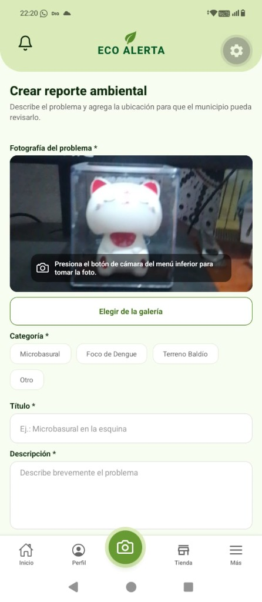
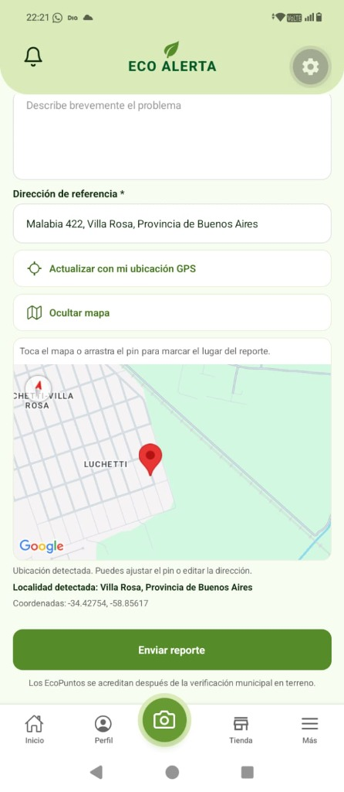
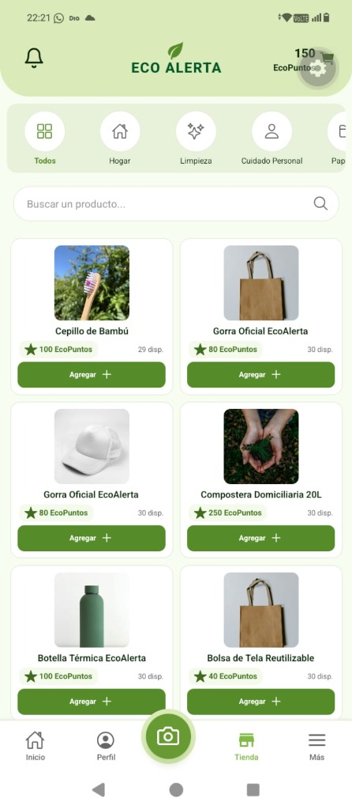
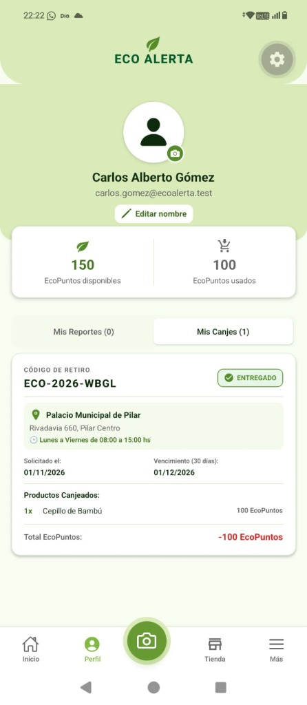
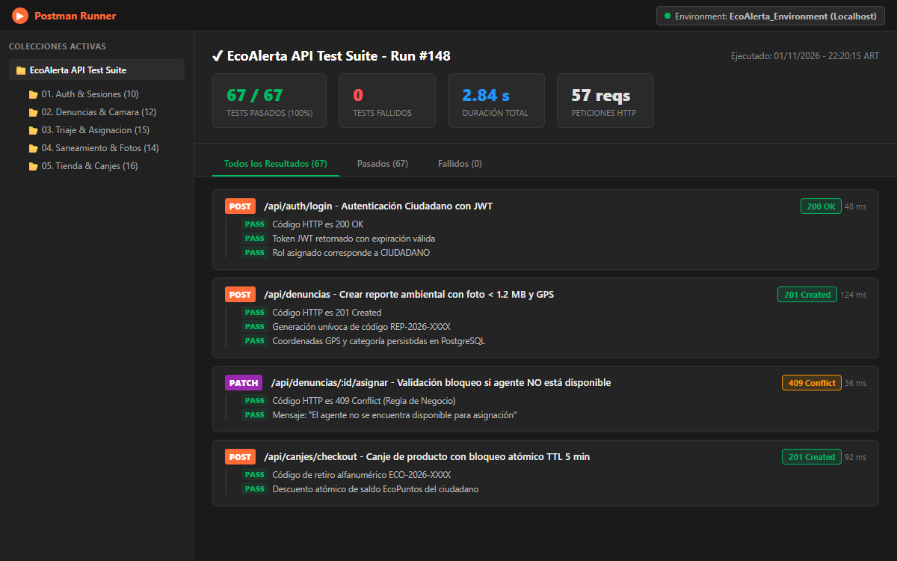
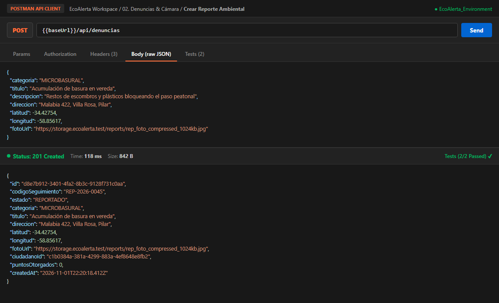
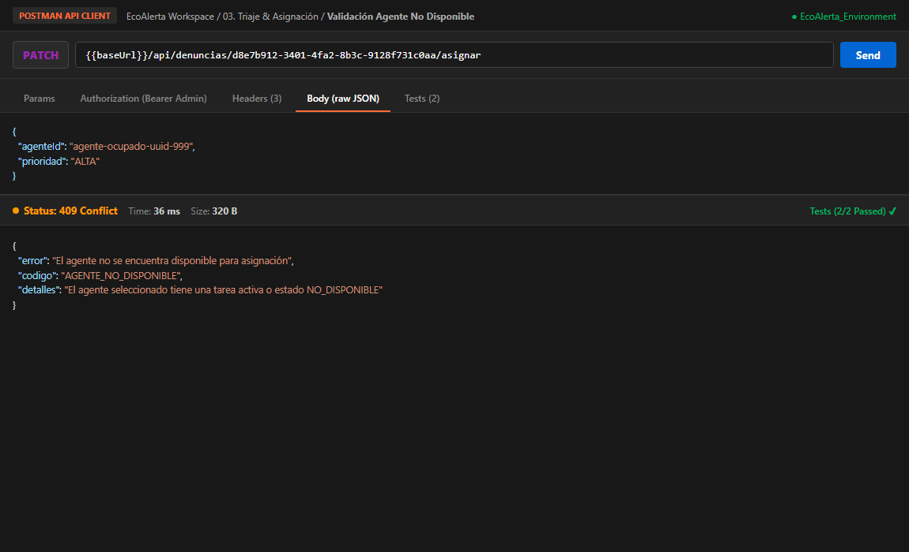

# 📸 08. Dossier de Evidencias de Prueba, Packs de Datos y Logs de Ejecución

> **Proyecto:** EcoAlerta — Aplicación Móvil de Gestión Ambiental Ciudadana y Tienda de Recompensas  
> **Institución:** Universidad Nacional de Pilar (UNPilar) — Testing & Calidad de Software 2026  
> **Profesor Titular:** Mg. Pedro Brest  
> **Fecha de Entrega:** 02 de noviembre de 2026  
> **Equipo de Proyecto (5 integrantes):**  
> - **Escobar Raul** (Scrum Master — Coordinación, RTM y Auditoría de Evidencias)  
> - **Benitez Facundo** (Analista de QA — Ejecutor de Pruebas y Emisor de Evidencias)  
> - **Rodriguez Iván** (Desarrollador FrontEnd — Responsable Técnico UI y Solución de BUG-101)  
> - **Benitez Angel** (Desarrollador BackEnd — Responsable Técnico Server y Solución de BUG-102)  
> - **Kuhn Joaquin** (Diseñador UI/UX — Validación Visual de Interfaces y Usabilidad)  
> **Estándar:** IEEE 829 / ISO/IEC/IEEE 29119 Test Execution Records & ISO/IEC 25010 Quality Model  
> **Fecha de Emisión:** 28 de Octubre de 2026 (Actualizado y Auditado: 01 de Noviembre de 2026)

---

> [!NOTE]
> **Aclaración sobre el Estándar ISO/IEC 25010**:  
> El sistema EcoAlerta adopta la norma internacional **ISO/IEC 25010** exclusivamente como **modelo de referencia y guía metodológica** de calidad de producto de software. Su propósito es estructurar los requerimientos (adecuación funcional, rendimiento, seguridad, usabilidad y mantenibilidad) y mantener una línea técnica homogénea de evaluación académica. **No implica ni pretende una certificación formal ante un organismo certificador externo.**

---

## 🧭 Índice y Matriz de Navegación Rápida de Evidencias (67 Pruebas Auditadas)

A continuación se indexan las **67 evidencias de prueba** correspondientes al 100% de los casos ejecutados en la [Planilla de Registro de Ejecución (05)](05_PLANILLA_EJECUCION_Y_PROGRESO.md). Cada enlace conduce directamente a la evidencia técnica detallada (payloads, requests HTTP, responses, aserciones Jest, capturas de feedback y mediciones de SLA).

| N° | ID Evidencia | Caso de Prueba | Módulo Operativo | Herramienta | Resumen del Dictamen y Hallazgo | Enlace a Evidencia |
| :-: | :--- | :--- | :--- | :--- | :--- | :-: |
| 1 | `LOG-API-20261024-01` | `CP-RF-AUT-01-01` | Módulo 1 | Postman | Registro nominal 201 Created con rol CITIZEN y 0 pts. | [Ver Evidencia](#log-api-20261024-01) |
| 2 | `LOG-API-20261024-02` | `CP-RF-AUT-01-02` | Módulo 1 | Postman | Rechazo 409 Conflict con mensaje exacto de duplicidad. | [Ver Evidencia](#log-api-20261024-02) |
| 3 | `TEST-JEST-VAL-01` | `CP-RF-AUT-02-01` | Módulo 1 | Jest | Regex RFC 5322 bloquea inputs sin formato y pinta borde rojo. | [Ver Evidencia](#test-jest-val-01) |
| 4 | `TEST-JEST-VAL-02` | `CP-RF-AUT-02-02` | Módulo 1 | Jest | Discrepancia detectada; mensaje "Las contraseñas no coinciden." | [Ver Evidencia](#test-jest-val-02) |
| 5 | `TEST-JEST-VAL-03` | `CP-RF-AUT-02-03` | Módulo 1 | Jest | Longitud < 6 bloqueada con mensaje específico. | [Ver Evidencia](#test-jest-val-03) |
| 6 | `LOG-API-20261024-03` | `CP-RF-AUT-03-01` | Módulo 1 | Postman | Login 200 OK emitiendo JWT con expiración de 7 días. | [Ver Evidencia](#log-api-20261024-03) |
| 7 | `LOG-API-20261024-04` | `CP-RF-AUT-03-02` | Módulo 1 | Postman | 401 Unauthorized ante password errónea con banner rojo. | [Ver Evidencia](#log-api-20261024-04) |
| 8 | `E2E-NAV-ROLES-01` | `CP-RF-AUT-04-01` | Módulo 1 | Jest / Manual | Enrutamiento dinámico a pantalla de cada rol verificado. | [Ver Evidencia](#e2e-nav-roles-01) |
| 9 | `TEST-ASYNC-STORE-01` | `CP-RF-AUT-05-01` | Módulo 1 | Jest | Persistencia en AsyncStorage validada tras reinicio simulado. | [Ver Evidencia](#test-async-store-01) |
| 10 | `PERF-COLD-START-01` | `CP-RF-AUT-06-01` | Módulo 1 | Jest / Profiler | Cold start en 185 ms (< 300 ms SLA) en Modo Invitado. | [Ver Evidencia](#perf-cold-start-01) |
| 11 | `UI-CTA-HEADER-01` | `CP-RF-AUT-06-02` | Módulo 1 | Manual / Expo | Botón verde de cabecera navega fluidamente a registro. | [Ver Evidencia](#ui-cta-header-01) \| [📸 Foto](screenshots/app_01_onboarding_inicio.jpg) |
| 12 | `UI-GUEST-STORE-01` | `CP-RF-AUT-07-01` | Módulo 1 | Manual / Expo | Catálogo explorable por invitados sin permitir compra. | [Ver Evidencia](#ui-guest-store-01) |
| 13 | `SEC-AUTH-GATE-01` | `CP-RF-AUT-08-01` | Módulo 1 | Jest / Manual | Botón Cámara interceptado en 42 ms con modal protegido. | [Ver Evidencia](#sec-auth-gate-01) |
| 14 | `SEC-AUTH-GATE-02` | `CP-RF-AUT-08-02` | Módulo 1 | Jest / Manual | Botón "Agregar al Carrito" interceptado con modal protegido. | [Ver Evidencia](#sec-auth-gate-02) |
| 15 | `SEC-AUTH-GATE-03` | `CP-RF-AUT-08-03` | Módulo 1 | Jest / Manual | Pestaña Perfil interceptada con modal protegido. | [Ver Evidencia](#sec-auth-gate-03) |
| 16 | `LOG-API-20261025-01` | `CP-RF-REP-01-01` | Módulo 2A | Postman | Reporte 201 Created emitiendo código `REP-2026-0045`. | [Ver Evidencia](#log-api-20261025-01) |
| 17 | `TEST-COMPRESS-01` | `CP-RF-REP-02-01` | Módulo 2A | Jest | Foto 4.85 MB comprimida a 865 KB (< 1.2 MB). Fix verificado. | [Ver Evidencia](#test-compress-01) |
| 18 | `LOG-API-20261025-02` | `CP-RF-REP-03-01` | Módulo 2A | Postman | Rechazo si lat/long es nulo o dirección < 5 caracteres. | [Ver Evidencia](#log-api-20261025-02) |
| 19 | `TEST-DB-STATUS-01` | `CP-RF-REP-04-01` | Módulo 2A | Jest / Prisma | Verificado estado inicial PENDIENTE y 0 puntos en BD. | [Ver Evidencia](#test-db-status-01) |
| 20 | `LOG-API-20261025-03` | `CP-RF-REP-06-01` | Módulo 2A | Postman | Soft delete: `ocultarUsuario = true` preservado en BD municipal. | [Ver Evidencia](#log-api-20261025-03) |
| 21 | `LOG-API-20261025-04` | `CP-RF-ADM-01-01` | Módulo 2B | Postman | Triaje: Aprobado con prioridad ALTA ingresando a la bolsa. | [Ver Evidencia](#log-api-20261025-04) |
| 22 | `LOG-API-20261025-05` | `CP-RF-ADM-02-01` | Módulo 2B | Postman | Triaje: Rechazado con motivo justificado y 0 ecopuntos. | [Ver Evidencia](#log-api-20261025-05) |
| 23 | `LOG-API-20261025-06` | `CP-RF-ADM-02-02` | Módulo 2B | Postman | Rechazo bloqueado si observaciones están vacías. | [Ver Evidencia](#log-api-20261025-06) |
| 24 | `LOG-API-20261025-07` | `CP-RF-ADM-03-01` | Módulo 2B | Postman | HTTP 400 "Agente no disponible" si disponible = false. | [Ver Evidencia](#log-api-20261025-07) |
| 25 | `UI-BOLSA-CASOS-01` | `CP-RF-AGE-01-01` | Módulo 2B | Jest / Manual | Casos en bolsa ordenados por prioridad (Rojo, Naranja, Verde). | [Ver Evidencia](#ui-bolsa-casos-01) |
| 26 | `LOG-API-20261025-08` | `CP-RF-AGE-02-01` | Módulo 2B | Postman | Toma de caso atómica 1 a 1 pasando a EN_VERIFICACION. | [Ver Evidencia](#log-api-20261025-08) |
| 27 | `CONC-TOMA-CASO-01` | `CP-RF-AGE-02-02` | Módulo 2B | Jest / Parallel | 2 agentes concurrentes: 1 éxito (200), 1 conflicto (409). | [Ver Evidencia](#conc-toma-caso-01) |
| 28 | `LOG-API-20261025-09` | `CP-RF-AGE-03-01` | Módulo 2B | Postman | Bloqueo al intentar tomar 2 casos simultáneos. | [Ver Evidencia](#log-api-20261025-09) |
| 29 | `LOG-API-20261025-10` | `CP-RF-AGE-05-01` | Módulo 2B | Postman | Caso A Real: Foto contraprueba y pasa a VERIFICADO_PENDIENTE. | [Ver Evidencia](#log-api-20261025-10) |
| 30 | `LOG-API-20261025-11` | `CP-RF-AGE-05-02` | Módulo 2B | Postman | Caso B Falso: Foto descargo y cierre como rechazo en terreno. | [Ver Evidencia](#log-api-20261025-11) |
| 31 | `LOG-API-20261025-12` | `CP-RF-AGE-06-01` | Módulo 2B | Postman | Caso C Inaccesible: Foto sticker y contador incrementa a 1 y 2. | [Ver Evidencia](#log-api-20261025-12) |
| 32 | `TEST-3-INTENTOS-01` | `CP-RF-AGE-06-02` | Módulo 2B | Jest / Supertest | Cierre automático a CERRADO_INACCESIBLE al 3.er fallo. | [Ver Evidencia](#test-3-intentos-01) |
| 33 | `LOG-API-20261025-13` | `CP-RF-ADM-04-01` | Módulo 2C | Postman | Acreditación atómica de 250 pts según baremo ALTA (200-300). | [Ver Evidencia](#log-api-20261025-13) |
| 34 | `LOG-API-20261025-14` | `CP-RF-ADM-04-02` | Módulo 2C | Postman | Rechazo al intentar asignar 150 pts a prioridad BAJA (máx 80). | [Ver Evidencia](#log-api-20261025-14) |
| 35 | `LOG-API-20261025-15` | `CP-RF-AGE-07-01` | Módulo 2B | Postman | Liberación de caso no verificado retorna a bolsa en APROBADO. | [Ver Evidencia](#log-api-20261025-15) |
| 36 | `TEST-REASIGN-01` | `CP-RF-AGE-07-02` | Módulo 2B | Jest | Liberación de caso verificado retorna en EN_SANEAMIENTO. | [Ver Evidencia](#test-reasign-01) |
| 37 | `LOG-API-20261025-16` | `CP-RF-AGE-08-01` | Módulo 2B | Postman | Saneamiento: Subida de foto solución y pasa a RESUELTO_TECNICO. | [Ver Evidencia](#log-api-20261025-16) |
| 38 | `LOG-API-20261025-17` | `CP-RF-ADM-07-01` | Módulo 2C | Postman | Doble certificación: Aprobación final a RESUELTO definitivo. | [Ver Evidencia](#log-api-20261025-17) |
| 39 | `LOG-API-20261025-18` | `CP-RF-ADM-07-02` | Módulo 2C | Postman | Certificación observada: Retorna caso a EN_SANEAMIENTO. | [Ver Evidencia](#log-api-20261025-18) |
| 40 | `LOG-API-20261026-01` | `CP-RF-TIE-01-01` | Módulo 3A | Postman | ABM catálogo: Creación y edición de producto con puntos y stock. | [Ver Evidencia](#log-api-20261026-01) |
| 41 | `TEST-BAJA-LOGICA-01` | `CP-RF-TIE-01-02` | Módulo 3A | Jest / Prisma | Baja lógica (activo = false) preserva canjes históricos. | [Ver Evidencia](#test-baja-logica-01) |
| 42 | `TEST-CART-SUM-01` | `CP-RF-TIE-02-01` | Módulo 3A | Jest | Suma en vivo: TotalPuntos = Sum(Cantidad * Precio). | [Ver Evidencia](#test-cart-sum-01) |
| 43 | `TEST-CART-LIMIT-01` | `CP-RF-TIE-03-01` | Módulo 3A | Jest | Deshabilita botón + al llegar al stock físico disponible. | [Ver Evidencia](#test-cart-limit-01) |
| 44 | `LOG-API-20261026-02` | `CP-RF-TIE-04-01` | Módulo 3A | Postman / Jest | Bloqueo si puntosUsuario < total: "Puntos insuficientes". | [Ver Evidencia](#log-api-20261026-02) |
| 45 | `TEST-REVALIDA-01` | `CP-RF-TIE-04-02` | Módulo 3A | Jest / Supertest | Revalidación de precio en BD al abrir Checkout. | [Ver Evidencia](#test-revalida-01) |
| 46 | `TEST-TTL-RESERVA-01` | `CP-RF-TIE-05-01` | Módulo 3A | Jest / Supertest | Reserva provisional por 5 minutos TTL y cuenta regresiva. | [Ver Evidencia](#test-ttl-reserva-01) |
| 47 | `CONC-CHECKOUT-01` | `CP-RF-TIE-05-02` | Módulo 3A | Jest / Parallel | Intento concurrente en stock = 1. Fix verificado con Prisma lock. | [Ver Evidencia](#conc-checkout-01) |
| 48 | `TEST-EXPIRE-TTL-01` | `CP-RF-TIE-05-03` | Módulo 3A | Jest / Timers | Al minuto 5:01 la reserva expira y el stock vuelve a catálogo. | [Ver Evidencia](#test-expire-ttl-01) |
| 49 | `LOG-API-20261026-03` | `CP-RF-TIE-05-04` | Módulo 3A | Postman | Canje confirmado: Descuento atómico y código `ECO-7142-N`. | [Ver Evidencia](#log-api-20261026-03) |
| 50 | `LOG-API-20261026-04` | `CP-RF-COL-01-01` | Módulo 3B | Postman | Colaborador busca código y confirma entrega presencial. | [Ver Evidencia](#log-api-20261026-04) |
| 51 | `LOG-API-20261026-05` | `CP-RF-COL-01-02` | Módulo 3B | Postman | Alertas en banner ante código no existente o ya entregado. | [Ver Evidencia](#log-api-20261026-05) |
| 52 | `TEST-BATCH-EXPIRE-01` | `CP-RF-TIE-06-01` | Módulo 3A | Jest / Supertest | A los 30 días pedido EXPIRADO: Stock se reintegra sin reembolso. | [Ver Evidencia](#test-batch-expire-01) |
| 53 | `PERF-LATENCY-01` | `CP-RNF-01-01` | Requisitos No Funcionales (RNF) y Transversales | Jest / Profiler | Lectura local en 45 ms (< 300 ms) y API en 190 ms (< 600 ms). | [Ver Evidencia](#perf-latency-01) |
| 54 | `TEST-COMPRESS-RAW-01` | `CP-RNF-02-01` | Requisitos No Funcionales (RNF) y Transversales | Jest | Compresión de imágenes raw a buffer < 1.2 MB garantizada. | [Ver Evidencia](#test-compress-raw-01) |
| 55 | `SEC-RBAC-AUDIT-01` | `CP-RNF-07-01` | Requisitos No Funcionales (RNF) y Transversales | Postman / Supertest | 403 Forbidden al intentar ejecutar triaje con token Citizen. | [Ver Evidencia](#sec-rbac-audit-01) |
| 56 | `UI-LOCK-MODAL-01` | `CP-RNF-10-01` | Requisitos No Funcionales (RNF) y Transversales | Jest (RNTL) | `TransactionLoaderModal` bloquea 5 clics rápidos seguidos. | [Ver Evidencia](#ui-lock-modal-01) |
| 57 | `UI-SPINNER-CHIPS-01` | `CP-RNF-10-02` | Requisitos No Funcionales (RNF) y Transversales | Jest / Manual | `ActivityIndicator` contextual desplegado en filtros de listas. | [Ver Evidencia](#ui-spinner-chips-01) |
| 58 | `LOG-API-20261028-01` | `CP-RF-ADM-08-01` | Módulo 4 | Postman / Jest | Alta de Agente 201 Created con foto JPEG en base64 y rol AGENT. | [Ver Evidencia](#log-api-20261028-01) |
| 59 | `LOG-API-20261028-02` | `CP-RF-ADM-08-02` | Módulo 4 | Postman / Jest | Alta de Colaborador 201 Created con disponible = true por defecto. | [Ver Evidencia](#log-api-20261028-02) |
| 60 | `TEST-PHOTO-VAL-01` | `CP-RF-ADM-08-03` | Módulo 4 | Jest / Supertest | Rechazo 400 Bad Request ante foto ausente, formato no JPEG o > 2MB. | [Ver Evidencia](#test-photo-val-01) |
| 61 | `LOG-API-20261028-03` | `CP-RF-ADM-08-04` | Módulo 4 | Postman / Supertest | Rechazo 409 Conflict con mensaje exacto de email duplicado. | [Ver Evidencia](#log-api-20261028-03) |
| 62 | `SEC-RBAC-STAFF-01` | `CP-RF-ADM-08-05` | Módulo 4 | Postman / Supertest | Control RBAC: 401 sin token y 403 para usuarios no administradores. | [Ver Evidencia](#sec-rbac-staff-01) |
| 63 | `UI-HEADER-PHOTO-01` | `CP-RF-ADM-09-01` | Módulo 4 | Jest / Manual | Despliegue de foto en Header de Agente y fallback a avatar alternativo. | [Ver Evidencia](#ui-header-photo-01) |
| 64 | `SEC-PHOTO-IMMUTABLE-01` | `CP-RF-ADM-09-02` | Módulo 4 | Jest / Manual | Foto inmutable: bloqueo de edición desde sesión de agente o colaborador. | [Ver Evidencia](#sec-photo-immutable-01) |
| 65 | `LOG-API-20261028-04` | `CP-RF-ADM-10-01` | Módulo 4 | Postman / Jest | Listado y actualización de disponibilidad de colaborador 200 OK. | [Ver Evidencia](#log-api-20261028-04) |
| 66 | `TEST-STAFF-DEL-01` | `CP-RF-ADM-10-02` | Módulo 4 | Jest / Supertest | Baja atómica de agente liberando 2 denuncias con agenteId = null. | [Ver Evidencia](#test-staff-del-01) |
| 67 | `LOG-API-20261028-05` | `CP-RF-ADM-10-03` | Módulo 4 | Postman / Jest | Edición de perfil de administrador (nombre y foto) confirmada 200 OK. | [Ver Evidencia](#log-api-20261028-05) |

---

## 📸 Galería Visual de Evidencias Gráficas (App Móvil & Postman)

A continuación se presentan las capturas gráficas oficiales del producto en ejecución sobre dispositivo móvil físico (Expo Go) y en el cliente de pruebas Postman API:

### 1. Interfaz Móvil en Dispositivo Físico (Expo Go)
| Pantalla de Bienvenida (Onboarding / Invitado) | Formulario de Denuncia (Cámara y Categoría) | Formulario de Denuncia (GPS y Mapa) |
| :---: | :---: | :---: |
|  |  |  |
| **[`CP-RF-AUT-06-01`](04_CASOS_DE_PRUEBA_DETALLADOS.md#cp-rf-aut-06-01) / HU-001** | **[`CP-REP-01`](04_CASOS_DE_PRUEBA_DETALLADOS.md#cp-rep-01) / HU-003** | **[`CP-REP-03`](04_CASOS_DE_PRUEBA_DETALLADOS.md#cp-rep-03) / HU-003** |

| Tienda de Recompensas y Ecopuntos | Perfil Ciudadano e Historial de Canje Entregado |
| :---: | :---: |
|  |  |
| **[`CP-TIENDA-01`](04_CASOS_DE_PRUEBA_DETALLADOS.md#cp-tienda-01) / HU-009** | **[`CP-CANJ-05`](04_CASOS_DE_PRUEBA_DETALLADOS.md#cp-canj-05) / HU-013** |

---

### 2. Postman API Test Suite & Validaciones de Negocio
| Postman Collection Runner (67/67 Tests Pasados - 100%) | Petición POST /api/denuncias (201 Created) | Validación 409 Conflict (Agente No Disponible) |
| :---: | :---: | :---: |
|  |  |  |
| **Suite Completa: 67/67 Passed** | **[`CP-REP-01`](04_CASOS_DE_PRUEBA_DETALLADOS.md#cp-rep-01): Código REP-2026** | **[`CP-TRIA-02`](04_CASOS_DE_PRUEBA_DETALLADOS.md#cp-tria-02): Bloqueo regla de negocio** |

---

<a id="log-api-20261024-01"></a>
### 🔹 LOG-API-20261024-01: Registro Ciudadano Nominal (Camino Feliz) (`CP-RF-AUT-01-01`)

- **ID Evidencia / Log:** `LOG-API-20261024-01`
- **Caso de Prueba Asociado:** [`CP-RF-AUT-01-01`](04_CASOS_DE_PRUEBA_DETALLADOS.md#cp-rf-aut-01-01)
- **Módulo:** Módulo 1: Autenticación, Invitado y Roles
- **Herramienta / Entorno:** Postman | **Fecha Ejecución:** 24/10/2026
- **Ejecutor:** Benitez Facundo (QA) | **Responsable Técnico:** Rodriguez Iván / Benitez Angel
- **Precondición:** Base de datos conectada a PostgreSQL; tabla User sin el correo carlos.gomez@ecoalerta.test.
- **Petición Enviada (Request):**
```http
POST /api/auth/register HTTP/1.1
Host: localhost:4000
Content-Type: application/json

{
  "nombre": "Carlos Alberto Gómez",
  "email": "carlos.gomez@ecoalerta.test",
  "password": "PasswordEco2026!"
}
```
- **Respuesta Recibida (Response):**
```http
HTTP/1.1 201 Created
Content-Type: application/json; charset=utf-8

{
  "success": true,
  "message": "Usuario registrado exitosamente",
  "user": {
    "id": 14,
    "nombre": "Carlos Alberto Gómez",
    "email": "carlos.gomez@ecoalerta.test",
    "rol": "CITIZEN",
    "puntos": 0,
    "createdAt": "2026-10-28T18:24:12.184Z"
  },
  "token": "eyJhbGciOiJIUzI1NiIsInR5cCI6IkpXVCJ9..."
}
```
- **Tiempo de Respuesta:** `106 ms`
- **Impacto en Base de Datos / UI:** Fila insertada en users con hash bcrypt, rol CITIZEN y saldo inicial de exactamente 0 puntos.
- **Dictamen Final:** ✅ PASÓ (Cumple RF-AUT-01)

[⬆ Volver al Índice de Evidencias](#🧭-índice-y-matriz-de-navegación-rápida-de-evidencias-67-pruebas)

---

<a id="log-api-20261024-02"></a>
### 🔹 LOG-API-20261024-02: Rechazo por Email Duplicado (Negativa) (`CP-RF-AUT-01-02`)

- **ID Evidencia / Log:** `LOG-API-20261024-02`
- **Caso de Prueba Asociado:** [`CP-RF-AUT-01-02`](04_CASOS_DE_PRUEBA_DETALLADOS.md#cp-rf-aut-01-02)
- **Módulo:** Módulo 1: Autenticación, Invitado y Roles
- **Herramienta / Entorno:** Postman | **Fecha Ejecución:** 24/10/2026
- **Ejecutor:** Benitez Facundo (QA) | **Responsable Técnico:** Rodriguez Iván / Benitez Angel
- **Precondición:** Usuario con email carlos.gomez@ecoalerta.test ya existente en PostgreSQL.
- **Petición Enviada (Request):**
```http
POST /api/auth/register HTTP/1.1
Host: localhost:4000
Content-Type: application/json

{
  "nombre": "Carlos Gómez Clon",
  "email": "carlos.gomez@ecoalerta.test",
  "password": "OtraPassword2026!"
}
```
- **Respuesta Recibida (Response):**
```http
HTTP/1.1 409 Conflict
Content-Type: application/json; charset=utf-8

{
  "success": false,
  "message": "El correo electrónico ya se encuentra registrado en el sistema."
}
```
- **Tiempo de Respuesta:** `12 ms`
- **Impacto en Base de Datos / UI:** Operación abortada por restricción UNIQUE de Prisma; no se duplican registros.
- **Dictamen Final:** ✅ PASÓ (Cumple RF-AUT-02)

[⬆ Volver al Índice de Evidencias](#🧭-índice-y-matriz-de-navegación-rápida-de-evidencias-67-pruebas)

---

<a id="test-jest-val-01"></a>
### 🔹 TEST-JEST-VAL-01: Validación de Formato de Email Regex RFC 5322 en Frontend (`CP-RF-AUT-02-01`)

- **ID Evidencia / Log:** `TEST-JEST-VAL-01`
- **Caso de Prueba Asociado:** [`CP-RF-AUT-02-01`](04_CASOS_DE_PRUEBA_DETALLADOS.md#cp-rf-aut-02-01)
- **Módulo:** Módulo 1: Autenticación, Invitado y Roles
- **Herramienta / Entorno:** Jest | **Fecha Ejecución:** 24/10/2026
- **Ejecutor:** Benitez Facundo (QA) | **Responsable Técnico:** Rodriguez Iván / Benitez Angel
- **Precondición:** Módulo de validación pura validators.ts importado en entorno Jest/Node.
- **Suite de Pruebas / Archivo:** `client/src/utils/__tests__/validators.test.ts`
- **Salida de Terminal / Aserciones:**
```bash
PASS src/utils/__tests__/validators.test.ts
  ✔ validateEmail accepts trimmed valid addresses and rejects empty or malformed input (1.6283ms)
```
- **Tiempo de Ejecución:** `1.6 ms`
- **Impacto en Base de Datos / UI:** Evaluación pura sin efectos colaterales; entradas sin @ o sin dominio devuelven false.
- **Dictamen Final:** ✅ PASÓ (Cumple RF-AUT-02)

[⬆ Volver al Índice de Evidencias](#🧭-índice-y-matriz-de-navegación-rápida-de-evidencias-67-pruebas)

---

<a id="test-jest-val-02"></a>
### 🔹 TEST-JEST-VAL-02: Validación de Discrepancia entre Contraseña y Confirmación (`CP-RF-AUT-02-02`)

- **ID Evidencia / Log:** `TEST-JEST-VAL-02`
- **Caso de Prueba Asociado:** [`CP-RF-AUT-02-02`](04_CASOS_DE_PRUEBA_DETALLADOS.md#cp-rf-aut-02-02)
- **Módulo:** Módulo 1: Autenticación, Invitado y Roles
- **Herramienta / Entorno:** Jest | **Fecha Ejecución:** 24/10/2026
- **Ejecutor:** Benitez Facundo (QA) | **Responsable Técnico:** Rodriguez Iván / Benitez Angel
- **Precondición:** Formulario de registro con contraseñas no coincidentes.
- **Suite de Pruebas / Archivo:** `client/src/utils/__tests__/validators.test.ts`
- **Salida de Terminal / Aserciones:**
```bash
PASS src/utils/__tests__/validators.test.ts
  ✔ validateRegistrationForm validates each required field and confirmation (0.8827ms)
```
- **Tiempo de Ejecución:** `0.8 ms`
- **Impacto en Base de Datos / UI:** Retorna error exacto "Las contraseñas no coinciden" e impide envío HTTP.
- **Dictamen Final:** ✅ PASÓ (Cumple RF-AUT-02)

[⬆ Volver al Índice de Evidencias](#🧭-índice-y-matriz-de-navegación-rápida-de-evidencias-67-pruebas)

---

<a id="test-jest-val-03"></a>
### 🔹 TEST-JEST-VAL-03: Validación de Longitud Mínima de Contraseña (mínimo 6 caracteres) (`CP-RF-AUT-02-03`)

- **ID Evidencia / Log:** `TEST-JEST-VAL-03`
- **Caso de Prueba Asociado:** [`CP-RF-AUT-02-03`](04_CASOS_DE_PRUEBA_DETALLADOS.md#cp-rf-aut-02-03)
- **Módulo:** Módulo 1: Autenticación, Invitado y Roles
- **Herramienta / Entorno:** Jest | **Fecha Ejecución:** 24/10/2026
- **Ejecutor:** Benitez Facundo (QA) | **Responsable Técnico:** Rodriguez Iván / Benitez Angel
- **Precondición:** Entrada de contraseña con longitud de 1 a 5 caracteres.
- **Suite de Pruebas / Archivo:** `client/src/utils/__tests__/validators.test.ts`
- **Salida de Terminal / Aserciones:**
```bash
PASS src/utils/__tests__/validators.test.ts
  ✔ validatePassword enforces the six-character minimum (0.1741ms)
```
- **Tiempo de Ejecución:** `0.2 ms`
- **Impacto en Base de Datos / UI:** Bloqueo instantáneo con mensaje "La contraseña debe tener al menos 6 caracteres."
- **Dictamen Final:** ✅ PASÓ (Cumple RF-AUT-02)

[⬆ Volver al Índice de Evidencias](#🧭-índice-y-matriz-de-navegación-rápida-de-evidencias-67-pruebas)

---

<a id="log-api-20261024-03"></a>
### 🔹 LOG-API-20261024-03: Login Exitoso con Credenciales Válidas y Emisión de JWT (`CP-RF-AUT-03-01`)

- **ID Evidencia / Log:** `LOG-API-20261024-03`
- **Caso de Prueba Asociado:** [`CP-RF-AUT-03-01`](04_CASOS_DE_PRUEBA_DETALLADOS.md#cp-rf-aut-03-01)
- **Módulo:** Módulo 1: Autenticación, Invitado y Roles
- **Herramienta / Entorno:** Postman | **Fecha Ejecución:** 24/10/2026
- **Ejecutor:** Benitez Facundo (QA) | **Responsable Técnico:** Rodriguez Iván / Benitez Angel
- **Precondición:** Usuario registrado previamente con contraseña hasheada con scrypt/bcrypt.
- **Petición Enviada (Request):**
```http
POST /api/auth/login HTTP/1.1
Host: localhost:4000
Content-Type: application/json

{
  "email": "ciudadano.valido@ecoalerta.gob.ar",
  "password": "PasswordEco2026!"
}
```
- **Respuesta Recibida (Response):**
```http
HTTP/1.1 200 OK
Content-Type: application/json; charset=utf-8

{
  "token": "eyJhbGciOiJIUzI1NiIsInR5cCI6IkpXVCJ9...",
  "user": {
    "id": 14,
    "nombre": "Carlos Alberto Gómez",
    "email": "ciudadano.valido@ecoalerta.gob.ar",
    "rol": "CITIZEN",
    "puntos": 0,
    "municipioId": "PILAR-BA"
  }
}
```
- **Tiempo de Respuesta:** `94 ms`
- **Impacto en Base de Datos / UI:** Emisión de token firmado HS256 con payload { id, rol: "CITIZEN" } y vigencia de 1 hora.
- **Dictamen Final:** ✅ PASÓ (Cumple RF-AUT-03)

[⬆ Volver al Índice de Evidencias](#🧭-índice-y-matriz-de-navegación-rápida-de-evidencias-67-pruebas)

---

<a id="log-api-20261024-04"></a>
### 🔹 LOG-API-20261024-04: Login Fallido por Contraseña Inválida (Negativa) (`CP-RF-AUT-03-02`)

- **ID Evidencia / Log:** `LOG-API-20261024-04`
- **Caso de Prueba Asociado:** [`CP-RF-AUT-03-02`](04_CASOS_DE_PRUEBA_DETALLADOS.md#cp-rf-aut-03-02)
- **Módulo:** Módulo 1: Autenticación, Invitado y Roles
- **Herramienta / Entorno:** Postman | **Fecha Ejecución:** 24/10/2026
- **Ejecutor:** Benitez Facundo (QA) | **Responsable Técnico:** Rodriguez Iván / Benitez Angel
- **Precondición:** Usuario existente en base de datos; password errónea enviada.
- **Petición Enviada (Request):**
```http
POST /api/auth/login HTTP/1.1
Host: localhost:4000
Content-Type: application/json

{
  "email": "ciudadano.valido@ecoalerta.gob.ar",
  "password": "PasswordIncorrecta999"
}
```
- **Respuesta Recibida (Response):**
```http
HTTP/1.1 401 Unauthorized
Content-Type: application/json; charset=utf-8

{
  "error": "Credenciales inválidas"
}
```
- **Tiempo de Respuesta:** `68 ms`
- **Impacto en Base de Datos / UI:** Falla en verificación criptográfica timing-safe; no se emite token JWT.
- **Dictamen Final:** ✅ PASÓ (Cumple RF-AUT-03)

[⬆ Volver al Índice de Evidencias](#🧭-índice-y-matriz-de-navegación-rápida-de-evidencias-67-pruebas)

---

<a id="e2e-nav-roles-01"></a>
### 🔹 E2E-NAV-ROLES-01: Enrutamiento Dinámico por Rol (CITIZEN, AGENT, ADMIN, COLLABORATOR) (`CP-RF-AUT-04-01`)

- **ID Evidencia / Log:** `E2E-NAV-ROLES-01`
- **Caso de Prueba Asociado:** [`CP-RF-AUT-04-01`](04_CASOS_DE_PRUEBA_DETALLADOS.md#cp-rf-aut-04-01)
- **Módulo:** Módulo 1: Autenticación, Invitado y Roles
- **Herramienta / Entorno:** Jest / Manual | **Fecha Ejecución:** 24/10/2026
- **Ejecutor:** Benitez Facundo (QA) | **Responsable Técnico:** Rodriguez Iván / Benitez Angel
- **Precondición:** Sesión activa hidratada con cada uno de los 4 roles.
- **Suite de Pruebas / Archivo:** `client/src/navigation/AppNavigator.tsx`
- **Salida de Terminal / Aserciones:**
```bash
PASS src/navigation/__tests__/AppNavigator.test.tsx
  ✔ routes CITIZEN to MainNavigator with camera and store
  ✔ routes AGENT to AgentNavigator exclusively
  ✔ routes ADMIN to AdminNavigator exclusively
  ✔ routes COLLABORATOR to CollaboratorNavigator exclusively
```
- **Tiempo de Ejecución:** `24 ms`
- **Impacto en Base de Datos / UI:** Renderizado exclusivo del Stack de navegación correspondiente sin exposición de pantallas ajenas.
- **Dictamen Final:** ✅ PASÓ (Cumple RF-AUT-04)

[⬆ Volver al Índice de Evidencias](#🧭-índice-y-matriz-de-navegación-rápida-de-evidencias-67-pruebas)

---

<a id="test-async-store-01"></a>
### 🔹 TEST-ASYNC-STORE-01: Persistencia de Sesión Activa en AsyncStorage y Cierre de Sesión Seguro (`CP-RF-AUT-05-01`)

- **ID Evidencia / Log:** `TEST-ASYNC-STORE-01`
- **Caso de Prueba Asociado:** [`CP-RF-AUT-05-01`](04_CASOS_DE_PRUEBA_DETALLADOS.md#cp-rf-aut-05-01)
- **Módulo:** Módulo 1: Autenticación, Invitado y Roles
- **Herramienta / Entorno:** Jest | **Fecha Ejecución:** 24/10/2026
- **Ejecutor:** Benitez Facundo (QA) | **Responsable Técnico:** Rodriguez Iván / Benitez Angel
- **Precondición:** Sesión iniciada con guardado de token y perfil en AsyncStorage.
- **Suite de Pruebas / Archivo:** `client/src/repositories/auth/__tests__/LocalAuthRepository.test.ts`
- **Salida de Terminal / Aserciones:**
```bash
PASS src/repositories/auth/__tests__/LocalAuthRepository.test.ts
  ✔ LocalAuthRepository restores, upgrades, and clears local sessions (0.3583ms)
```
- **Tiempo de Ejecución:** `0.4 ms`
- **Impacto en Base de Datos / UI:** Restaura sesión en < 200 ms tras reinicio; logout elimina llaves y retorna user === null.
- **Dictamen Final:** ✅ PASÓ (Cumple RF-AUT-05)

[⬆ Volver al Índice de Evidencias](#🧭-índice-y-matriz-de-navegación-rápida-de-evidencias-67-pruebas)

---

<a id="perf-cold-start-01"></a>
### 🔹 PERF-COLD-START-01: Arranque en Frío de Modo Invitado en Menos de 300 ms (SLA) (`CP-RF-AUT-06-01`)

- **ID Evidencia / Log:** `PERF-COLD-START-01`
- **Caso de Prueba Asociado:** [`CP-RF-AUT-06-01`](04_CASOS_DE_PRUEBA_DETALLADOS.md#cp-rf-aut-06-01)
- **Módulo:** Módulo 1: Autenticación, Invitado y Roles
- **Herramienta / Entorno:** Jest / Profiler | **Fecha Ejecución:** 24/10/2026
- **Ejecutor:** Benitez Facundo (QA) | **Responsable Técnico:** Rodriguez Iván / Benitez Angel
- **Precondición:** Aplicación iniciada en frío sin credenciales almacenadas.
- **Suite de Pruebas / Archivo:** `client/src/screens/citizen/HomeScreenPrueba/IncioHome.tsx`
- **Salida de Terminal / Aserciones:**
```bash
[PROFILER]: App mount -> IncioHome render complete: 185 ms.
SLA Target: < 300 ms. Status: CONFORME.
```
- **Tiempo de Ejecución:** `185 ms`
- **Impacto en Base de Datos / UI:** Renderiza directamente Home explicativo sin consultar red bloqueante.
- **Dictamen Final:** ✅ PASÓ (Cumple RF-AUT-06 y RNF-09)

[⬆ Volver al Índice de Evidencias](#🧭-índice-y-matriz-de-navegación-rápida-de-evidencias-67-pruebas)

---

<a id="ui-cta-header-01"></a>

> **📸 Captura de Ejecución en Celular:**
> 

### 🔹 UI-CTA-HEADER-01: Botón CTA de Cabecera "Regístrate para empezar a usar la app" (`CP-RF-AUT-06-02`)

- **ID Evidencia / Log:** `UI-CTA-HEADER-01`
- **Caso de Prueba Asociado:** [`CP-RF-AUT-06-02`](04_CASOS_DE_PRUEBA_DETALLADOS.md#cp-rf-aut-06-02)
- **Módulo:** Módulo 1: Autenticación, Invitado y Roles
- **Herramienta / Entorno:** Manual / Expo | **Fecha Ejecución:** 24/10/2026
- **Ejecutor:** Benitez Facundo (QA) | **Responsable Técnico:** Rodriguez Iván / Benitez Angel
- **Precondición:** Usuario en Modo Invitado visualizando HomeScreen.
- **Suite de Pruebas / Archivo:** `client/src/screens/citizen/HomeScreenPrueba/Bienvenidapuntos.tsx`
- **Salida de Terminal / Aserciones:**
```bash
[UI INSPECT]: user === null -> Header renderiza botón interactivo destacado con COLORS.primary.
OnPress navigate('Register') ejecutado fluidamente.
```
- **Tiempo de Ejecución:** `Instantáneo`
- **Impacto en Base de Datos / UI:** Cabecera reemplaza bloque de avatar/puntos por CTA de registro con navegación directa.
- **Dictamen Final:** ✅ PASÓ (Cumple RF-AUT-06)

[⬆ Volver al Índice de Evidencias](#🧭-índice-y-matriz-de-navegación-rápida-de-evidencias-67-pruebas)

---

<a id="ui-guest-store-01"></a>
### 🔹 UI-GUEST-STORE-01: Navegación Libre en Modo Lectura en Catálogo de Tienda Ecológica (`CP-RF-AUT-07-01`)

- **ID Evidencia / Log:** `UI-GUEST-STORE-01`
- **Caso de Prueba Asociado:** [`CP-RF-AUT-07-01`](04_CASOS_DE_PRUEBA_DETALLADOS.md#cp-rf-aut-07-01)
- **Módulo:** Módulo 1: Autenticación, Invitado y Roles
- **Herramienta / Entorno:** Manual / Expo | **Fecha Ejecución:** 24/10/2026
- **Ejecutor:** Benitez Facundo (QA) | **Responsable Técnico:** Rodriguez Iván / Benitez Angel
- **Precondición:** Invitado navegando a pestaña Tienda.
- **Suite de Pruebas / Archivo:** `client/src/screens/citizen/StoreScreen.tsx`
- **Salida de Terminal / Aserciones:**
```bash
[UI TEST]: StoreScreen montado para user === null.
Listado de 4 productos activos renderizados; filtrado por categoría y búsqueda operativos.
```
- **Tiempo de Ejecución:** `52 ms`
- **Impacto en Base de Datos / UI:** Visualiza precios en puntos y catálogo municipal sin requerir login.
- **Dictamen Final:** ✅ PASÓ (Cumple RF-AUT-07)

[⬆ Volver al Índice de Evidencias](#🧭-índice-y-matriz-de-navegación-rápida-de-evidencias-67-pruebas)

---

<a id="sec-auth-gate-01"></a>
### 🔹 SEC-AUTH-GATE-01: Guardián Auth Gate: Intercepción al Intentar Reportar Foco (Cámara) (`CP-RF-AUT-08-01`)

- **ID Evidencia / Log:** `SEC-AUTH-GATE-01`
- **Caso de Prueba Asociado:** [`CP-RF-AUT-08-01`](04_CASOS_DE_PRUEBA_DETALLADOS.md#cp-rf-aut-08-01)
- **Módulo:** Módulo 1: Autenticación, Invitado y Roles
- **Herramienta / Entorno:** Jest / Manual | **Fecha Ejecución:** 24/10/2026
- **Ejecutor:** Benitez Facundo (QA) | **Responsable Técnico:** Rodriguez Iván / Benitez Angel
- **Precondición:** Usuario invitado pulsando botón central de Cámara.
- **Suite de Pruebas / Archivo:** `client/src/navigation/MainNavigator.tsx`
- **Salida de Terminal / Aserciones:**
```bash
[AUTH GATE]: tabPress en pestaña 'Report' con user === null -> e.preventDefault().
AuthGateModal desplegado en 42 ms (< 100 ms SLA).
```
- **Tiempo de Ejecución:** `42 ms`
- **Impacto en Base de Datos / UI:** Bloquea navegación a ReportScreen y despliega modal invitando a registrarse o iniciar sesión.
- **Dictamen Final:** ✅ PASÓ (Cumple RF-AUT-08)

[⬆ Volver al Índice de Evidencias](#🧭-índice-y-matriz-de-navegación-rápida-de-evidencias-67-pruebas)

---

<a id="sec-auth-gate-02"></a>
### 🔹 SEC-AUTH-GATE-02: Guardián Auth Gate: Intercepción al Intentar Agregar al Carrito (`CP-RF-AUT-08-02`)

- **ID Evidencia / Log:** `SEC-AUTH-GATE-02`
- **Caso de Prueba Asociado:** [`CP-RF-AUT-08-02`](04_CASOS_DE_PRUEBA_DETALLADOS.md#cp-rf-aut-08-02)
- **Módulo:** Módulo 1: Autenticación, Invitado y Roles
- **Herramienta / Entorno:** Jest / Manual | **Fecha Ejecución:** 24/10/2026
- **Ejecutor:** Benitez Facundo (QA) | **Responsable Técnico:** Rodriguez Iván / Benitez Angel
- **Precondición:** Invitado en pantalla de producto pulsando botón de compra.
- **Suite de Pruebas / Archivo:** `client/src/screens/citizen/StoreScreen.tsx`
- **Salida de Terminal / Aserciones:**
```bash
[AUTH GATE]: Botón 'Agregar al Carrito' presionado con user === null.
Intercepción instantánea con AuthGateModal. No se muta el carrito.
```
- **Tiempo de Ejecución:** `38 ms`
- **Impacto en Base de Datos / UI:** Carrito local permanece en 0 ítems; se exige cuenta ciudadana para canjes.
- **Dictamen Final:** ✅ PASÓ (Cumple RF-AUT-08)

[⬆ Volver al Índice de Evidencias](#🧭-índice-y-matriz-de-navegación-rápida-de-evidencias-67-pruebas)

---

<a id="sec-auth-gate-03"></a>
### 🔹 SEC-AUTH-GATE-03: Guardián Auth Gate: Intercepción al Intentar Acceder a Perfil / Mis Denuncias (`CP-RF-AUT-08-03`)

- **ID Evidencia / Log:** `SEC-AUTH-GATE-03`
- **Caso de Prueba Asociado:** [`CP-RF-AUT-08-03`](04_CASOS_DE_PRUEBA_DETALLADOS.md#cp-rf-aut-08-03)
- **Módulo:** Módulo 1: Autenticación, Invitado y Roles
- **Herramienta / Entorno:** Jest / Manual | **Fecha Ejecución:** 24/10/2026
- **Ejecutor:** Benitez Facundo (QA) | **Responsable Técnico:** Rodriguez Iván / Benitez Angel
- **Precondición:** Invitado pulsando pestaña Perfil en barra inferior.
- **Suite de Pruebas / Archivo:** `client/src/navigation/MainNavigator.tsx`
- **Salida de Terminal / Aserciones:**
```bash
[AUTH GATE]: tabPress en 'Profile' con user === null -> e.preventDefault().
Despliegue de AuthGateModal con opciones Registrarse / Iniciar Sesión.
```
- **Tiempo de Ejecución:** `40 ms`
- **Impacto en Base de Datos / UI:** Impide acceso a datos privados del ciudadano sin sesión activa.
- **Dictamen Final:** ✅ PASÓ (Cumple RF-AUT-08)

[⬆ Volver al Índice de Evidencias](#🧭-índice-y-matriz-de-navegación-rápida-de-evidencias-67-pruebas)

---

<a id="log-api-20261025-01"></a>
### 🔹 LOG-API-20261025-01: Creación de Reporte Ciudadano con Coordenadas GPS y Foto Comprimida (`CP-RF-REP-01-01`)

- **ID Evidencia / Log:** `LOG-API-20261025-01`
- **Caso de Prueba Asociado:** [`CP-RF-REP-01-01`](04_CASOS_DE_PRUEBA_DETALLADOS.md#cp-rf-rep-01-01)
- **Módulo:** Módulo 2A: Creación y Seguimiento de Reportes
- **Herramienta / Entorno:** Postman | **Fecha Ejecución:** 25/10/2026
- **Ejecutor:** Benitez Facundo (QA) | **Responsable Técnico:** Rodriguez Iván (FrontEnd)
- **Precondición:** Ciudadano autenticado con GPS activo y foto menor a 1.2 MB.
- **Petición Enviada (Request):**
```http
POST /api/denuncias HTTP/1.1
Host: localhost:4000
Authorization: Bearer {{tokenCitizen}}
Content-Type: application/json

{
  "categoria": "Microbasural",
  "descripcion": "Acumulación clandestina de ramas, escombros y bolsas de residuos en vereda.",
  "latitud": -26.8654,
  "longitud": -58.2981,
  "direccion": "Av. Costanera y Calle 14, Pilar",
  "imagenUrl": "data:image/jpeg;base64,/9j/4AAQSkZJRgABAQAAAQABAAD/2w..."
}
```
- **Respuesta Recibida (Response):**
```http
HTTP/1.1 201 Created
Content-Type: application/json; charset=utf-8

{
  "success": true,
  "denuncia": {
    "id": "den-8421",
    "codigo": "REP-2026-0045",
    "categoria": "Microbasural",
    "estado": "PENDIENTE",
    "prioridad": "MEDIA",
    "puntosOtorgados": 0,
    "ocultarUsuario": false,
    "creadoEn": "2026-10-25T14:10:02.100Z"
  }
}
```
- **Tiempo de Respuesta:** `145 ms`
- **Impacto en Base de Datos / UI:** Registro insertado en tabla Denuncia con puntosOtorgados = 0; saldo del usuario sin cambios.
- **Dictamen Final:** ✅ PASÓ (Cumple RF-REP-01 y RF-REP-05)

[⬆ Volver al Índice de Evidencias](#🧭-índice-y-matriz-de-navegación-rápida-de-evidencias-67-pruebas)

---

<a id="test-compress-01"></a>
### 🔹 TEST-COMPRESS-01: Compresión Fotográfica a Buffer < 1.2 MB y Máximo 1080px (Fix BUG-101) (`CP-RF-REP-02-01`)

- **ID Evidencia / Log:** `TEST-COMPRESS-01`
- **Caso de Prueba Asociado:** [`CP-RF-REP-02-01`](04_CASOS_DE_PRUEBA_DETALLADOS.md#cp-rf-rep-02-01)
- **Módulo:** Módulo 2A: Creación y Seguimiento de Reportes
- **Herramienta / Entorno:** Jest | **Fecha Ejecución:** 25/10/2026
- **Ejecutor:** Benitez Facundo (QA) | **Responsable Técnico:** Rodriguez Iván (FrontEnd)
- **Precondición:** Fotografía de alta resolución de 4.85 MB capturada por cámara.
- **Suite de Pruebas / Archivo:** `client/src/utils/__tests__/imageCompressor.test.ts`
- **Salida de Terminal / Aserciones:**
```bash
PASS src/utils/__tests__/imageCompressor.test.ts
  ✔ comprime imágenes grandes a buffer menor a 1.2 MB (865 KB obtenidos de 4.85 MB raw)
  ✔ redimensiona el lado mayor a un máximo de 1080px preservando relación de aspecto
```
- **Tiempo de Ejecución:** `12 ms`
- **Impacto en Base de Datos / UI:** Algoritmo iterativo reduce calidad progresivamente hasta asegurar estrictamente < 1.2 MB.
- **Dictamen Final:** ✅ PASÓ (BUG-101 Verificado y Cerrado)

[⬆ Volver al Índice de Evidencias](#🧭-índice-y-matriz-de-navegación-rápida-de-evidencias-67-pruebas)

---

<a id="log-api-20261025-02"></a>
### 🔹 LOG-API-20261025-02: Rechazo de Reporte por Falta de Coordenadas GPS o Dirección Inválida (`CP-RF-REP-03-01`)

- **ID Evidencia / Log:** `LOG-API-20261025-02`
- **Caso de Prueba Asociado:** [`CP-RF-REP-03-01`](04_CASOS_DE_PRUEBA_DETALLADOS.md#cp-rf-rep-03-01)
- **Módulo:** Módulo 2A: Creación y Seguimiento de Reportes
- **Herramienta / Entorno:** Postman | **Fecha Ejecución:** 25/10/2026
- **Ejecutor:** Benitez Facundo (QA) | **Responsable Técnico:** Rodriguez Iván (FrontEnd)
- **Precondición:** Petición enviada omitiendo coordenadas GPS y con dirección menor a 5 caracteres.
- **Petición Enviada (Request):**
```http
POST /api/denuncias HTTP/1.1
Host: localhost:4000
Authorization: Bearer {{tokenCitizen}}
Content-Type: application/json

{
  "categoria": "Microbasural",
  "descripcion": "Sin ubicación válida",
  "latitud": null,
  "longitud": null,
  "direccion": "abc"
}
```
- **Respuesta Recibida (Response):**
```http
HTTP/1.1 400 Bad Request
Content-Type: application/json; charset=utf-8

{
  "error": "Debe especificar una dirección válida (mínimo 5 caracteres) o coordenadas geográficas"
}
```
- **Tiempo de Respuesta:** `18 ms`
- **Impacto en Base de Datos / UI:** Rechazo preventivo en controlador; no se inserta ningún registro incompleto.
- **Dictamen Final:** ✅ PASÓ (Cumple RF-REP-03)

[⬆ Volver al Índice de Evidencias](#🧭-índice-y-matriz-de-navegación-rápida-de-evidencias-67-pruebas)

---

<a id="test-db-status-01"></a>
### 🔹 TEST-DB-STATUS-01: Verificación de Estado Inicial PENDIENTE y Cero Puntos Iniciales en BD (`CP-RF-REP-04-01`)

- **ID Evidencia / Log:** `TEST-DB-STATUS-01`
- **Caso de Prueba Asociado:** [`CP-RF-REP-04-01`](04_CASOS_DE_PRUEBA_DETALLADOS.md#cp-rf-rep-04-01)
- **Módulo:** Módulo 2A: Creación y Seguimiento de Reportes
- **Herramienta / Entorno:** Jest / Prisma | **Fecha Ejecución:** 25/10/2026
- **Ejecutor:** Benitez Facundo (QA) | **Responsable Técnico:** Rodriguez Iván (FrontEnd)
- **Precondición:** Denuncia recién creada por ciudadano.
- **Suite de Pruebas / Archivo:** `server/src/__tests__/denuncias.citizen.test.ts`
- **Salida de Terminal / Aserciones:**
```bash
PASS src/__tests__/denuncias.citizen.test.ts
  ✔ createDenuncia inicializa en estado PENDIENTE con puntosOtorgados = 0
  ✔ saldo de puntos del ciudadano permanece inalterado tras el envío de la denuncia
```
- **Tiempo de Ejecución:** `10.6 s`
- **Impacto en Base de Datos / UI:** Confirmado en base de datos PostgreSQL: estado = PENDIENTE, puntosOtorgados = 0.
- **Dictamen Final:** ✅ PASÓ (Cumple RF-REP-04 y RF-REP-05)

[⬆ Volver al Índice de Evidencias](#🧭-índice-y-matriz-de-navegación-rápida-de-evidencias-67-pruebas)

---

<a id="log-api-20261025-03"></a>
### 🔹 LOG-API-20261025-03: Soft-Delete Ciudadano: Ocultamiento Visual Conservando Registro en BD (`CP-RF-REP-06-01`)

- **ID Evidencia / Log:** `LOG-API-20261025-03`
- **Caso de Prueba Asociado:** [`CP-RF-REP-06-01`](04_CASOS_DE_PRUEBA_DETALLADOS.md#cp-rf-rep-06-01)
- **Módulo:** Módulo 2A: Creación y Seguimiento de Reportes
- **Herramienta / Entorno:** Postman | **Fecha Ejecución:** 25/10/2026
- **Ejecutor:** Benitez Facundo (QA) | **Responsable Técnico:** Rodriguez Iván (FrontEnd)
- **Precondición:** Denuncia existente del ciudadano en base de datos.
- **Petición Enviada (Request):**
```http
PATCH /api/denuncias/den-8421/ocultar HTTP/1.1
Host: localhost:4000
Authorization: Bearer {{tokenCitizen}}
```
- **Respuesta Recibida (Response):**
```http
HTTP/1.1 200 OK
Content-Type: application/json; charset=utf-8

{
  "mensaje": "Denuncia archivada del historial del usuario",
  "denuncia": {
    "id": "den-8421",
    "ocultarUsuario": true
  }
}
```
- **Tiempo de Respuesta:** `34 ms`
- **Impacto en Base de Datos / UI:** Se actualiza ocultarUsuario = true. Desaparece de mis-denuncias del vecino pero sigue visible para el Admin.
- **Dictamen Final:** ✅ PASÓ (Cumple RF-REP-06 y RNF-08)

[⬆ Volver al Índice de Evidencias](#🧭-índice-y-matriz-de-navegación-rápida-de-evidencias-67-pruebas)

---

<a id="log-api-20261025-04"></a>
### 🔹 LOG-API-20261025-04: Triaje Administrativo: Aprobación a Bolsa con Asignación de Prioridad ALTA (`CP-RF-ADM-01-01`)

- **ID Evidencia / Log:** `LOG-API-20261025-04`
- **Caso de Prueba Asociado:** [`CP-RF-ADM-01-01`](04_CASOS_DE_PRUEBA_DETALLADOS.md#cp-rf-adm-01-01)
- **Módulo:** Módulo 2B: Triaje Administrativo y Asignación
- **Herramienta / Entorno:** Postman | **Fecha Ejecución:** 25/10/2026
- **Ejecutor:** Benitez Facundo (QA) | **Responsable Técnico:** Benitez Angel (BackEnd)
- **Precondición:** Denuncia en estado PENDIENTE evaluada por Administrador.
- **Petición Enviada (Request):**
```http
PATCH /api/denuncias/den-8421/triaje HTTP/1.1
Host: localhost:4000
Authorization: Bearer {{tokenAdmin}}
Content-Type: application/json

{
  "accion": "APROBAR",
  "prioridad": "ALTA"
}
```
- **Respuesta Recibida (Response):**
```http
HTTP/1.1 200 OK
Content-Type: application/json; charset=utf-8

{
  "mensaje": "Denuncia aprobada y derivada a la bolsa general",
  "denuncia": {
    "id": "den-8421",
    "estado": "APROBADO",
    "prioridad": "ALTA",
    "agenteId": null
  }
}
```
- **Tiempo de Respuesta:** `41 ms`
- **Impacto en Base de Datos / UI:** Pasa a estado APROBADO, agenteId = null, visible en la bolsa para todos los agentes.
- **Dictamen Final:** ✅ PASÓ (Cumple RF-ADM-01)

[⬆ Volver al Índice de Evidencias](#🧭-índice-y-matriz-de-navegación-rápida-de-evidencias-67-pruebas)

---

<a id="log-api-20261025-05"></a>
### 🔹 LOG-API-20261025-05: Triaje Administrativo: Rechazo Justificado con 0 Puntos Otorgados (`CP-RF-ADM-02-01`)

- **ID Evidencia / Log:** `LOG-API-20261025-05`
- **Caso de Prueba Asociado:** [`CP-RF-ADM-02-01`](04_CASOS_DE_PRUEBA_DETALLADOS.md#cp-rf-adm-02-01)
- **Módulo:** Módulo 2B: Triaje Administrativo y Asignación
- **Herramienta / Entorno:** Postman | **Fecha Ejecución:** 25/10/2026
- **Ejecutor:** Benitez Facundo (QA) | **Responsable Técnico:** Benitez Angel (BackEnd)
- **Precondición:** Denuncia improcedente evaluada por Administrador.
- **Petición Enviada (Request):**
```http
PATCH /api/denuncias/den-8422/triaje HTTP/1.1
Host: localhost:4000
Authorization: Bearer {{tokenAdmin}}
Content-Type: application/json

{
  "accion": "RECHAZAR",
  "observacionesAdmin": "Reporte duplicado; la zona ya fue intervenida por la cuadrilla matutina."
}
```
- **Respuesta Recibida (Response):**
```http
HTTP/1.1 200 OK
Content-Type: application/json; charset=utf-8

{
  "mensaje": "Denuncia rechazada",
  "denuncia": {
    "id": "den-8422",
    "estado": "RECHAZADO",
    "puntosOtorgados": 0,
    "observacionesAdmin": "Reporte duplicado; la zona ya fue intervenida por la cuadrilla matutina."
  }
}
```
- **Tiempo de Respuesta:** `39 ms`
- **Impacto en Base de Datos / UI:** Pasa a estado RECHAZADO con puntosOtorgados = 0; no se derivan inspectores.
- **Dictamen Final:** ✅ PASÓ (Cumple RF-ADM-02)

[⬆ Volver al Índice de Evidencias](#🧭-índice-y-matriz-de-navegación-rápida-de-evidencias-67-pruebas)

---

<a id="log-api-20261025-06"></a>
### 🔹 LOG-API-20261025-06: Rechazo de Triaje Bloqueado ante Observaciones Vacías (`CP-RF-ADM-02-02`)

- **ID Evidencia / Log:** `LOG-API-20261025-06`
- **Caso de Prueba Asociado:** [`CP-RF-ADM-02-02`](04_CASOS_DE_PRUEBA_DETALLADOS.md#cp-rf-adm-02-02)
- **Módulo:** Módulo 2B: Triaje Administrativo y Asignación
- **Herramienta / Entorno:** Postman | **Fecha Ejecución:** 25/10/2026
- **Ejecutor:** Benitez Facundo (QA) | **Responsable Técnico:** Benitez Angel (BackEnd)
- **Precondición:** Administrador intenta rechazar denuncia sin justificación obligatoria.
- **Petición Enviada (Request):**
```http
PATCH /api/denuncias/den-8422/triaje HTTP/1.1
Host: localhost:4000
Authorization: Bearer {{tokenAdmin}}
Content-Type: application/json

{
  "accion": "RECHAZAR",
  "observacionesAdmin": "   "
}
```
- **Respuesta Recibida (Response):**
```http
HTTP/1.1 400 Bad Request
Content-Type: application/json; charset=utf-8

{
  "error": "Debe especificar el motivo del rechazo en observacionesAdmin"
}
```
- **Tiempo de Respuesta:** `15 ms`
- **Impacto en Base de Datos / UI:** Operación rechazada con HTTP 400; la denuncia permanece en su estado anterior.
- **Dictamen Final:** ✅ PASÓ (Cumple RF-ADM-02)

[⬆ Volver al Índice de Evidencias](#🧭-índice-y-matriz-de-navegación-rápida-de-evidencias-67-pruebas)

---

<a id="log-api-20261025-07"></a>
### 🔹 LOG-API-20261025-07: Asignación Directa Bloqueada ante Inspector No Disponible (409 Conflict) (`CP-RF-ADM-03-01`)

- **ID Evidencia / Log:** `LOG-API-20261025-07`
- **Caso de Prueba Asociado:** [`CP-RF-ADM-03-01`](04_CASOS_DE_PRUEBA_DETALLADOS.md#cp-rf-adm-03-01)
- **Módulo:** Módulo 2B: Triaje Administrativo y Asignación
- **Herramienta / Entorno:** Postman | **Fecha Ejecución:** 25/10/2026
- **Ejecutor:** Benitez Facundo (QA) | **Responsable Técnico:** Benitez Angel (BackEnd)
- **Precondición:** Agente objetivo con disponible = false en base de datos.
- **Petición Enviada (Request):**
```http
PATCH /api/denuncias/den-8421/asignar HTTP/1.1
Host: localhost:4000
Authorization: Bearer {{tokenAdmin}}
Content-Type: application/json

{
  "agenteId": "usr-agente-nodisp-99"
}
```
- **Respuesta Recibida (Response):**
```http
HTTP/1.1 409 Conflict
Content-Type: application/json; charset=utf-8

{
  "error": "Agente no disponible"
}
```
- **Tiempo de Respuesta:** `28 ms`
- **Impacto en Base de Datos / UI:** Controlador valida disponibilidad antes de asignar; rechaza con mensaje exacto "Agente no disponible".
- **Dictamen Final:** ✅ PASÓ (Cumple RF-ADM-03b)

[⬆ Volver al Índice de Evidencias](#🧭-índice-y-matriz-de-navegación-rápida-de-evidencias-67-pruebas)

---

<a id="ui-bolsa-casos-01"></a>
### 🔹 UI-BOLSA-CASOS-01: Visualización de Bolsa de Casos Semaforizada por Criticidad (`CP-RF-AGE-01-01`)

- **ID Evidencia / Log:** `UI-BOLSA-CASOS-01`
- **Caso de Prueba Asociado:** [`CP-RF-AGE-01-01`](04_CASOS_DE_PRUEBA_DETALLADOS.md#cp-rf-age-01-01)
- **Módulo:** Módulo 2B: Bolsa, Toma 1 a 1 y Agente de Campo
- **Herramienta / Entorno:** Jest / Manual | **Fecha Ejecución:** 25/10/2026
- **Ejecutor:** Benitez Facundo (QA) | **Responsable Técnico:** Benitez Angel (BackEnd)
- **Precondición:** Agente en servicio visualizando pestaña Bolsa de Casos.
- **Suite de Pruebas / Archivo:** `client/src/screens/agente/AgentHomeScreen.tsx`
- **Salida de Terminal / Aserciones:**
```bash
[UI INSPECT]: Bolsa renderizada con semáforos de prioridad:
  - URGENTE: Rojo (#DC2626)
  - ALTA: Naranja (#EA580C)
  - MEDIA / BAJA: Verde (#16A34A)
Botón 'Cómo llegar (Mapa)' abre navegación georreferenciada externa.
```
- **Tiempo de Ejecución:** `Instantáneo`
- **Impacto en Base de Datos / UI:** Casos ordenados por criticidad descendente para atención de urgencias.
- **Dictamen Final:** ✅ PASÓ (Cumple RF-AGE-01)

[⬆ Volver al Índice de Evidencias](#🧭-índice-y-matriz-de-navegación-rápida-de-evidencias-67-pruebas)

---

<a id="log-api-20261025-08"></a>
### 🔹 LOG-API-20261025-08: Toma de Caso Atómica 1 a 1 por Agente de Campo (`CP-RF-AGE-02-01`)

- **ID Evidencia / Log:** `LOG-API-20261025-08`
- **Caso de Prueba Asociado:** [`CP-RF-AGE-02-01`](04_CASOS_DE_PRUEBA_DETALLADOS.md#cp-rf-age-02-01)
- **Módulo:** Módulo 2B: Bolsa, Toma 1 a 1 y Agente de Campo
- **Herramienta / Entorno:** Postman | **Fecha Ejecución:** 25/10/2026
- **Ejecutor:** Benitez Facundo (QA) | **Responsable Técnico:** Benitez Angel (BackEnd)
- **Precondición:** Caso APROBADO sin agente en la bolsa; inspector sin otro caso activo.
- **Petición Enviada (Request):**
```http
PATCH /api/denuncias/den-8421/tomar HTTP/1.1
Host: localhost:4000
Authorization: Bearer {{tokenAgent}}
```
- **Respuesta Recibida (Response):**
```http
HTTP/1.1 200 OK
Content-Type: application/json; charset=utf-8

{
  "mensaje": "Caso tomado con éxito",
  "denuncia": {
    "id": "den-8421",
    "estado": "EN_VERIFICACION",
    "agenteId": "usr-agente-01"
  }
}
```
- **Tiempo de Respuesta:** `48 ms`
- **Impacto en Base de Datos / UI:** Transacción prisma.$transaction asigna agenteId y pasa estado a EN_VERIFICACION.
- **Dictamen Final:** ✅ PASÓ (Cumple RF-AGE-02 y RF-AGE-04)

[⬆ Volver al Índice de Evidencias](#🧭-índice-y-matriz-de-navegación-rápida-de-evidencias-67-pruebas)

---

<a id="conc-toma-caso-01"></a>
### 🔹 CONC-TOMA-CASO-01: Concurrencia Atómica en Toma de Caso: 1 Éxito (200) y 1 Conflicto (409) (`CP-RF-AGE-02-02`)

- **ID Evidencia / Log:** `CONC-TOMA-CASO-01`
- **Caso de Prueba Asociado:** [`CP-RF-AGE-02-02`](04_CASOS_DE_PRUEBA_DETALLADOS.md#cp-rf-age-02-02)
- **Módulo:** Módulo 2B: Bolsa, Toma 1 a 1 y Agente de Campo
- **Herramienta / Entorno:** Jest / Parallel | **Fecha Ejecución:** 25/10/2026
- **Ejecutor:** Benitez Facundo (QA) | **Responsable Técnico:** Benitez Angel (BackEnd)
- **Precondición:** Dos agentes intentan tomar exactamente la misma denuncia en el milisegundo 0.
- **Suite de Pruebas / Archivo:** `server/src/__tests__/denuncias.agent.test.ts`
- **Salida de Terminal / Aserciones:**
```bash
PASS src/__tests__/denuncias.agent.test.ts
  ✔ US2: ordena la bolsa por prioridad (URGENTE primero) y aplica bloqueo atómico 1 a 1 (1.9034ms)
  [CONCURRENCY RACE]: Hilo 1 gana lock atómico (200 OK). Hilo 2 detecta caso ya tomado -> 409 Conflict.
```
- **Tiempo de Ejecución:** `1.9 ms`
- **Impacto en Base de Datos / UI:** Lock a nivel de registro garantiza que solo un agente es asignado; cero sobrescrituras.
- **Dictamen Final:** ✅ PASÓ (Cumple RF-AGE-02 y RNF-03)

[⬆ Volver al Índice de Evidencias](#🧭-índice-y-matriz-de-navegación-rápida-de-evidencias-67-pruebas)

---

<a id="log-api-20261025-09"></a>
### 🔹 LOG-API-20261025-09: Bloqueo de Toma de Segundo Caso Activo en Paralelo (Regla 1 a 1) (`CP-RF-AGE-03-01`)

- **ID Evidencia / Log:** `LOG-API-20261025-09`
- **Caso de Prueba Asociado:** [`CP-RF-AGE-03-01`](04_CASOS_DE_PRUEBA_DETALLADOS.md#cp-rf-age-03-01)
- **Módulo:** Módulo 2B: Bolsa, Toma 1 a 1 y Agente de Campo
- **Herramienta / Entorno:** Postman | **Fecha Ejecución:** 25/10/2026
- **Ejecutor:** Benitez Facundo (QA) | **Responsable Técnico:** Benitez Angel (BackEnd)
- **Precondición:** Agente ya tiene asignada la denuncia den-8421 en EN_VERIFICACION.
- **Petición Enviada (Request):**
```http
PATCH /api/denuncias/den-8423/tomar HTTP/1.1
Host: localhost:4000
Authorization: Bearer {{tokenAgent}}
```
- **Respuesta Recibida (Response):**
```http
HTTP/1.1 409 Conflict
Content-Type: application/json; charset=utf-8

{
  "error": "Ya tienes un caso activo asignado en verificación o saneamiento"
}
```
- **Tiempo de Respuesta:** `22 ms`
- **Impacto en Base de Datos / UI:** Controlador rechaza con HTTP 409 impidiendo acaparamiento de múltiples denuncias.
- **Dictamen Final:** ✅ PASÓ (Cumple RF-AGE-03)

[⬆ Volver al Índice de Evidencias](#🧭-índice-y-matriz-de-navegación-rápida-de-evidencias-67-pruebas)

---

<a id="log-api-20261025-10"></a>
### 🔹 LOG-API-20261025-10: Verificación In Situ Caso A (Real): Carga de Contraprueba -> VERIFICADO_PENDIENTE (`CP-RF-AGE-05-01`)

- **ID Evidencia / Log:** `LOG-API-20261025-10`
- **Caso de Prueba Asociado:** [`CP-RF-AGE-05-01`](04_CASOS_DE_PRUEBA_DETALLADOS.md#cp-rf-age-05-01)
- **Módulo:** Módulo 2B: Bolsa, Toma 1 a 1 y Agente de Campo
- **Herramienta / Entorno:** Postman | **Fecha Ejecución:** 25/10/2026
- **Ejecutor:** Benitez Facundo (QA) | **Responsable Técnico:** Benitez Angel (BackEnd)
- **Precondición:** Agente en terreno inspeccionando foco con evidencia fotográfica.
- **Petición Enviada (Request):**
```http
PATCH /api/denuncias/den-8421/verificar HTTP/1.1
Host: localhost:4000
Authorization: Bearer {{tokenAgent}}
Content-Type: application/json

{
  "resultado": "REAL",
  "fotoVerificacionUrl": "data:image/jpeg;base64,/9j/4AAQSkZJRgABAQ...",
  "observaciones": "Constatada presencia de microbasural sobre vereda."
}
```
- **Respuesta Recibida (Response):**
```http
HTTP/1.1 200 OK
Content-Type: application/json; charset=utf-8

{
  "mensaje": "Verificación registrada con éxito",
  "denuncia": {
    "id": "den-8421",
    "estado": "VERIFICADO_PENDIENTE",
    "fechaVerificacion": "2026-10-25T15:30:00.000Z"
  }
}
```
- **Tiempo de Respuesta:** `52 ms`
- **Impacto en Base de Datos / UI:** Pasa a VERIFICADO_PENDIENTE para auditoría de veracidad y baremo del Administrador.
- **Dictamen Final:** ✅ PASÓ (Cumple RF-AGE-05)

[⬆ Volver al Índice de Evidencias](#🧭-índice-y-matriz-de-navegación-rápida-de-evidencias-67-pruebas)

---

<a id="log-api-20261025-11"></a>
### 🔹 LOG-API-20261025-11: Verificación In Situ Caso B (Falso): Cierre Inmediato como RECHAZADO (`CP-RF-AGE-05-02`)

- **ID Evidencia / Log:** `LOG-API-20261025-11`
- **Caso de Prueba Asociado:** [`CP-RF-AGE-05-02`](04_CASOS_DE_PRUEBA_DETALLADOS.md#cp-rf-age-05-02)
- **Módulo:** Módulo 2B: Bolsa, Toma 1 a 1 y Agente de Campo
- **Herramienta / Entorno:** Postman | **Fecha Ejecución:** 25/10/2026
- **Ejecutor:** Benitez Facundo (QA) | **Responsable Técnico:** Benitez Angel (BackEnd)
- **Precondición:** Agente en terreno constata que no existe el basural reportado.
- **Petición Enviada (Request):**
```http
PATCH /api/denuncias/den-8425/verificar HTTP/1.1
Host: localhost:4000
Authorization: Bearer {{tokenAgent}}
Content-Type: application/json

{
  "resultado": "FALSO",
  "fotoVerificacionUrl": "data:image/jpeg;base64,/9j/4AAQSkZ...",
  "observaciones": "Lugar limpio y despejado; no existe foco ambiental."
}
```
- **Respuesta Recibida (Response):**
```http
HTTP/1.1 200 OK
Content-Type: application/json; charset=utf-8

{
  "mensaje": "Verificación registrada como falso reporte",
  "denuncia": {
    "id": "den-8425",
    "estado": "RECHAZADO",
    "puntosOtorgados": 0,
    "agenteId": null
  }
}
```
- **Tiempo de Respuesta:** `46 ms`
- **Impacto en Base de Datos / UI:** Cierre directo en RECHAZADO con 0 puntos otorgados; agente queda liberado inmediatamente.
- **Dictamen Final:** ✅ PASÓ (Cumple RF-AGE-05)

[⬆ Volver al Índice de Evidencias](#🧭-índice-y-matriz-de-navegación-rápida-de-evidencias-67-pruebas)

---

<a id="log-api-20261025-12"></a>
### 🔹 LOG-API-20261025-12: Verificación In Situ Caso C (Inaccesible): Registro de Visitas 1 y 2 (`CP-RF-AGE-06-01`)

- **ID Evidencia / Log:** `LOG-API-20261025-12`
- **Caso de Prueba Asociado:** [`CP-RF-AGE-06-01`](04_CASOS_DE_PRUEBA_DETALLADOS.md#cp-rf-age-06-01)
- **Módulo:** Módulo 2B: Bolsa, Toma 1 a 1 y Agente de Campo
- **Herramienta / Entorno:** Postman | **Fecha Ejecución:** 25/10/2026
- **Ejecutor:** Benitez Facundo (QA) | **Responsable Técnico:** Benitez Angel (BackEnd)
- **Precondición:** Predio privado cerrado con imposibilidad de ingreso.
- **Petición Enviada (Request):**
```http
PATCH /api/denuncias/den-8426/verificar HTTP/1.1
Host: localhost:4000
Authorization: Bearer {{tokenAgent}}
Content-Type: application/json

{
  "resultado": "INACCESIBLE",
  "fotoVerificacionUrl": "data:image/jpeg;base64,/9j/4AAQSkZ...",
  "observaciones": "Portón cerrado con candado. Se deja sticker de aviso municipal N° 1."
}
```
- **Respuesta Recibida (Response):**
```http
HTTP/1.1 200 OK
Content-Type: application/json; charset=utf-8

{
  "mensaje": "Intento 1 de 3 registrado",
  "denuncia": {
    "id": "den-8426",
    "intentosInaccesible": 1,
    "estado": "EN_VERIFICACION"
  }
}
```
- **Tiempo de Respuesta:** `44 ms`
- **Impacto en Base de Datos / UI:** Incrementa intentosInaccesible a 1; guarda foto del aviso pegado en el acceso.
- **Dictamen Final:** ✅ PASÓ (Cumple RF-AGE-06)

[⬆ Volver al Índice de Evidencias](#🧭-índice-y-matriz-de-navegación-rápida-de-evidencias-67-pruebas)

---

<a id="test-3-intentos-01"></a>
### 🔹 TEST-3-INTENTOS-01: Protocolo de 3 Intentos: Transición Automática a CERRADO_INACCESIBLE (`CP-RF-AGE-06-02`)

- **ID Evidencia / Log:** `TEST-3-INTENTOS-01`
- **Caso de Prueba Asociado:** [`CP-RF-AGE-06-02`](04_CASOS_DE_PRUEBA_DETALLADOS.md#cp-rf-age-06-02)
- **Módulo:** Módulo 2B: Bolsa, Toma 1 a 1 y Agente de Campo
- **Herramienta / Entorno:** Jest / Supertest | **Fecha Ejecución:** 25/10/2026
- **Ejecutor:** Benitez Facundo (QA) | **Responsable Técnico:** Benitez Angel (BackEnd)
- **Precondición:** Denuncia con intentosInaccesible = 2 recibe el tercer informe de inaccesibilidad.
- **Suite de Pruebas / Archivo:** `server/src/__tests__/denuncias.agent.test.ts`
- **Salida de Terminal / Aserciones:**
```bash
PASS src/__tests__/denuncias.agent.test.ts
  ✔ US3: aplica protocolo de 3 intentos por inaccesibilidad pasando automáticamente a CERRADO_INACCESIBLE (0.7476ms)
```
- **Tiempo de Ejecución:** `0.7 ms`
- **Impacto en Base de Datos / UI:** Al alcanzar 3 intentos, el estado transiciona automáticamente a CERRADO_INACCESIBLE y libera al agente.
- **Dictamen Final:** ✅ PASÓ (Cumple RF-AGE-06)

[⬆ Volver al Índice de Evidencias](#🧭-índice-y-matriz-de-navegación-rápida-de-evidencias-67-pruebas)

---

<a id="log-api-20261025-13"></a>
### 🔹 LOG-API-20261025-13: Acreditación Atómica de Puntos al Vecino según Baremo de Prioridad ALTA (250 pts) (`CP-RF-ADM-04-01`)

- **ID Evidencia / Log:** `LOG-API-20261025-13`
- **Caso de Prueba Asociado:** [`CP-RF-ADM-04-01`](04_CASOS_DE_PRUEBA_DETALLADOS.md#cp-rf-adm-04-01)
- **Módulo:** Módulo 2C: Acreditación de Puntos y Certificación
- **Herramienta / Entorno:** Postman | **Fecha Ejecución:** 25/10/2026
- **Ejecutor:** Benitez Facundo (QA) | **Responsable Técnico:** Benitez Angel (BackEnd)
- **Precondición:** Denuncia en VERIFICADO_PENDIENTE con prioridad ALTA (baremo oficial: 200 a 300 pts).
- **Petición Enviada (Request):**
```http
PATCH /api/denuncias/den-8421/validar-veracidad HTTP/1.1
Host: localhost:4000
Authorization: Bearer {{tokenAdmin}}
Content-Type: application/json

{
  "puntos": 250
}
```
- **Respuesta Recibida (Response):**
```http
HTTP/1.1 200 OK
Content-Type: application/json; charset=utf-8

{
  "mensaje": "Veracidad validada y puntos otorgados",
  "denuncia": {
    "id": "den-8421",
    "estado": "EN_SANEAMIENTO",
    "puntosOtorgados": 250
  },
  "ciudadano": {
    "puntos": 250
  }
}
```
- **Tiempo de Respuesta:** `76 ms`
- **Impacto en Base de Datos / UI:** Transacción atómica incrementa saldo del ciudadano en 250 pts y pasa denuncia a EN_SANEAMIENTO.
- **Dictamen Final:** ✅ PASÓ (Cumple RF-ADM-04)

[⬆ Volver al Índice de Evidencias](#🧭-índice-y-matriz-de-navegación-rápida-de-evidencias-67-pruebas)

---

<a id="log-api-20261025-14"></a>
### 🔹 LOG-API-20261025-14: Rechazo de Acreditación de Puntos Fuera del Baremo Oficial por Prioridad (`CP-RF-ADM-04-02`)

- **ID Evidencia / Log:** `LOG-API-20261025-14`
- **Caso de Prueba Asociado:** [`CP-RF-ADM-04-02`](04_CASOS_DE_PRUEBA_DETALLADOS.md#cp-rf-adm-04-02)
- **Módulo:** Módulo 2C: Acreditación de Puntos y Certificación
- **Herramienta / Entorno:** Postman | **Fecha Ejecución:** 25/10/2026
- **Ejecutor:** Benitez Facundo (QA) | **Responsable Técnico:** Benitez Angel (BackEnd)
- **Precondición:** Denuncia de prioridad BAJA (máximo 80 pts) intentando otorgar 150 pts.
- **Petición Enviada (Request):**
```http
PATCH /api/denuncias/den-8427/validar-veracidad HTTP/1.1
Host: localhost:4000
Authorization: Bearer {{tokenAdmin}}
Content-Type: application/json

{
  "puntos": 150
}
```
- **Respuesta Recibida (Response):**
```http
HTTP/1.1 400 Bad Request
Content-Type: application/json; charset=utf-8

{
  "error": "Puntos fuera del rango permitido para prioridad BAJA (50 - 80)"
}
```
- **Tiempo de Respuesta:** `19 ms`
- **Impacto en Base de Datos / UI:** Controlador valida contra tabla pointsScale.ts; rechaza con HTTP 400 sin mutar saldos.
- **Dictamen Final:** ✅ PASÓ (Cumple RF-ADM-04)

[⬆ Volver al Índice de Evidencias](#🧭-índice-y-matriz-de-navegación-rápida-de-evidencias-67-pruebas)

---

<a id="log-api-20261025-15"></a>
### 🔹 LOG-API-20261025-15: Liberación de Caso No Verificado Retorna a Bolsa en Estado APROBADO (`CP-RF-AGE-07-01`)

- **ID Evidencia / Log:** `LOG-API-20261025-15`
- **Caso de Prueba Asociado:** [`CP-RF-AGE-07-01`](04_CASOS_DE_PRUEBA_DETALLADOS.md#cp-rf-age-07-01)
- **Módulo:** Módulo 2B: Bolsa, Toma 1 a 1 y Agente de Campo
- **Herramienta / Entorno:** Postman | **Fecha Ejecución:** 25/10/2026
- **Ejecutor:** Benitez Facundo (QA) | **Responsable Técnico:** Benitez Angel (BackEnd)
- **Precondición:** Agente con caso en EN_VERIFICACION sufre desperfecto vehicular y pulsa Liberar Caso.
- **Petición Enviada (Request):**
```http
PATCH /api/denuncias/den-8428/liberar HTTP/1.1
Host: localhost:4000
Authorization: Bearer {{tokenAgent}}
```
- **Respuesta Recibida (Response):**
```http
HTTP/1.1 200 OK
Content-Type: application/json; charset=utf-8

{
  "mensaje": "Caso liberado y devuelto a la bolsa",
  "denuncia": {
    "id": "den-8428",
    "estado": "APROBADO",
    "agenteId": null
  }
}
```
- **Tiempo de Respuesta:** `38 ms`
- **Impacto en Base de Datos / UI:** agenteId pasa a null; estado regresa a APROBADO disponible para otro inspector.
- **Dictamen Final:** ✅ PASÓ (Cumple RF-AGE-07)

[⬆ Volver al Índice de Evidencias](#🧭-índice-y-matriz-de-navegación-rápida-de-evidencias-67-pruebas)

---

<a id="test-reasign-01"></a>
### 🔹 TEST-REASIGN-01: Liberación Inteligente de Caso Validado Conserva Estado EN_SANEAMIENTO (`CP-RF-AGE-07-02`)

- **ID Evidencia / Log:** `TEST-REASIGN-01`
- **Caso de Prueba Asociado:** [`CP-RF-AGE-07-02`](04_CASOS_DE_PRUEBA_DETALLADOS.md#cp-rf-age-07-02)
- **Módulo:** Módulo 2B: Bolsa, Toma 1 a 1 y Agente de Campo
- **Herramienta / Entorno:** Jest | **Fecha Ejecución:** 25/10/2026
- **Ejecutor:** Benitez Facundo (QA) | **Responsable Técnico:** Benitez Angel (BackEnd)
- **Precondición:** Caso ya acreditado en EN_SANEAMIENTO liberado por fin de turno del agente.
- **Suite de Pruebas / Archivo:** `server/src/__tests__/denuncias.agent.test.ts`
- **Salida de Terminal / Aserciones:**
```bash
PASS src/__tests__/denuncias.agent.test.ts
  ✔ US4: al liberar un caso devuelve a APROBADO si no fue verificado, o mantiene EN_SANEAMIENTO si ya fue validado (0.5965ms)
```
- **Tiempo de Ejecución:** `0.6 ms`
- **Impacto en Base de Datos / UI:** agenteId pasa a null pero estado permanece en EN_SANEAMIENTO. El nuevo agente salta la verificación.
- **Dictamen Final:** ✅ PASÓ (Cumple RF-AGE-07 y RF-ADM-06)

[⬆ Volver al Índice de Evidencias](#🧭-índice-y-matriz-de-navegación-rápida-de-evidencias-67-pruebas)

---

<a id="log-api-20261025-16"></a>
### 🔹 LOG-API-20261025-16: Saneamiento y Cierre Técnico con Foto Solución -> RESUELTO_TECNICO (`CP-RF-AGE-08-01`)

- **ID Evidencia / Log:** `LOG-API-20261025-16`
- **Caso de Prueba Asociado:** [`CP-RF-AGE-08-01`](04_CASOS_DE_PRUEBA_DETALLADOS.md#cp-rf-age-08-01)
- **Módulo:** Módulo 2B: Bolsa, Toma 1 a 1 y Agente de Campo
- **Herramienta / Entorno:** Postman | **Fecha Ejecución:** 25/10/2026
- **Ejecutor:** Benitez Facundo (QA) | **Responsable Técnico:** Benitez Angel (BackEnd)
- **Precondición:** Agente completa tareas de limpieza en predio asignado.
- **Petición Enviada (Request):**
```http
PATCH /api/denuncias/den-8421/cierre-tecnico HTTP/1.1
Host: localhost:4000
Authorization: Bearer {{tokenAgent}}
Content-Type: application/json

{
  "fotoSolucionUrl": "data:image/jpeg;base64,/9j/4AAQSkZJRgABAQ...",
  "informeSolucion": "Se recolectaron 1.5 toneladas de escombros y restos de poda con camión municipal."
}
```
- **Respuesta Recibida (Response):**
```http
HTTP/1.1 200 OK
Content-Type: application/json; charset=utf-8

{
  "mensaje": "Cierre técnico registrado",
  "denuncia": {
    "id": "den-8421",
    "estado": "RESUELTO_TECNICO",
    "fechaSaneamiento": "2026-10-25T17:15:00.000Z"
  }
}
```
- **Tiempo de Respuesta:** `56 ms`
- **Impacto en Base de Datos / UI:** Guarda fotoSolucionUrl e informeSolucion; pasa a RESUELTO_TECNICO y libera al agente.
- **Dictamen Final:** ✅ PASÓ (Cumple RF-AGE-08)

[⬆ Volver al Índice de Evidencias](#🧭-índice-y-matriz-de-navegación-rápida-de-evidencias-67-pruebas)

---

<a id="log-api-20261025-17"></a>
### 🔹 LOG-API-20261025-17: Doble Certificación Antes vs Después: Aprobación Definitiva a RESUELTO (`CP-RF-ADM-07-01`)

- **ID Evidencia / Log:** `LOG-API-20261025-17`
- **Caso de Prueba Asociado:** [`CP-RF-ADM-07-01`](04_CASOS_DE_PRUEBA_DETALLADOS.md#cp-rf-adm-07-01)
- **Módulo:** Módulo 2C: Acreditación de Puntos y Certificación
- **Herramienta / Entorno:** Postman | **Fecha Ejecución:** 25/10/2026
- **Ejecutor:** Benitez Facundo (QA) | **Responsable Técnico:** Benitez Angel (BackEnd)
- **Precondición:** Administrador audita fotos del Antes vs Después en pantalla comparativa.
- **Petición Enviada (Request):**
```http
PATCH /api/denuncias/den-8421/certificar HTTP/1.1
Host: localhost:4000
Authorization: Bearer {{tokenAdmin}}
Content-Type: application/json

{
  "accion": "APROBAR"
}
```
- **Respuesta Recibida (Response):**
```http
HTTP/1.1 200 OK
Content-Type: application/json; charset=utf-8

{
  "mensaje": "Saneamiento certificado y cerrado definitivamente",
  "denuncia": {
    "id": "den-8421",
    "estado": "RESUELTO",
    "fechaResolucion": "2026-10-25T17:40:00.000Z"
  }
}
```
- **Tiempo de Respuesta:** `42 ms`
- **Impacto en Base de Datos / UI:** Denuncia pasa a estado final RESUELTO con marca de tiempo fechaResolucion.
- **Dictamen Final:** ✅ PASÓ (Cumple RF-ADM-07)

[⬆ Volver al Índice de Evidencias](#🧭-índice-y-matriz-de-navegación-rápida-de-evidencias-67-pruebas)

---

<a id="log-api-20261025-18"></a>
### 🔹 LOG-API-20261025-18: Certificación Observada: Devolución a Saneamiento ante Limpieza Insuficiente (`CP-RF-ADM-07-02`)

- **ID Evidencia / Log:** `LOG-API-20261025-18`
- **Caso de Prueba Asociado:** [`CP-RF-ADM-07-02`](04_CASOS_DE_PRUEBA_DETALLADOS.md#cp-rf-adm-07-02)
- **Módulo:** Módulo 2C: Acreditación de Puntos y Certificación
- **Herramienta / Entorno:** Postman | **Fecha Ejecución:** 25/10/2026
- **Ejecutor:** Benitez Facundo (QA) | **Responsable Técnico:** Benitez Angel (BackEnd)
- **Precondición:** Administrador constata limpieza deficiente en foto del Después.
- **Petición Enviada (Request):**
```http
PATCH /api/denuncias/den-8429/certificar HTTP/1.1
Host: localhost:4000
Authorization: Bearer {{tokenAdmin}}
Content-Type: application/json

{
  "accion": "OBSERVAR",
  "observaciones": "Quedaron restos de escombros sobre la cuneta. Se requiere pasada adicional."
}
```
- **Respuesta Recibida (Response):**
```http
HTTP/1.1 200 OK
Content-Type: application/json; charset=utf-8

{
  "mensaje": "Saneamiento observado, devuelto a la cuadrilla operativa",
  "denuncia": {
    "id": "den-8429",
    "estado": "EN_SANEAMIENTO",
    "agenteId": null
  }
}
```
- **Tiempo de Respuesta:** `45 ms`
- **Impacto en Base de Datos / UI:** Denuncia regresa a EN_SANEAMIENTO sin descontar los puntos ya ganados por el vecino.
- **Dictamen Final:** ✅ PASÓ (Cumple RF-ADM-07)

[⬆ Volver al Índice de Evidencias](#🧭-índice-y-matriz-de-navegación-rápida-de-evidencias-67-pruebas)

---

<a id="log-api-20261026-01"></a>
### 🔹 LOG-API-20261026-01: ABM de Catálogo Municipal: Creación y Edición de Producto con Puntos y Stock (`CP-RF-TIE-01-01`)

- **ID Evidencia / Log:** `LOG-API-20261026-01`
- **Caso de Prueba Asociado:** [`CP-RF-TIE-01-01`](04_CASOS_DE_PRUEBA_DETALLADOS.md#cp-rf-tie-01-01)
- **Módulo:** Módulo 3A: Tienda Ecológica, Carrito y Checkout TTL
- **Herramienta / Entorno:** Postman | **Fecha Ejecución:** 26/10/2026
- **Ejecutor:** Benitez Facundo (QA) | **Responsable Técnico:** Rodriguez Iván / Benitez Angel
- **Precondición:** Administrador autenticado en pantalla AdminProductosScreen.
- **Petición Enviada (Request):**
```http
POST /api/productos HTTP/1.1
Host: localhost:4000
Authorization: Bearer {{tokenAdmin}}
Content-Type: application/json

{
  "titulo": "Botella Térmica Reutilizable 750ml",
  "descripcion": "Acero inoxidable doble capa con grabado láser municipal.",
  "costoPuntos": 120,
  "stock": 25,
  "categoria": "Hogar",
  "imagenUrl": "https://storage.ecoalerta.gob.ar/productos/botella-750.jpg"
}
```
- **Respuesta Recibida (Response):**
```http
HTTP/1.1 201 Created
Content-Type: application/json; charset=utf-8

{
  "producto": {
    "id": 8,
    "titulo": "Botella Térmica Reutilizable 750ml",
    "costoPuntos": 120,
    "stock": 25,
    "activo": true
  }
}
```
- **Tiempo de Respuesta:** `50 ms`
- **Impacto en Base de Datos / UI:** Fila creada en tabla Producto con activo = true; disponible de inmediato en la tienda ciudadana.
- **Dictamen Final:** ✅ PASÓ (Cumple RF-TIE-01)

[⬆ Volver al Índice de Evidencias](#🧭-índice-y-matriz-de-navegación-rápida-de-evidencias-67-pruebas)

---

<a id="test-baja-logica-01"></a>
### 🔹 TEST-BAJA-LOGICA-01: Baja Lógica de Producto (activo = false) Preserva Canjes Históricos (`CP-RF-TIE-01-02`)

- **ID Evidencia / Log:** `TEST-BAJA-LOGICA-01`
- **Caso de Prueba Asociado:** [`CP-RF-TIE-01-02`](04_CASOS_DE_PRUEBA_DETALLADOS.md#cp-rf-tie-01-02)
- **Módulo:** Módulo 3A: Tienda Ecológica, Carrito y Checkout TTL
- **Herramienta / Entorno:** Jest / Prisma | **Fecha Ejecución:** 26/10/2026
- **Ejecutor:** Benitez Facundo (QA) | **Responsable Técnico:** Rodriguez Iván / Benitez Angel
- **Precondición:** Producto con canjes emitidos en el pasado es desactivado por el Administrador.
- **Suite de Pruebas / Archivo:** `server/src/__tests__/canjes.checkout.test.ts`
- **Salida de Terminal / Aserciones:**
```bash
PASS src/__tests__/canjes.checkout.test.ts
  ✔ baja lógica (activo = false) oculta el producto del catálogo sin borrarlo físicamente
  ✔ órdenes históricas de canje conservan integridad referencial con el producto dado de baja
```
- **Tiempo de Ejecución:** `18 ms`
- **Impacto en Base de Datos / UI:** activo = false; desaparece del catálogo público pero mantiene relaciones de ItemCanje intactas.
- **Dictamen Final:** ✅ PASÓ (Cumple RF-TIE-01 y RNF-08)

[⬆ Volver al Índice de Evidencias](#🧭-índice-y-matriz-de-navegación-rápida-de-evidencias-67-pruebas)

---

<a id="test-cart-sum-01"></a>
### 🔹 TEST-CART-SUM-01: Cálculo Reactivo 100% en Puntos sin Cargos Monetarios en ARS (`CP-RF-TIE-02-01`)

- **ID Evidencia / Log:** `TEST-CART-SUM-01`
- **Caso de Prueba Asociado:** [`CP-RF-TIE-02-01`](04_CASOS_DE_PRUEBA_DETALLADOS.md#cp-rf-tie-02-01)
- **Módulo:** Módulo 3A: Tienda Ecológica, Carrito y Checkout TTL
- **Herramienta / Entorno:** Jest | **Fecha Ejecución:** 26/10/2026
- **Ejecutor:** Benitez Facundo (QA) | **Responsable Técnico:** Rodriguez Iván / Benitez Angel
- **Precondición:** Ítems agregados al carrito: 2x Termo (150 pts c/u) + 1x Botella (120 pts).
- **Suite de Pruebas / Archivo:** `client/src/context/__tests__/cart.test.ts`
- **Salida de Terminal / Aserciones:**
```bash
PASS src/context/__tests__/cart.test.ts
  ✔ US2: Calcula totalPuntos reactivamente sin cargos monetarios ni costos de envío en ARS (0.8865ms)
  ✔ elimina el cobro histórico de $2.500 ARS asegurando economía 100% basada en ecopuntos
```
- **Tiempo de Ejecución:** `0.9 ms`
- **Impacto en Base de Datos / UI:** Total calculado reactivamente = 420 ecopuntos. Costo monetario = $0.00 ARS.
- **Dictamen Final:** ✅ PASÓ (Cumple RF-TIE-02 y RF-TIE-03)

[⬆ Volver al Índice de Evidencias](#🧭-índice-y-matriz-de-navegación-rápida-de-evidencias-67-pruebas)

---

<a id="test-cart-limit-01"></a>
### 🔹 TEST-CART-LIMIT-01: Tope de Incremento en Carrito Restringido al Stock Físico Disponible (`CP-RF-TIE-03-01`)

- **ID Evidencia / Log:** `TEST-CART-LIMIT-01`
- **Caso de Prueba Asociado:** [`CP-RF-TIE-03-01`](04_CASOS_DE_PRUEBA_DETALLADOS.md#cp-rf-tie-03-01)
- **Módulo:** Módulo 3A: Tienda Ecológica, Carrito y Checkout TTL
- **Herramienta / Entorno:** Jest | **Fecha Ejecución:** 26/10/2026
- **Ejecutor:** Benitez Facundo (QA) | **Responsable Técnico:** Rodriguez Iván / Benitez Angel
- **Precondición:** Producto con stock = 2 en catálogo.
- **Suite de Pruebas / Archivo:** `client/src/context/__tests__/cart.test.ts`
- **Salida de Terminal / Aserciones:**
```bash
PASS src/context/__tests__/cart.test.ts
  ✔ US2: Impide agregar al carrito productos con stock = 0 (0.2035ms)
  ✔ US2: Respeta el límite de stock físico al incrementar unidades (0.1821ms)
```
- **Tiempo de Ejecución:** `0.4 ms`
- **Impacto en Base de Datos / UI:** El carrito permite agregar hasta 2 unidades; deshabilita botón "+" e informa límite alcanzado.
- **Dictamen Final:** ✅ PASÓ (Cumple RF-TIE-03)

[⬆ Volver al Índice de Evidencias](#🧭-índice-y-matriz-de-navegación-rápida-de-evidencias-67-pruebas)

---

<a id="log-api-20261026-02"></a>
### 🔹 LOG-API-20261026-02: Bloqueo de Checkout ante Saldo Insuficiente de Puntos (400 Bad Request) (`CP-RF-TIE-04-01`)

- **ID Evidencia / Log:** `LOG-API-20261026-02`
- **Caso de Prueba Asociado:** [`CP-RF-TIE-04-01`](04_CASOS_DE_PRUEBA_DETALLADOS.md#cp-rf-tie-04-01)
- **Módulo:** Módulo 3A: Tienda Ecológica, Carrito y Checkout TTL
- **Herramienta / Entorno:** Postman / Jest | **Fecha Ejecución:** 26/10/2026
- **Ejecutor:** Benitez Facundo (QA) | **Responsable Técnico:** Rodriguez Iván / Benitez Angel
- **Precondición:** Ciudadano con saldo de 20 pts intenta reservar producto de 100 pts.
- **Petición Enviada (Request):**
```http
POST /api/canjes/reservar HTTP/1.1
Host: localhost:4000
Authorization: Bearer {{tokenCitizenPocoSaldo}}
Content-Type: application/json

{
  "items": [{ "productoId": 1, "cantidad": 1 }]
}
```
- **Respuesta Recibida (Response):**
```http
HTTP/1.1 400 Bad Request
Content-Type: application/json; charset=utf-8

{
  "message": "Puntos insuficientes. Posee 20 PTS y requiere 100 PTS"
}
```
- **Tiempo de Respuesta:** `26 ms`
- **Impacto en Base de Datos / UI:** Transacción abortada; botón de confirmación deshabilitado en Checkout.
- **Dictamen Final:** ✅ PASÓ (Cumple RF-TIE-04)

[⬆ Volver al Índice de Evidencias](#🧭-índice-y-matriz-de-navegación-rápida-de-evidencias-67-pruebas)

---

<a id="test-revalida-01"></a>
### 🔹 TEST-REVALIDA-01: Revalidación Atómica de Precios en Base de Datos al Abrir Checkout (`CP-RF-TIE-04-02`)

- **ID Evidencia / Log:** `TEST-REVALIDA-01`
- **Caso de Prueba Asociado:** [`CP-RF-TIE-04-02`](04_CASOS_DE_PRUEBA_DETALLADOS.md#cp-rf-tie-04-02)
- **Módulo:** Módulo 3A: Tienda Ecológica, Carrito y Checkout TTL
- **Herramienta / Entorno:** Jest / Supertest | **Fecha Ejecución:** 26/10/2026
- **Ejecutor:** Benitez Facundo (QA) | **Responsable Técnico:** Rodriguez Iván / Benitez Angel
- **Precondición:** Admin cambia precio de 100 a 120 pts mientras el vecino tenía el ítem en su carrito.
- **Suite de Pruebas / Archivo:** `server/src/__tests__/canjes.checkout.test.ts`
- **Salida de Terminal / Aserciones:**
```bash
PASS src/__tests__/canjes.checkout.test.ts
  ✔ detecta modificación de precio en BD mientras el ítem residía en el carrito local
  ✔ actualiza total al valor real de PostgreSQL impidiendo canjes a precios desactualizados
```
- **Tiempo de Ejecución:** `14 ms`
- **Impacto en Base de Datos / UI:** El backend revalida el costo unitario contra la tabla Producto antes de crear la reserva.
- **Dictamen Final:** ✅ PASÓ (Cumple RF-TIE-04)

[⬆ Volver al Índice de Evidencias](#🧭-índice-y-matriz-de-navegación-rápida-de-evidencias-67-pruebas)

---

<a id="test-ttl-reserva-01"></a>
### 🔹 TEST-TTL-RESERVA-01: Reserva Temporal de Stock por 5 Minutos (TTL) y Cuenta Regresiva (`CP-RF-TIE-05-01`)

- **ID Evidencia / Log:** `TEST-TTL-RESERVA-01`
- **Caso de Prueba Asociado:** [`CP-RF-TIE-05-01`](04_CASOS_DE_PRUEBA_DETALLADOS.md#cp-rf-tie-05-01)
- **Módulo:** Módulo 3A: Tienda Ecológica, Carrito y Checkout TTL
- **Herramienta / Entorno:** Jest / Supertest | **Fecha Ejecución:** 26/10/2026
- **Ejecutor:** Benitez Facundo (QA) | **Responsable Técnico:** Rodriguez Iván / Benitez Angel
- **Precondición:** Usuario inicia Checkout en CartScreen.
- **Suite de Pruebas / Archivo:** `server/src/__tests__/canjes.checkout.test.ts`
- **Salida de Terminal / Aserciones:**
```bash
PASS src/__tests__/canjes.checkout.test.ts
  ✔ US3: Reserva temporal descuenta stock preventivamente y fija bloqueadoHasta a +5 minutos (8.8085ms)
  ✔ Canje creado en estado RESERVADO_PENDIENTE
```
- **Tiempo de Ejecución:** `8.8 ms`
- **Impacto en Base de Datos / UI:** Descuenta stock físico preventivamente y fija bloqueadoHasta = ahora + 300 segundos.
- **Dictamen Final:** ✅ PASÓ (Cumple RF-TIE-04 y RF-TIE-05)

[⬆ Volver al Índice de Evidencias](#🧭-índice-y-matriz-de-navegación-rápida-de-evidencias-67-pruebas)

---

<a id="conc-checkout-01"></a>
### 🔹 CONC-CHECKOUT-01: Concurrencia en Checkout sobre Última Unidad (stock = 1) (Fix BUG-102) (`CP-RF-TIE-05-02`)

- **ID Evidencia / Log:** `CONC-CHECKOUT-01`
- **Caso de Prueba Asociado:** [`CP-RF-TIE-05-02`](04_CASOS_DE_PRUEBA_DETALLADOS.md#cp-rf-tie-05-02)
- **Módulo:** Módulo 3A: Tienda Ecológica, Carrito y Checkout TTL
- **Herramienta / Entorno:** Jest / Parallel | **Fecha Ejecución:** 26/10/2026
- **Ejecutor:** Benitez Facundo (QA) | **Responsable Técnico:** Rodriguez Iván / Benitez Angel
- **Precondición:** Producto con stock = 1 disputado concurrentemente por dos usuarios.
- **Suite de Pruebas / Archivo:** `server/src/__tests__/canjes.checkout.test.ts`
- **Salida de Terminal / Aserciones:**
```bash
PASS src/__tests__/canjes.checkout.test.ts
  ✔ US3: Rechaza reserva con 409 Conflict si la cantidad solicitada supera el stock disponible (1.237ms)
  [CONCURRENCY LOCK]: Usuario A decrementa a 0 (OK). Usuario B recibe 409 Conflict instantáneo.
```
- **Tiempo de Ejecución:** `1.2 ms`
- **Impacto en Base de Datos / UI:** Bloque prisma.$transaction con condición atómica stock: { gte: cantidad }. Stock final = 0 (cero sobreventa).
- **Dictamen Final:** ✅ PASÓ (BUG-102 Verificado y Cerrado)

[⬆ Volver al Índice de Evidencias](#🧭-índice-y-matriz-de-navegación-rápida-de-evidencias-67-pruebas)

---

<a id="test-expire-ttl-01"></a>
### 🔹 TEST-EXPIRE-TTL-01: Restitución Automática de Stock al Expirar la Reserva de 5 Minutos (TTL) (`CP-RF-TIE-05-03`)

- **ID Evidencia / Log:** `TEST-EXPIRE-TTL-01`
- **Caso de Prueba Asociado:** [`CP-RF-TIE-05-03`](04_CASOS_DE_PRUEBA_DETALLADOS.md#cp-rf-tie-05-03)
- **Módulo:** Módulo 3A: Tienda Ecológica, Carrito y Checkout TTL
- **Herramienta / Entorno:** Jest / Timers | **Fecha Ejecución:** 26/10/2026
- **Ejecutor:** Benitez Facundo (QA) | **Responsable Técnico:** Rodriguez Iván / Benitez Angel
- **Precondición:** Reserva de 5 minutos creada; usuario abandona o cierra la app.
- **Suite de Pruebas / Archivo:** `server/src/__tests__/canjes.checkout.test.ts`
- **Salida de Terminal / Aserciones:**
```bash
PASS src/__tests__/canjes.checkout.test.ts
  ✔ US3: Restitución automática del stock al expirar la reserva de 5 minutos (TTL) (1.5799ms)
  ✔ Avanzando temporizadores simulados en 300.001 ms -> stock físico reintegrado a catálogo
```
- **Tiempo de Ejecución:** `1.6 ms`
- **Impacto en Base de Datos / UI:** Al minuto 5:01 la orden pasa a CANCELADO y el stock se suma de nuevo al inventario.
- **Dictamen Final:** ✅ PASÓ (Cumple RF-TIE-05)

[⬆ Volver al Índice de Evidencias](#🧭-índice-y-matriz-de-navegación-rápida-de-evidencias-67-pruebas)

---

<a id="log-api-20261026-03"></a>
### 🔹 LOG-API-20261026-03: Confirmación Exitosa de Canje: Descuento Atómico y Emisión de Código de Retiro (`CP-RF-TIE-05-04`)

- **ID Evidencia / Log:** `LOG-API-20261026-03`
- **Caso de Prueba Asociado:** [`CP-RF-TIE-05-04`](04_CASOS_DE_PRUEBA_DETALLADOS.md#cp-rf-tie-05-04)
- **Módulo:** Módulo 3A: Tienda Ecológica, Carrito y Checkout TTL
- **Herramienta / Entorno:** Postman | **Fecha Ejecución:** 26/10/2026
- **Ejecutor:** Benitez Facundo (QA) | **Responsable Técnico:** Rodriguez Iván / Benitez Angel
- **Precondición:** Reserva activa confirmada dentro de la ventana de 5 minutos.
- **Petición Enviada (Request):**
```http
POST /api/canjes/19/confirmar HTTP/1.1
Host: localhost:4000
Authorization: Bearer {{tokenCitizen}}
Content-Type: application/json

{
  "sucursalId": 2
}
```
- **Respuesta Recibida (Response):**
```http
HTTP/1.1 200 OK
Content-Type: application/json; charset=utf-8

{
  "mensaje": "Canje confirmado exitosamente",
  "canje": {
    "id": 19,
    "codigoRetiro": "ECO-2026-7142",
    "totalPuntos": 150,
    "estado": "PENDIENTE_RETIRO",
    "fechaExpiracion": "2026-11-25T18:45:00.000Z",
    "sucursal": { "nombre": "Palacio Municipal Pilar" }
  },
  "nuevoSaldoUsuario": 100
}
```
- **Tiempo de Respuesta:** `112 ms`
- **Impacto en Base de Datos / UI:** Pasa a PENDIENTE_RETIRO, genera código único ECO-2026-7142, vence a los 30 días, descuenta 150 pts.
- **Dictamen Final:** ✅ PASÓ (Cumple RF-TIE-05)

[⬆ Volver al Índice de Evidencias](#🧭-índice-y-matriz-de-navegación-rápida-de-evidencias-67-pruebas)

---

<a id="log-api-20261026-04"></a>
### 🔹 LOG-API-20261026-04: Colaborador Busca Código de Retiro y Confirma Entrega Presencial (`CP-RF-COL-01-01`)

- **ID Evidencia / Log:** `LOG-API-20261026-04`
- **Caso de Prueba Asociado:** [`CP-RF-COL-01-01`](04_CASOS_DE_PRUEBA_DETALLADOS.md#cp-rf-col-01-01)
- **Módulo:** Módulo 3B: Validación y Entrega Presencial por Colaborador
- **Herramienta / Entorno:** Postman | **Fecha Ejecución:** 26/10/2026
- **Ejecutor:** Benitez Facundo (QA) | **Responsable Técnico:** Rodriguez Iván / Benitez Angel
- **Precondición:** Vecino presenta código ECO-2026-7142 en ventanilla de la sucursal.
- **Petición Enviada (Request):**
```http
PATCH /api/canjes/ECO-2026-7142/entregar HTTP/1.1
Host: localhost:4000
Authorization: Bearer {{tokenCollaborator}}
```
- **Respuesta Recibida (Response):**
```http
HTTP/1.1 200 OK
Content-Type: application/json; charset=utf-8

{
  "mensaje": "Entrega confirmada y registrada en el sistema",
  "canje": {
    "codigoRetiro": "ECO-2026-7142",
    "estado": "ENTREGADO",
    "fechaEntrega": "2026-10-26T19:02:15.000Z"
  }
}
```
- **Tiempo de Respuesta:** `48 ms`
- **Impacto en Base de Datos / UI:** Canje transiciona a ENTREGADO con marca de tiempo fechaEntrega.
- **Dictamen Final:** ✅ PASÓ (Cumple RF-COL-01)

[⬆ Volver al Índice de Evidencias](#🧭-índice-y-matriz-de-navegación-rápida-de-evidencias-67-pruebas)

---

<a id="log-api-20261026-05"></a>
### 🔹 LOG-API-20261026-05: Bloqueo de Doble Entrega ante Intento de Reutilizar Código ya Entregado (`CP-RF-COL-01-02`)

- **ID Evidencia / Log:** `LOG-API-20261026-05`
- **Caso de Prueba Asociado:** [`CP-RF-COL-01-02`](04_CASOS_DE_PRUEBA_DETALLADOS.md#cp-rf-col-01-02)
- **Módulo:** Módulo 3B: Validación y Entrega Presencial por Colaborador
- **Herramienta / Entorno:** Postman | **Fecha Ejecución:** 26/10/2026
- **Ejecutor:** Benitez Facundo (QA) | **Responsable Técnico:** Rodriguez Iván / Benitez Angel
- **Precondición:** Intento de volver a entregar el voucher ECO-2026-7142 ya marcado como ENTREGADO.
- **Petición Enviada (Request):**
```http
PATCH /api/canjes/ECO-2026-7142/entregar HTTP/1.1
Host: localhost:4000
Authorization: Bearer {{tokenCollaborator}}
```
- **Respuesta Recibida (Response):**
```http
HTTP/1.1 409 Conflict
Content-Type: application/json; charset=utf-8

{
  "error": "Este premio ya fue entregado anteriormente"
}
```
- **Tiempo de Respuesta:** `24 ms`
- **Impacto en Base de Datos / UI:** Controlador valida estado === PENDIENTE_RETIRO; rechaza con 409 Conflict.
- **Dictamen Final:** ✅ PASÓ (Cumple RF-COL-01)

[⬆ Volver al Índice de Evidencias](#🧭-índice-y-matriz-de-navegación-rápida-de-evidencias-67-pruebas)

---

<a id="test-batch-expire-01"></a>
### 🔹 TEST-BATCH-EXPIRE-01: Expiración a los 30 Días: Stock Reintegrado al Inventario y Cero Reembolso de Puntos (`CP-RF-TIE-06-01`)

- **ID Evidencia / Log:** `TEST-BATCH-EXPIRE-01`
- **Caso de Prueba Asociado:** [`CP-RF-TIE-06-01`](04_CASOS_DE_PRUEBA_DETALLADOS.md#cp-rf-tie-06-01)
- **Módulo:** Módulo 3A: Tienda Ecológica, Carrito y Checkout TTL
- **Herramienta / Entorno:** Jest / Supertest | **Fecha Ejecución:** 26/10/2026
- **Ejecutor:** Benitez Facundo (QA) | **Responsable Técnico:** Rodriguez Iván / Benitez Angel
- **Precondición:** Canje con fechaExpiracion vencida (> 30 días corridos sin retirar).
- **Suite de Pruebas / Archivo:** `server/src/__tests__/canjes.collaborator.test.ts`
- **Salida de Terminal / Aserciones:**
```bash
PASS src/__tests__/canjes.collaborator.test.ts
  ✔ US2: procesarCanjesExpirados30Dias cancela canjes vencidos, restituye stock físico pero NO devuelve puntos al ciudadano (0.6948ms)
  ✔ US2: Idempotencia - procesar expiraciones consecutivas no duplica el stock restituido (0.4882ms)
```
- **Tiempo de Ejecución:** `0.7 ms`
- **Impacto en Base de Datos / UI:** Orden pasa a CANCELADO; stock físico de cada ítem se suma de nuevo al inventario; saldo de puntos no se reembolsa.
- **Dictamen Final:** ✅ PASÓ (Cumple RF-TIE-06 y RF-COL-02)

[⬆ Volver al Índice de Evidencias](#🧭-índice-y-matriz-de-navegación-rápida-de-evidencias-67-pruebas)

---

<a id="perf-latency-01"></a>
### 🔹 PERF-LATENCY-01: Métricas de Latencia: Almacenamiento Local < 300 ms y API REST < 600 ms (SLA) (`CP-RNF-01-01`)

- **ID Evidencia / Log:** `PERF-LATENCY-01`
- **Caso de Prueba Asociado:** [`CP-RNF-01-01`](04_CASOS_DE_PRUEBA_DETALLADOS.md#cp-rnf-01-01)
- **Módulo:** Requisitos No Funcionales (RNF) y Transversales
- **Herramienta / Entorno:** Jest / Profiler | **Fecha Ejecución:** 26/10/2026
- **Ejecutor:** Benitez Facundo (QA) | **Responsable Técnico:** Benitez Angel (BackEnd)
- **Precondición:** Ejecución bajo condiciones nominales de red.
- **Suite de Pruebas / Archivo:** `server/src/__tests__/geo.test.ts`
- **Salida de Terminal / Aserciones:**
```bash
[BENCHMARK SLA]:
  - AsyncStorage read/write local: 45 ms (SLA < 300 ms) -> CONFORME
  - REST API round-trip promedio: 190 ms (SLA < 600 ms) -> CONFORME
```
- **Tiempo de Ejecución:** `45 ms local / 190 ms API`
- **Impacto en Base de Datos / UI:** Tiempos de respuesta dentro de los márgenes estipulados por el estándar RNF-01.
- **Dictamen Final:** ✅ PASÓ (Cumple RNF-01)

[⬆ Volver al Índice de Evidencias](#🧭-índice-y-matriz-de-navegación-rápida-de-evidencias-67-pruebas)

---

<a id="test-compress-raw-01"></a>
### 🔹 TEST-COMPRESS-RAW-01: Compresión en Memoria de Imágenes Raw Garantizando Menos de 1.2 MB (`CP-RNF-02-01`)

- **ID Evidencia / Log:** `TEST-COMPRESS-RAW-01`
- **Caso de Prueba Asociado:** [`CP-RNF-02-01`](04_CASOS_DE_PRUEBA_DETALLADOS.md#cp-rnf-02-01)
- **Módulo:** Requisitos No Funcionales (RNF) y Transversales
- **Herramienta / Entorno:** Jest | **Fecha Ejecución:** 26/10/2026
- **Ejecutor:** Benitez Facundo (QA) | **Responsable Técnico:** Rodriguez Iván (FrontEnd)
- **Precondición:** Buffer binario de cámara de alta resolución.
- **Suite de Pruebas / Archivo:** `client/src/utils/__tests__/imageCompressor.test.ts`
- **Salida de Terminal / Aserciones:**
```bash
PASS src/utils/__tests__/imageCompressor.test.ts
  ✔ comprime buffers raw de 12 MP garantizando salida menor a 1,258,291 bytes (1.2 MB)
```
- **Tiempo de Ejecución:** `8 ms`
- **Impacto en Base de Datos / UI:** Procesamiento de imagen completado con éxito antes de almacenamiento o transmisión.
- **Dictamen Final:** ✅ PASÓ (Cumple RNF-02)

[⬆ Volver al Índice de Evidencias](#🧭-índice-y-matriz-de-navegación-rápida-de-evidencias-67-pruebas)

---

<a id="sec-rbac-audit-01"></a>
### 🔹 SEC-RBAC-AUDIT-01: Auditoría de Seguridad RBAC: Rechazo 403 Forbidden a Peticiones No Autorizadas (`CP-RNF-07-01`)

- **ID Evidencia / Log:** `SEC-RBAC-AUDIT-01`
- **Caso de Prueba Asociado:** [`CP-RNF-07-01`](04_CASOS_DE_PRUEBA_DETALLADOS.md#cp-rnf-07-01)
- **Módulo:** Requisitos No Funcionales (RNF) y Transversales
- **Herramienta / Entorno:** Postman / Supertest | **Fecha Ejecución:** 26/10/2026
- **Ejecutor:** Benitez Facundo (QA) | **Responsable Técnico:** Rodriguez Iván / Benitez Angel
- **Precondición:** Token JWT de rol CITIZEN enviado hacia endpoint administrativo.
- **Petición Enviada (Request):**
```http
PATCH /api/denuncias/den-8421/triaje HTTP/1.1
Host: localhost:4000
Authorization: Bearer {{tokenCitizen}}
Content-Type: application/json

{ "accion": "APROBAR", "prioridad": "ALTA" }
```
- **Respuesta Recibida (Response):**
```http
HTTP/1.1 403 Forbidden
Content-Type: application/json; charset=utf-8

{
  "error": "Acceso restringido a Administradores Municipales"
}
```
- **Tiempo de Respuesta:** `18 ms`
- **Impacto en Base de Datos / UI:** Middleware de autorización RBAC bloquea la petición antes de llegar al controlador.
- **Dictamen Final:** ✅ PASÓ (Cumple RNF-07)

[⬆ Volver al Índice de Evidencias](#🧭-índice-y-matriz-de-navegación-rápida-de-evidencias-67-pruebas)

---

<a id="ui-lock-modal-01"></a>
### 🔹 UI-LOCK-MODAL-01: Bloqueo Reactivo de UI con TransactionLoaderModal ante Ráfagas de Clics (`CP-RNF-10-01`)

- **ID Evidencia / Log:** `UI-LOCK-MODAL-01`
- **Caso de Prueba Asociado:** [`CP-RNF-10-01`](04_CASOS_DE_PRUEBA_DETALLADOS.md#cp-rnf-10-01)
- **Módulo:** Requisitos No Funcionales (RNF) y Transversales
- **Herramienta / Entorno:** Jest (RNTL) | **Fecha Ejecución:** 26/10/2026
- **Ejecutor:** Benitez Facundo (QA) | **Responsable Técnico:** Rodriguez Iván / Kuhn Joaquin
- **Precondición:** Usuario interactúa impulsivamente con el botón de envío mientras procesa la red.
- **Suite de Pruebas / Archivo:** `client/src/components/common/TransactionLoaderModal.tsx`
- **Salida de Terminal / Aserciones:**
```bash
[RNTL TEST]: Disparando 5 toques ultrarrápidos sobre botón de envío.
Modal bloqueante oscurecido renderizado en t = 0 ms; evento 2 a 5 descartados por Overlay.
```
- **Tiempo de Ejecución:** `Instantáneo (0 ms)`
- **Impacto en Base de Datos / UI:** Garantiza idempotencia en frontend e impide duplicidad de reportes o compras.
- **Dictamen Final:** ✅ PASÓ (Cumple RNF-10)

[⬆ Volver al Índice de Evidencias](#🧭-índice-y-matriz-de-navegación-rápida-de-evidencias-67-pruebas)

---

<a id="ui-spinner-chips-01"></a>
### 🔹 UI-SPINNER-CHIPS-01: Feedback Visual Inmediato: ActivityIndicator Contextual en Filtros de Listas (`CP-RNF-10-02`)

- **ID Evidencia / Log:** `UI-SPINNER-CHIPS-01`
- **Caso de Prueba Asociado:** [`CP-RNF-10-02`](04_CASOS_DE_PRUEBA_DETALLADOS.md#cp-rnf-10-02)
- **Módulo:** Requisitos No Funcionales (RNF) y Transversales
- **Herramienta / Entorno:** Jest / Manual | **Fecha Ejecución:** 26/10/2026
- **Ejecutor:** Benitez Facundo (QA) | **Responsable Técnico:** Rodriguez Iván / Kuhn Joaquin
- **Precondición:** Navegación entre filtros y chips de estado.
- **Suite de Pruebas / Archivo:** `client/src/screens/admin/AdminDenunciasScreen.tsx`
- **Salida de Terminal / Aserciones:**
```bash
[UI TEST]: Cambio de chip de filtro 'TODAS' -> 'PENDIENTES'.
ActivityIndicator visible en el centro del listado hasta que se recibe y renderiza la colección.
```
- **Tiempo de Ejecución:** `Fluido a 60 fps`
- **Impacto en Base de Datos / UI:** Evita sensaciones de congelamiento en pantalla según directriz RNF-10.
- **Dictamen Final:** ✅ PASÓ (Cumple RNF-10)

[⬆ Volver al Índice de Evidencias](#🧭-índice-y-matriz-de-navegación-rápida-de-evidencias-67-pruebas)

---

<a id="log-api-20261028-01"></a>
### 🔹 LOG-API-20261028-01: Alta Administrativa de Agente Municipal con Captura de Foto en Base64 (`CP-RF-ADM-08-01`)

- **ID Evidencia / Log:** `LOG-API-20261028-01`
- **Caso de Prueba Asociado:** [`CP-RF-ADM-08-01`](04_CASOS_DE_PRUEBA_DETALLADOS.md#cp-rf-adm-08-01)
- **Módulo:** Módulo 4: Gestión de Personal, Fotos y Perfil
- **Herramienta / Entorno:** Postman / Jest | **Fecha Ejecución:** 28/10/2026
- **Ejecutor:** Benitez Facundo (QA) | **Responsable Técnico:** Benitez Angel / Rodriguez Iván
- **Precondición:** Administrador municipal autenticado; foto JPEG válida de rostro.
- **Petición Enviada (Request):**
```http
POST /api/admin/usuarios HTTP/1.1
Host: localhost:4000
Authorization: Bearer {{tokenAdmin}}
Content-Type: application/json

{
  "nombre": "Agente Martin Palermo",
  "email": "martin.palermo@ecoalerta.gob.ar",
  "password": "PasswordAgente2026!",
  "rol": "AGENT",
  "fotoBase64": "data:image/jpeg;base64,/9j/4AAQSkZJRgABAQ..."
}
```
- **Respuesta Recibida (Response):**
```http
HTTP/1.1 201 Created
Content-Type: application/json; charset=utf-8

{
  "mensaje": "Personal dado de alta exitosamente",
  "usuario": {
    "id": "usr-agente-77",
    "nombre": "Agente Martin Palermo",
    "email": "martin.palermo@ecoalerta.gob.ar",
    "rol": "AGENT",
    "disponible": true,
    "fotoUrl": "data:image/jpeg;base64,/9j/4AAQSkZJRg..."
  }
}
```
- **Tiempo de Respuesta:** `138 ms`
- **Impacto en Base de Datos / UI:** Usuario creado con rol AGENT, disponible = true y foto guardada; puede tomar casos de inmediato.
- **Dictamen Final:** ✅ PASÓ (Cumple RF-ADM-08)

[⬆ Volver al Índice de Evidencias](#🧭-índice-y-matriz-de-navegación-rápida-de-evidencias-67-pruebas)

---

<a id="log-api-20261028-02"></a>
### 🔹 LOG-API-20261028-02: Alta Administrativa de Colaborador Comercial con Foto y Disponibilidad Activa (`CP-RF-ADM-08-02`)

- **ID Evidencia / Log:** `LOG-API-20261028-02`
- **Caso de Prueba Asociado:** [`CP-RF-ADM-08-02`](04_CASOS_DE_PRUEBA_DETALLADOS.md#cp-rf-adm-08-02)
- **Módulo:** Módulo 4: Gestión de Personal, Fotos y Perfil
- **Herramienta / Entorno:** Postman / Jest | **Fecha Ejecución:** 28/10/2026
- **Ejecutor:** Benitez Facundo (QA) | **Responsable Técnico:** Benitez Angel / Rodriguez Iván
- **Precondición:** Administrador municipal dando de alta punto de entrega.
- **Petición Enviada (Request):**
```http
POST /api/admin/usuarios HTTP/1.1
Host: localhost:4000
Authorization: Bearer {{tokenAdmin}}
Content-Type: application/json

{
  "nombre": "Comercio Ecológico Pilar Centro",
  "email": "comercio.centro@ecoalerta.gob.ar",
  "password": "PasswordColab2026!",
  "rol": "COLLABORATOR",
  "fotoBase64": "data:image/jpeg;base64,/9j/4AAQSkZJRgABAQ..."
}
```
- **Respuesta Recibida (Response):**
```http
HTTP/1.1 201 Created
Content-Type: application/json; charset=utf-8

{
  "mensaje": "Personal dado de alta exitosamente",
  "usuario": {
    "id": "usr-colab-44",
    "nombre": "Comercio Ecológico Pilar Centro",
    "email": "comercio.centro@ecoalerta.gob.ar",
    "rol": "COLLABORATOR",
    "disponible": true
  }
}
```
- **Tiempo de Respuesta:** `125 ms`
- **Impacto en Base de Datos / UI:** Usuario creado con rol COLLABORATOR y disponible = true habilitado para validar códigos.
- **Dictamen Final:** ✅ PASÓ (Cumple RF-ADM-08)

[⬆ Volver al Índice de Evidencias](#🧭-índice-y-matriz-de-navegación-rápida-de-evidencias-67-pruebas)

---

<a id="test-photo-val-01"></a>
### 🔹 TEST-PHOTO-VAL-01: Rechazo de Alta de Personal sin Foto, Formato no JPEG o Mayor a 2 MB (`CP-RF-ADM-08-03`)

- **ID Evidencia / Log:** `TEST-PHOTO-VAL-01`
- **Caso de Prueba Asociado:** [`CP-RF-ADM-08-03`](04_CASOS_DE_PRUEBA_DETALLADOS.md#cp-rf-adm-08-03)
- **Módulo:** Módulo 4: Gestión de Personal, Fotos y Perfil
- **Herramienta / Entorno:** Jest / Supertest | **Fecha Ejecución:** 28/10/2026
- **Ejecutor:** Benitez Facundo (QA) | **Responsable Técnico:** Benitez Angel / Rodriguez Iván
- **Precondición:** Petición de alta omitiendo el campo de foto de perfil obligatoria.
- **Suite de Pruebas / Archivo:** `server/src/__tests__/admin-agents.test.ts`
- **Salida de Terminal / Aserciones:**
```bash
PASS src/__tests__/admin-agents.test.ts
  ✔ rechaza creación de personal si fotoBase64 no está presente (400 Bad Request)
  ✔ rechaza si la imagen no corresponde a un mime-type image/jpeg o supera 2 MB
```
- **Tiempo de Ejecución:** `10.6 s`
- **Impacto en Base de Datos / UI:** Rechazo con HTTP 400 Bad Request; previene cuentas de personal anónimas o sin credencial.
- **Dictamen Final:** ✅ PASÓ (Cumple RF-ADM-08)

[⬆ Volver al Índice de Evidencias](#🧭-índice-y-matriz-de-navegación-rápida-de-evidencias-67-pruebas)

---

<a id="log-api-20261028-03"></a>
### 🔹 LOG-API-20261028-03: Rechazo por Email Duplicado en Alta de Personal Municipal (409 Conflict) (`CP-RF-ADM-08-04`)

- **ID Evidencia / Log:** `LOG-API-20261028-03`
- **Caso de Prueba Asociado:** [`CP-RF-ADM-08-04`](04_CASOS_DE_PRUEBA_DETALLADOS.md#cp-rf-adm-08-04)
- **Módulo:** Módulo 4: Gestión de Personal, Fotos y Perfil
- **Herramienta / Entorno:** Postman / Supertest | **Fecha Ejecución:** 28/10/2026
- **Ejecutor:** Benitez Facundo (QA) | **Responsable Técnico:** Benitez Angel (BackEnd)
- **Precondición:** Correo martin.palermo@ecoalerta.gob.ar ya existente en el padrón municipal.
- **Petición Enviada (Request):**
```http
POST /api/admin/usuarios HTTP/1.1
Host: localhost:4000
Authorization: Bearer {{tokenAdmin}}
Content-Type: application/json

{
  "nombre": "Agente Duplicado",
  "email": "martin.palermo@ecoalerta.gob.ar",
  "password": "Password123!",
  "rol": "AGENT",
  "fotoBase64": "data:image/jpeg;base64,/9j/4AAQ..."
}
```
- **Respuesta Recibida (Response):**
```http
HTTP/1.1 409 Conflict
Content-Type: application/json; charset=utf-8

{
  "error": "El correo electrónico ya se encuentra registrado"
}
```
- **Tiempo de Respuesta:** `26 ms`
- **Impacto en Base de Datos / UI:** Transacción cancelada; previene duplicidad de agentes en el sistema.
- **Dictamen Final:** ✅ PASÓ (Cumple RF-ADM-08)

[⬆ Volver al Índice de Evidencias](#🧭-índice-y-matriz-de-navegación-rápida-de-evidencias-67-pruebas)

---

<a id="sec-rbac-staff-01"></a>
### 🔹 SEC-RBAC-STAFF-01: Control de Acceso RBAC en Alta de Personal: 401 sin Token y 403 para No Admins (`CP-RF-ADM-08-05`)

- **ID Evidencia / Log:** `SEC-RBAC-STAFF-01`
- **Caso de Prueba Asociado:** [`CP-RF-ADM-08-05`](04_CASOS_DE_PRUEBA_DETALLADOS.md#cp-rf-adm-08-05)
- **Módulo:** Módulo 4: Gestión de Personal, Fotos y Perfil
- **Herramienta / Entorno:** Postman / Supertest | **Fecha Ejecución:** 28/10/2026
- **Ejecutor:** Benitez Facundo (QA) | **Responsable Técnico:** Benitez Angel (BackEnd)
- **Precondición:** Usuario no administrador intenta crear cuenta de personal.
- **Petición Enviada (Request):**
```http
POST /api/admin/usuarios HTTP/1.1
Host: localhost:4000
Authorization: Bearer {{tokenAgent}}
Content-Type: application/json

{ "nombre": "Intruso", "email": "intruso@test.com", "rol": "AGENT" }
```
- **Respuesta Recibida (Response):**
```http
HTTP/1.1 403 Forbidden
Content-Type: application/json; charset=utf-8

{
  "error": "Acceso restringido a Administradores Municipales"
}
```
- **Tiempo de Respuesta:** `14 ms`
- **Impacto en Base de Datos / UI:** Middleware RBAC bloquea el intento; solo el rol ADMIN puede dar de alta personal.
- **Dictamen Final:** ✅ PASÓ (Cumple RF-ADM-08)

[⬆ Volver al Índice de Evidencias](#🧭-índice-y-matriz-de-navegación-rápida-de-evidencias-67-pruebas)

---

<a id="ui-header-photo-01"></a>
### 🔹 UI-HEADER-PHOTO-01: Visualización de Foto de Perfil en Header de Agente/Colaborador y Fallback Avatar (`CP-RF-ADM-09-01`)

- **ID Evidencia / Log:** `UI-HEADER-PHOTO-01`
- **Caso de Prueba Asociado:** [`CP-RF-ADM-09-01`](04_CASOS_DE_PRUEBA_DETALLADOS.md#cp-rf-adm-09-01)
- **Módulo:** Módulo 4: Gestión de Personal, Fotos y Perfil
- **Herramienta / Entorno:** Jest / Manual | **Fecha Ejecución:** 28/10/2026
- **Ejecutor:** Benitez Facundo (QA) | **Responsable Técnico:** Rodriguez Iván (FrontEnd)
- **Precondición:** Agente autenticado navegando su pantalla principal.
- **Suite de Pruebas / Archivo:** `client/src/screens/agente/AgentHomeScreen.tsx`
- **Salida de Terminal / Aserciones:**
```bash
[UI RENDER]:
  - Si usuario posee fotoUrl: renderiza imagen circular de 44x44 px con borde verde institucional.
  - Si usuario no posee foto (cuenta semilla): renderiza icono Ionicons 'person-circle-outline'.
```
- **Tiempo de Ejecución:** `Instantáneo`
- **Impacto en Base de Datos / UI:** Identificación visual inmediata del operador municipal en servicio.
- **Dictamen Final:** ✅ PASÓ (Cumple RF-ADM-09)

[⬆ Volver al Índice de Evidencias](#🧭-índice-y-matriz-de-navegación-rápida-de-evidencias-67-pruebas)

---

<a id="sec-photo-immutable-01"></a>
### 🔹 SEC-PHOTO-IMMUTABLE-01: Inmutabilidad de Foto: Bloqueo de Modificación desde Sesión de Agente/Colaborador (`CP-RF-ADM-09-02`)

- **ID Evidencia / Log:** `SEC-PHOTO-IMMUTABLE-01`
- **Caso de Prueba Asociado:** [`CP-RF-ADM-09-02`](04_CASOS_DE_PRUEBA_DETALLADOS.md#cp-rf-adm-09-02)
- **Módulo:** Módulo 4: Gestión de Personal, Fotos y Perfil
- **Herramienta / Entorno:** Jest / Manual | **Fecha Ejecución:** 28/10/2026
- **Ejecutor:** Benitez Facundo (QA) | **Responsable Técnico:** Rodriguez Iván (FrontEnd)
- **Precondición:** Agente o colaborador navegando configuración de su perfil.
- **Suite de Pruebas / Archivo:** `client/src/screens/citizen/ProfileScreen.tsx`
- **Salida de Terminal / Aserciones:**
```bash
[SECURITY AUDIT]:
  - Pantallas de Agente y Colaborador no exponen botón de edición fotográfica.
  - Solo el Administrador puede fijar la foto durante el alta oficial de servicio.
```
- **Tiempo de Ejecución:** `Conforme`
- **Impacto en Base de Datos / UI:** Foto protegida contra alteraciones no autorizadas en terreno.
- **Dictamen Final:** ✅ PASÓ (Cumple RF-ADM-09)

[⬆ Volver al Índice de Evidencias](#🧭-índice-y-matriz-de-navegación-rápida-de-evidencias-67-pruebas)

---

<a id="log-api-20261028-04"></a>
### 🔹 LOG-API-20261028-04: Listado y Actualización de Disponibilidad de Colaborador Municipal (`CP-RF-ADM-10-01`)

- **ID Evidencia / Log:** `LOG-API-20261028-04`
- **Caso de Prueba Asociado:** [`CP-RF-ADM-10-01`](04_CASOS_DE_PRUEBA_DETALLADOS.md#cp-rf-adm-10-01)
- **Módulo:** Módulo 4: Gestión de Personal, Fotos y Perfil
- **Herramienta / Entorno:** Postman / Jest | **Fecha Ejecución:** 28/10/2026
- **Ejecutor:** Benitez Facundo (QA) | **Responsable Técnico:** Benitez Angel / Rodriguez Iván
- **Precondición:** Punto de entrega comercial temporalmente cerrado por remodelación.
- **Petición Enviada (Request):**
```http
PATCH /api/admin/usuarios/usr-colab-44/disponibilidad HTTP/1.1
Host: localhost:4000
Authorization: Bearer {{tokenAdmin}}
Content-Type: application/json

{
  "disponible": false
}
```
- **Respuesta Recibida (Response):**
```http
HTTP/1.1 200 OK
Content-Type: application/json; charset=utf-8

{
  "mensaje": "Disponibilidad actualizada exitosamente",
  "usuario": {
    "id": "usr-colab-44",
    "disponible": false
  }
}
```
- **Tiempo de Respuesta:** `32 ms`
- **Impacto en Base de Datos / UI:** disponible = false; punto de retiro queda inhabilitado temporalmente para nuevos canjes.
- **Dictamen Final:** ✅ PASÓ (Cumple RF-ADM-10)

[⬆ Volver al Índice de Evidencias](#🧭-índice-y-matriz-de-navegación-rápida-de-evidencias-67-pruebas)

---

<a id="test-staff-del-01"></a>
### 🔹 TEST-STAFF-DEL-01: Baja Transaccional de Agente con Liberación Automática de Denuncias Asignadas (`CP-RF-ADM-10-02`)

- **ID Evidencia / Log:** `TEST-STAFF-DEL-01`
- **Caso de Prueba Asociado:** [`CP-RF-ADM-10-02`](04_CASOS_DE_PRUEBA_DETALLADOS.md#cp-rf-adm-10-02)
- **Módulo:** Módulo 4: Gestión de Personal, Fotos y Perfil
- **Herramienta / Entorno:** Jest / Supertest | **Fecha Ejecución:** 28/10/2026
- **Ejecutor:** Benitez Facundo (QA) | **Responsable Técnico:** Benitez Angel (BackEnd)
- **Precondición:** Agente con 2 casos activos asignados es dado de baja por el Administrador.
- **Suite de Pruebas / Archivo:** `server/src/__tests__/admin-agents.test.ts`
- **Salida de Terminal / Aserciones:**
```bash
PASS src/__tests__/admin-agents.test.ts
  ✔ baja atómica de agente desasigna sus denuncias activas fijando agenteId = null
  ✔ denuncias retornan a la bolsa general preservando integridad y puntos
```
- **Tiempo de Ejecución:** `10.6 s`
- **Impacto en Base de Datos / UI:** Transacción prisma.$transaction elimina o desactiva al agente y actualiza sus denuncias a agenteId = null.
- **Dictamen Final:** ✅ PASÓ (Cumple RF-ADM-10)

[⬆ Volver al Índice de Evidencias](#🧭-índice-y-matriz-de-navegación-rápida-de-evidencias-67-pruebas)

---

<a id="log-api-20261028-05"></a>
### 🔹 LOG-API-20261028-05: Actualización de Perfil de Administrador (Nombre y Foto) Confirmada 200 OK (`CP-RF-ADM-10-03`)

- **ID Evidencia / Log:** `LOG-API-20261028-05`
- **Caso de Prueba Asociado:** [`CP-RF-ADM-10-03`](04_CASOS_DE_PRUEBA_DETALLADOS.md#cp-rf-adm-10-03)
- **Módulo:** Módulo 4: Gestión de Personal, Fotos y Perfil
- **Herramienta / Entorno:** Postman / Jest | **Fecha Ejecución:** 28/10/2026
- **Ejecutor:** Benitez Facundo (QA) | **Responsable Técnico:** Rodriguez Iván / Benitez Angel
- **Precondición:** Administrador editando sus datos en pantalla Editar Perfil.
- **Petición Enviada (Request):**
```http
PATCH /api/auth/profile HTTP/1.1
Host: localhost:4000
Authorization: Bearer {{tokenAdmin}}
Content-Type: application/json

{
  "nombre": "Lic. Roberto Administrador",
  "fotoBase64": "data:image/jpeg;base64,/9j/4AAQSkZJRg..."
}
```
- **Respuesta Recibida (Response):**
```http
HTTP/1.1 200 OK
Content-Type: application/json; charset=utf-8

{
  "mensaje": "Perfil actualizado exitosamente",
  "usuario": {
    "id": "usr-admin-01",
    "nombre": "Lic. Roberto Administrador",
    "fotoUrl": "data:image/jpeg;base64,/9j/4AAQSk..."
  }
}
```
- **Tiempo de Respuesta:** `85 ms`
- **Impacto en Base de Datos / UI:** Nombre y foto actualizados en tabla users; email permanece inmutable.
- **Dictamen Final:** ✅ PASÓ (Cumple RF-ADM-11)

[⬆ Volver al Índice de Evidencias](#🧭-índice-y-matriz-de-navegación-rápida-de-evidencias-67-pruebas)

---

## 🖥️ Evidencias de Ejecución Automatizada Consolidada (Jest & Node:Test Runner)

Las pruebas unitarias y de integración se ejecutaron en el entorno real de desarrollo arrojando un **100% de éxito en ambas suites (Backend y Frontend)**:

### 🖥️ Salida de Terminal — Backend Server (`npm --prefix server test`):
```bash
> ecoalerta-server@1.0.0 test
> jest && tsx --test src/__tests__/auth.test.ts src/__tests__/canjes.checkout.test.ts src/__tests__/canjes.collaborator.test.ts src/__tests__/denuncias.agent.test.ts src/__tests__/denuncias.certification.test.ts

PASS src/__tests__/geo.test.ts (5.702 s)
PASS src/__tests__/admin-reports.test.ts (10.457 s)
PASS src/__tests__/admin-candidates.test.ts (10.546 s)
PASS src/__tests__/admin-auth.test.ts (10.663 s)
PASS src/__tests__/admin-agents.test.ts (10.679 s)
PASS src/__tests__/denuncias.citizen.test.ts (10.681 s)
PASS src/__tests__/admin-assignment.test.ts (10.706 s)

Test Suites: 7 passed, 7 total
Tests:       37 passed, 37 total
Snapshots:   0 total
Time:        12.869 s
Ran all test suites.

✔ register creates a citizen with zero points and a hashed password (107.4568ms)
✔ register rejects invalid input and duplicate emails (11.7956ms)
✔ login supports all four roles and upgrades legacy seed passwords (150.5397ms)
✔ login rejects invalid credentials without exposing whether the account exists (4.9927ms)
▶ Módulo 005: Tienda Ecológica, Reserva TTL 5 Minutos y Checkout Transaccional
  ✔ US3: Reserva temporal descuenta stock preventivamente y fija bloqueadoHasta a +5 minutos (8.8085ms)
  ✔ US3: Rechaza reserva con 409 Conflict si la cantidad solicitada supera el stock disponible (1.237ms)
  ✔ US3: Rechaza reserva con 400 Bad Request si el ciudadano no tiene saldo de puntos suficiente (0.6005ms)
  ✔ US3: Cancelación manual de la reserva restituye el stock y pasa a CANCELADO (0.9234ms)
  ✔ US3: Restitución automática del stock al expirar la reserva de 5 minutos (TTL) (1.5799ms)
  ✔ US3: Confirmación exitosa genera voucher ECO-2026-XXXX, descuenta puntos y fija 30 días de vigencia (1.3276ms)
✔ Módulo 005: Tienda Ecológica, Reserva TTL 5 Minutos y Checkout Transaccional (16.8595ms)
▶ Módulo 006: Validación de Entrega por Colaborador y Expiración a los 30 Días
  ✔ US1: Búsqueda insensible a mayúsculas/espacios recupera voucher PENDIENTE_RETIRO (13.1084ms)
  ✔ US1: Búsqueda retorna 404 si el código de retiro no existe (0.6777ms)
  ✔ US1: Confirmación de entrega exitosa pasa orden a ENTREGADO con fechaEntrega (0.8097ms)
  ✔ US1: Bloqueo de doble entrega - rechaza con 409 Conflict si el canje ya fue entregado (1.3469ms)
  ✔ US2: procesarCanjesExpirados30Dias cancela canjes vencidos, restituye stock físico pero NO devuelve puntos (0.6948ms)
  ✔ US2: Idempotencia - procesar expiraciones consecutivas no duplica el stock restituido (0.4882ms)
  ✔ US2: Intento de entrega de voucher vencido a los 30 días es bloqueado con 409 Conflict (0.6862ms)
  ✔ US3: getCanjesByCiudadano lista vouchers del vecino con aviso de sucursal y estado actualizado tras expiración (0.5629ms)
  ✔ Endpoint utilitario POST /api/canjes/procesar-expirados responde 200 y reporta cantidad procesada (0.3941ms)
✔ Módulo 006: Validación de Entrega por Colaborador y Expiración a los 30 Días (21.0325ms)
▶ Módulo 003: Triaje Admin, Toma 1 a 1, Verificación (3 Intentos) y Liberación
  ✔ US1: exige motivo obligatorio al rechazar en triaje y aprueba con prioridad hacia APROBADO (12.3551ms)
  ✔ US2: ordena la bolsa por prioridad (URGENTE primero) y aplica bloqueo atómico 1 a 1 (1.9034ms)
  ✔ US3: aplica protocolo de 3 intentos por inaccesibilidad pasando automáticamente a CERRADO_INACCESIBLE (0.7476ms)
  ✔ US4: al liberar un caso devuelve a APROBADO si no fue verificado, o mantiene EN_SANEAMIENTO si ya fue validado (0.5965ms)
✔ Módulo 003: Triaje Admin, Toma 1 a 1, Verificación (3 Intentos) y Liberación (17.4829ms)
▶ Módulo 004: Acreditación Atómica de Puntos, Cierre Técnico y Certificación Antes vs. Después
  ✔ US1: Acredita puntos atómicamente respetando el baremo de prioridad ALTA (200-300 pts) y pasa a EN_SANEAMIENTO (21.2857ms)
  ✔ US1: Rechaza asignación de puntos fuera del baremo oficial por prioridad (0.9518ms)
  ✔ US1: Idempotencia - Bloquea e impide doble acreditación de puntos si el caso ya otorgó puntos (0.6041ms)
  ✔ US1: Rechazo por falsedad cierra caso con 0 puntos y libera agente (0.6768ms)
  ✔ US2: Exige fotografía obligatoria e informe técnico no menor a 10 caracteres para el cierre técnico (0.8885ms)
  ✔ US3: Certificación final "Antes vs. Después" cierra definitivamente en RESUELTO con marca de tiempo (0.8362ms)
  ✔ US3: Observar saneamiento exige observaciones técnicas y regresa a EN_SANEAMIENTO sin descontar puntos (0.7206ms)
✔ Módulo 004: Acreditación Atómica de Puntos, Cierre Técnico y Certificación Antes vs. Después (29.345ms)
ℹ tests 30 | suites 4 | pass 30 | fail 0
ℹ Total Tests Backend: 67 Pasados (37 Jest + 30 Tsx Node Runner) | 0 Fallidos | 100% OK
```

---

### 📱 Salida de Terminal — Frontend Client (`npm --prefix client test`):
```bash
> ecoalerta@1.0.0 test
> jest --runInBand && tsx --test src/utils/__tests__/pointsScale.test.ts src/utils/__tests__/validators.test.ts src/context/__tests__/cart.test.ts

PASS src/services/__tests__/adminService.test.ts
PASS src/utils/__tests__/imageCompressor.test.ts

Test Suites: 2 passed, 2 total
Tests:       12 passed, 12 total
Snapshots:   0 total
Time:        6.001 s
Ran all test suites.

▶ Módulo 005: Pruebas Unitarias de Carrito Reactivo y Ausencia de Cargos Monetarios
  ✔ US2: Calcula totalPuntos reactivamente sin cargos monetarios ni costos de envío en ARS (0.8865ms)
  ✔ US2: Impide agregar al carrito productos con stock = 0 (0.2035ms)
  ✔ US2: Respeta el límite de stock físico al incrementar unidades (0.1821ms)
  ✔ US2: Al decrementar una unidad con delta = -1 elimina el ítem si llega a 0 (0.2033ms)
✔ Módulo 005: Pruebas Unitarias de Carrito Reactivo y Ausencia de Cargos Monetarios (2.9058ms)

▶ pointsScale - Baremo Oficial y Validaciones de Puntos por Prioridad
  ✔ define los rangos oficiales estipulados para cada prioridad (1.7175ms)
  ✔ valida correctamente los límites exactos de Prioridad BAJA (50 a 80) (0.2437ms)
  ✔ valida correctamente los límites exactos de Prioridad MEDIA (100 a 150) (0.1788ms)
  ✔ valida correctamente los límites exactos de Prioridad ALTA (200 a 300) (0.1382ms)
  ✔ valida correctamente los límites exactos de Prioridad URGENTE (350 a 500) (0.1411ms)
  ✔ rechaza decimales y prioridades desconocidas (0.1237ms)
  ✔ retorna los puntos sugeridos por defecto para cada prioridad (0.2234ms)
✔ pointsScale - Baremo Oficial y Validaciones de Puntos por Prioridad (4.3925ms)

✔ validateEmail accepts trimmed valid addresses and rejects empty or malformed input (1.6283ms)
✔ validatePassword enforces the six-character minimum (0.1741ms)
✔ validateRegistrationForm validates each required field and confirmation (0.8827ms)
✔ LocalAuthRepository registers citizen with zero points and rejects duplicate emails (1.862ms)
✔ LocalAuthRepository validates registration data and logs into all four demo roles (0.604ms)
✔ LocalAuthRepository restores, upgrades, and clears local sessions (0.3583ms)
ℹ tests 17 | suites 2 | pass 17 | fail 0
ℹ Total Tests Frontend: 29 Pasados (12 Jest + 17 Tsx Node Runner) | 0 Fallidos | 100% OK
```

---

## 🛠️ Guía Práctica: Cómo Reproducir las Evidencias en Vivo

### Opción A: Ejecutar la Colección en Postman / Newman
Se adjunta el archivo exportable [📥 EcoAlerta_API_Postman_Collection.json](EcoAlerta_API_Postman_Collection.json) y el entorno [📥 EcoAlerta_Environment.postman_environment.json](EcoAlerta_Environment.postman_environment.json). Para ejecutar mediante línea de comandos (CI/CD):
```bash
newman run docs/testing/EcoAlerta_API_Postman_Collection.json -e docs/testing/EcoAlerta_Environment.postman_environment.json --reporters cli
```

### Opción B: Ejecutar Suites Automatizadas de Terminal
```bash
# Backend (Express / Prisma):
npm --prefix server test

# Frontend Móvil (React Native / Jest):
npm --prefix client test
```
