# 🎨 09. Storyboard Visual y Guion Gráfico de Flujos de Usuario (EcoAlerta)

> **Proyecto:** EcoAlerta — Aplicación Móvil de Gestión Ambiental Ciudadana y Tienda de Recompensas  
> **Cátedra:** Testing & Calidad de Software — UNPilar 2026  
> **Fecha de Entrega:** 02 de noviembre de 2026  
> **Responsables de Diseño y Usabilidad:** **Kuhn Joaquin** (Diseñador UI/UX) & **Rodriguez Iván** (Desarrollador FrontEnd)  
> **Auditoría de Testware:** **Escobar Raul** (Scrum Master) & **Benitez Facundo** (Analista de QA)  
> **Estándar:** Storyboard UX / IEEE 829 & ISO/IEC 25010 (Usabilidad y Adecuación Funcional)  
> **Versión:** 1.0 (Auditado e Integrado)

---

## 🧭 ¿Qué es este Storyboard y cómo se vincula con Testing?

El **Storyboard** (Guion Gráfico de Usuario) ilustra la **secuencia visual pantalla a pantalla** que experimenta cada tipo de usuario en la aplicación móvil EcoAlerta. Permite a los analistas de QA y al docente verificar:
1. **La interfaz exacta que ve el usuario** en cada etapa de su viaje (User Journey).
2. **Los disparadores de acción (CTA)**: botones, modales, toasts y validaciones en pantalla.
3. **La trazabilidad directa:** Cada viñeta del Storyboard se vincula con una **Historia de Usuario (HU)**, sus **Criterios de Aceptación (Gherkin BDD)** y sus **Casos de Prueba (CP)**.

---

## 🎬 1. STORYBOARD N° 1: Onboarding Inicial y Modo Invitado (Auth Gate)

### Escenario:
Un vecino nuevo descarga e instala EcoAlerta en su celular. Abre la aplicación por primera vez y navega sin estar registrado.

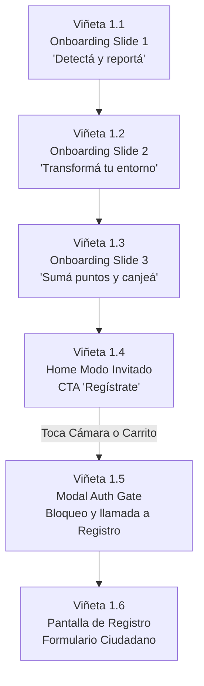

#### 🎬 Viñeta 1.1 a 1.3: Carrusel de Bienvenida (Onboarding)

> **📸 Captura Real en Dispositivo Móvil:**  
> 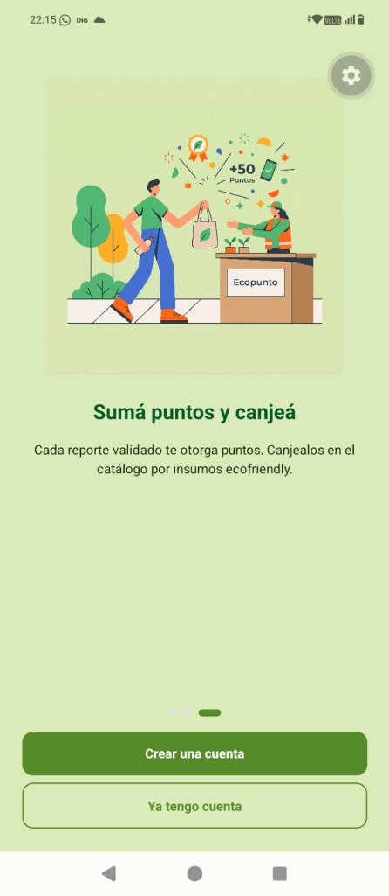

* **Componente:** `OnboardingPantalla.tsx` (Autoplay cada 4 segundos, indicadores de paginación interactivos).
```
+------------------------------------------+
|  [Omitir]                                |
|                                          |
|         [ 📸 Imagen Ilustrativa ]        |
|                                          |
|            Detectá y reportá             |
|   Identificá microbasurales y focos de   |
|   dengue en tu barrio. Tomá una foto y   |
|   compartí la ubicación exacta.          |
|                                          |
|                 (===) ( ) ( )            |
|                                          |
|            [ Siguiente ➔ ]               |
+------------------------------------------+
```
* **Acciones y Variantes:**
  - **Slide 1:** "Detectá y reportá" (`assets/tarjeta1.jfif`) $\rightarrow$ Botón *Siguiente* u *Omitir*.
  - **Slide 2:** "Transformá tu entorno" (`assets/tarjeta2.jfif`) $\rightarrow$ Explicación del saneamiento municipal.
  - **Slide 3:** "Sumá puntos y canjeá" (`assets/tarjeta3.jfif`) $\rightarrow$ Botones: `[Crear una cuenta]` y `[Ya tengo cuenta]`.
* **Trazabilidad:** [`HU-INV-01`](02_CATALOGO_HU_RF_CRITERIOS_BDD.md#hu-inv-01) ([`HU-008-01`](02_CATALOGO_HU_RF_CRITERIOS_BDD.md#hu-008-01)) · [`RF-AUT-06`](02_CATALOGO_HU_RF_CRITERIOS_BDD.md#rf-aut-06) · Caso de Prueba: [`CP-RF-AUT-06-01`](04_CASOS_DE_PRUEBA_DETALLADOS.md#cp-rf-aut-06-01).

---

#### 🎬 Viñeta 1.4 y 1.5: Home Invitado y Modal "Auth Gate"

> **📸 Capturas Reales en Dispositivo Móvil:**  
> | 1. Home en Modo Invitado (Exploración Libre) | 2. Modal "Auth Gate" Interceptor (Al Tocar Cámara o Carrito) |
> | :---: | :---: |
> | 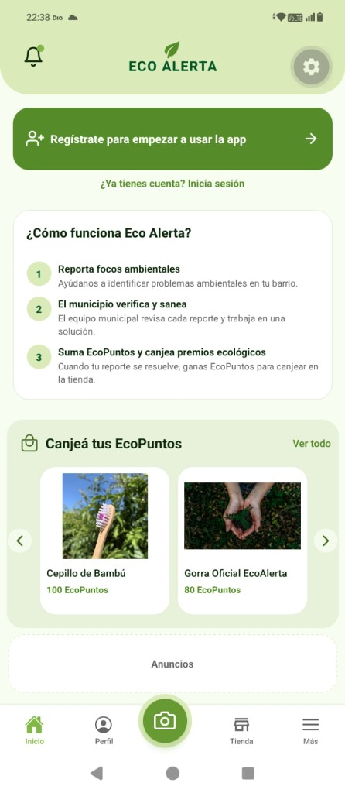 | 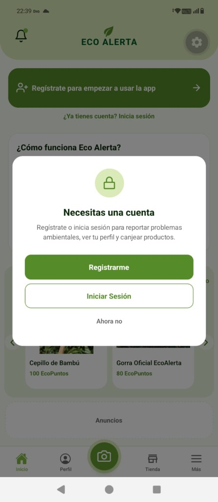 |

* **Componente:** `CitizenHomeScreen.tsx` (Modo Invitado) + Modal Interceptor.
```
+------------------------------------------+
|  EcoAlerta                      [🔔 0]   |
|  [🌿 Regístrate para empezar a usar]     |  <-- CTA Verde #2E7D32
|  ¿Ya tienes cuenta? Inicia sesión        |
+------------------------------------------+
|  📊 Impacto Municipal en Pilar           |
|  • 128 Focos saneados  • 450 Vecinos     |
|                                          |
|  🛒 Catálogo de Premios (Solo Lectura)   |
|  [ Botella Térmica - 250 PTS ]           |
|  [ Bolsa Ecológica - 80 PTS  ]           |
+------------------------------------------+
|  [🏠 Inicio]  [🛒 Tienda]  [📷]  [👤 Perfil]
+------------------------------------------+
                    │ (Toca botón central 📷)
                    ▼
+------------------------------------------+
|             ¡UNITE A LA COMUNIDAD!       |
|                                          |
|   Para reportar focos ambientales en tu  |
|   barrio y ganar ecopuntos canjeables,   |
|   necesitas tener una cuenta ciudadana.  |
|                                          |
|          [ REGISTRARSE AHORA ]           |
|          [ Ya tengo cuenta ]             |
|          [ Continuar explorando ]        |
+------------------------------------------+
```
* **Trazabilidad:** [`HU-INV-01`](02_CATALOGO_HU_RF_CRITERIOS_BDD.md#hu-inv-01), [`HU-INV-02`](02_CATALOGO_HU_RF_CRITERIOS_BDD.md#hu-inv-02), [`HU-INV-03`](02_CATALOGO_HU_RF_CRITERIOS_BDD.md#hu-inv-03) · [`RF-AUT-06`](02_CATALOGO_HU_RF_CRITERIOS_BDD.md#rf-aut-06), [`RF-AUT-08`](02_CATALOGO_HU_RF_CRITERIOS_BDD.md#rf-aut-08) · Casos: [`CP-RF-AUT-06-02`](04_CASOS_DE_PRUEBA_DETALLADOS.md#cp-rf-aut-06-02), [`CP-RF-AUT-08-01`](04_CASOS_DE_PRUEBA_DETALLADOS.md#cp-rf-aut-08-01).

---

## 🎬 2. STORYBOARD N° 2: Reporte Ciudadano, Cámara y Geolocalización

### Escenario:
Un vecino autenticado encuentra un basural clandestino en su cuadra, abre la app, toma la fotografía y envía la alerta ambiental.

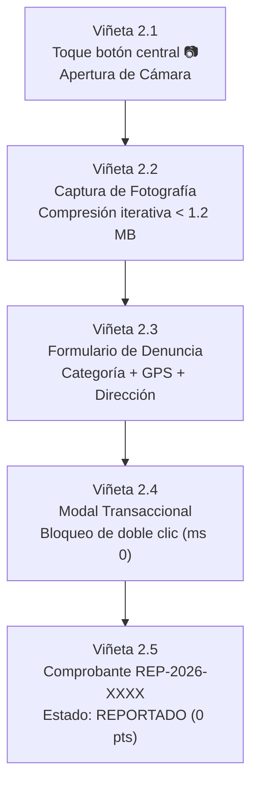

#### 🎬 Viñeta 2.2 y 2.3: Captura y Formulario de Alerta Ambiental

> **📸 Capturas Reales en Dispositivo Móvil:**  
> | 1. Captura de Foto y Categoría | 2. Geolocalización GPS y Mapa Interactivo |
> | :---: | :---: |
> | 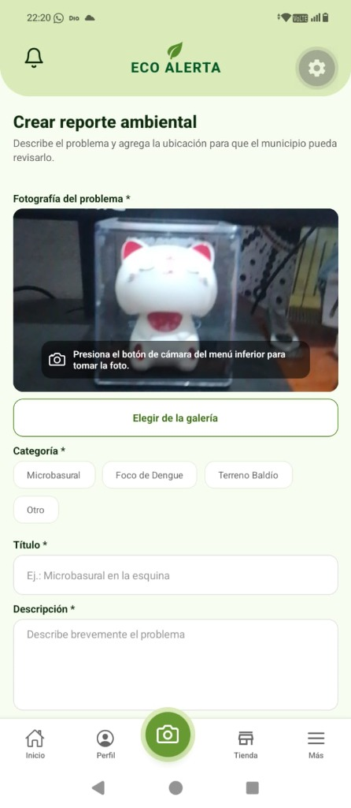 | 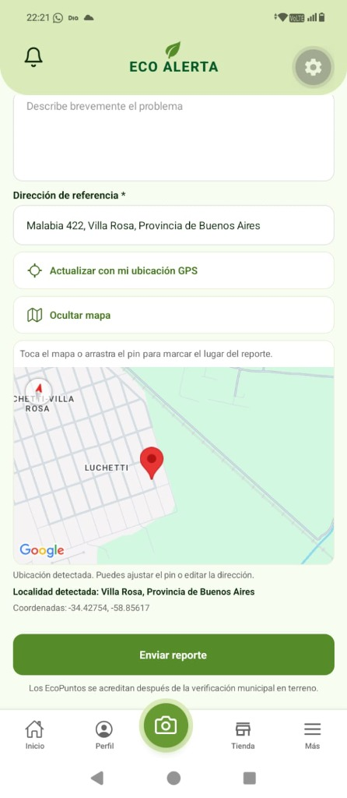 |

```
+------------------------------------------+
| 📷 NUEVO REPORTE AMBIENTAL       [Volver]|
+------------------------------------------+
| [ Previsualización de Foto Comprimida ]  |  <-- imageCompressor.ts (< 1.2 MB)
| (Foto nítida con timestamp y geolocal)   |
|                                          |
| Categoría del Foco:                      |
| (•) Microbasural   ( ) Foco de Dengue    |
| ( ) Terreno Baldío ( ) Desecho Químico   |
|                                          |
| Ubicación Detectada:                     |
| 📍 Lat: -34.4589, Long: -58.9142         |
| Dirección manual de referencia:          |
| [ Calle Las Lilas 420, e/ Los Aromos   ] |
|                                          |
| Descripción de lo observado:             |
| [ Acumulación de ramas y bolsas plásticas|
|   bloqueando el desagüe pluvial.       ] |
|                                          |
|        [ ENVIAR REPORTE AMBIENTAL ]      |
+------------------------------------------+
```

#### 🎬 Viñeta 2.4 y 2.5: Modal Transaccional y Confirmación

> **📸 Capturas Reales en Dispositivo Móvil:**  
> | 1. Envío en Progreso (Lock / Anti-duplicados) | 2. Comprobante de Reporte Recibido |
> | :---: | :---: |
> | 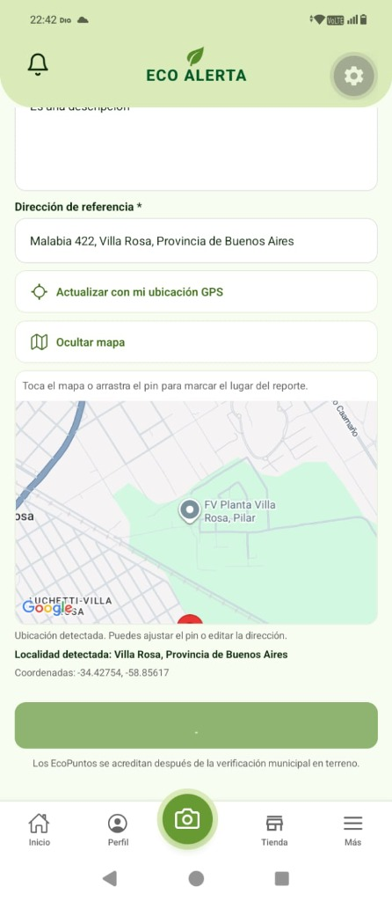 | 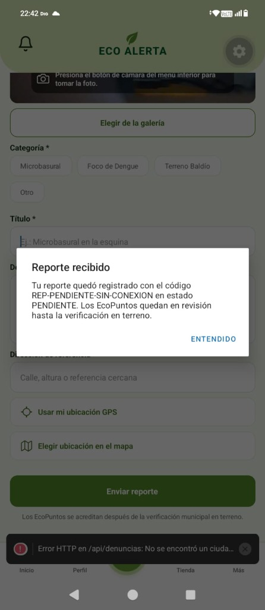 |

```
       (Al pulsar Enviar en ms 0)              (Respuesta 201 Created de la API)
+------------------------------------------+  +------------------------------------------+
|                                          |  |                                          |
|         [ ⏳ Spinner Animado ]           |  |         [ ✅ REPORTE ENVIADO ]           |
|                                          |  |                                          |
|      Procesando reporte ambiental...     |  |   Código de Seguimiento:                 |
|                                          |  |   👉 REP-2026-0045                       |
|   (Toda la pantalla queda bloqueada      |  |                                          |
|    impidiendo toques duplicados)         |  |   Estado: REPORTADO / PENDIENTE          |
|                                          |  |   Tus puntos se acreditarán cuando el    |
|                                          |  |   inspector verifique la zona.           |
|                                          |  |                                          |
|                                          |  |        [ IR A MIS DENUNCIAS ]            |
+------------------------------------------+  +------------------------------------------+
```
* **Trazabilidad:** [`HU-03`](02_CATALOGO_HU_RF_CRITERIOS_BDD.md#hu-03) · [`RF-REP-01`](02_CATALOGO_HU_RF_CRITERIOS_BDD.md#rf-rep-01), [`RF-REP-02`](02_CATALOGO_HU_RF_CRITERIOS_BDD.md#rf-rep-02), [`RF-REP-03`](02_CATALOGO_HU_RF_CRITERIOS_BDD.md#rf-rep-03), [`RNF-02`](02_CATALOGO_HU_RF_CRITERIOS_BDD.md#rnf-02), [`RNF-10`](02_CATALOGO_HU_RF_CRITERIOS_BDD.md#rnf-10) · Casos: [`CP-RF-REP-01-01`](04_CASOS_DE_PRUEBA_DETALLADOS.md#cp-rf-rep-01-01), [`CP-RF-REP-02-01`](04_CASOS_DE_PRUEBA_DETALLADOS.md#cp-rf-rep-02-01) (Fix [`BUG-101`](05_PLANILLA_EJECUCION_Y_PROGRESO.md#bug-101)), [`CP-RNF-10-01`](04_CASOS_DE_PRUEBA_DETALLADOS.md#cp-rnf-10-01).

---

## 🎬 3. STORYBOARD N° 3: Triaje, Inspección de Agente y Saneamiento

### Escenario:
El Administrador evalúa la denuncia en el panel municipal, aprueba su prioridad, el Agente toma el caso, inspecciona el terreno y sube la foto de resolución.

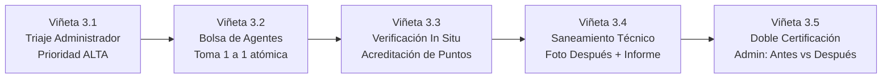

#### 🖼️ Viñeta 3.1 y 3.2: Triaje Municipal y Bolsa de Agente
```
[ ADMIN: AdminDenunciasScreen ]               [ AGENTE: AgentHomeScreen ]
+------------------------------------------+  +------------------------------------------+
| 🛡️ TRIAJE DE REPORTES        [Filtros ▾] |  | 📋 BOLSA DE CASOS DISPONIBLES            |
+------------------------------------------+  +------------------------------------------+
| Denuncia: REP-2026-0045                  |  | 🔴 PRIORIDAD ALTA                        |
| Barrio: Pilar Centro (Las Lilas 420)     |  | REP-2026-0045 · Microbasural             |
| [Ver Foto Ciudadano]                     |  | A 1.2 km de tu posición actual           |
|                                          |  |                                          |
| Asignar Prioridad Técnica:               |  |  ( ) Ver Detalles y Ubicación            |
| [ BAJA ] [ MEDIA ] [ (•) ALTA ] [URGENTE]|  |                                          |
|                                          |  |        [ 📌 TOMAR CASO EXCLUSIVO ]       |
|    [ APROBAR Y ENVIAR A BOLSA ]          |  +------------------------------------------+
|    [ Rechazar con Motivo...   ]          |  *(Al presionar: Bloqueo atómico 1 a 1      |
+------------------------------------------+   en BD impidiendo que otro agente lo tome)*
```

#### 🖼️ Viñeta 3.4 y 3.5: Cierre Técnico y Doble Certificación Antes vs. Después
```
+------------------------------------------------------------------------------------+
| 🔍 DOBLE CERTIFICACIÓN FINAL — ADMINISTRACIÓN MUNICIPAL                            |
+------------------------------------------------------------------------------------+
| Caso: REP-2026-0045  |  Categoría: Microbasural  |  Inspector: Agente Marcos Ramos |
|                                                                                    |
|       FOTO INICIAL (CIUDADANO)                     FOTO FINAL (SANEAMIENTO)        |
|  +----------------------------------+        +----------------------------------+  |
|  | [ Basural clandestino en vereda] |        | [ Zona limpia, pintada y cartel] |  |
|  | Fecha: 24/10/2026 14:10 hs       |        | Fecha: 26/10/2026 11:30 hs       |  |
|  +----------------------------------+        +----------------------------------+  |
|                                                                                    |
| Informe Técnico del Agente:                                                        |
| "Se retiraron 4 toneladas de escombros con cuadrilla N° 2 y se desinfectó la zona"|
| Puntos acreditados al vecino: 250 PTS (Baremo Oficial Prioridad ALTA)              |
|                                                                                    |
|          [ ✅ APROBAR Y MARCAR RESUELTO ]       [ ⚠️ OBSERVAR LIMPIEZA ]           |
+------------------------------------------------------------------------------------+
```
* **Trazabilidad:** [`HU-05`](02_CATALOGO_HU_RF_CRITERIOS_BDD.md#hu-05), [`HU-08`](02_CATALOGO_HU_RF_CRITERIOS_BDD.md#hu-08), [`HU-09`](02_CATALOGO_HU_RF_CRITERIOS_BDD.md#hu-09), [`HU-11`](02_CATALOGO_HU_RF_CRITERIOS_BDD.md#hu-11) ([`HU-07`](02_CATALOGO_HU_RF_CRITERIOS_BDD.md#hu-07)) · [`RF-ADM-01`](02_CATALOGO_HU_RF_CRITERIOS_BDD.md#rf-adm-01), [`RF-ADM-04`](02_CATALOGO_HU_RF_CRITERIOS_BDD.md#rf-adm-04), [`RF-AGE-02`](02_CATALOGO_HU_RF_CRITERIOS_BDD.md#rf-age-02), [`RF-AGE-08`](02_CATALOGO_HU_RF_CRITERIOS_BDD.md#rf-age-08), [`RF-ADM-07`](02_CATALOGO_HU_RF_CRITERIOS_BDD.md#rf-adm-07) · Casos: [`CP-RF-ADM-01-01`](04_CASOS_DE_PRUEBA_DETALLADOS.md#cp-rf-adm-01-01), [`CP-RF-AGE-02-01`](04_CASOS_DE_PRUEBA_DETALLADOS.md#cp-rf-age-02-01), [`CP-RF-ADM-04-01`](04_CASOS_DE_PRUEBA_DETALLADOS.md#cp-rf-adm-04-01), [`CP-RF-ADM-07-01`](04_CASOS_DE_PRUEBA_DETALLADOS.md#cp-rf-adm-07-01).

---

## 🎬 4. STORYBOARD N° 4: Tienda Ecológica, Carrito y Retiro por Colaborador

### Escenario:
El vecino tiene 250 ecopuntos ganados, ingresa al catálogo, elige una botella térmica, confirma el canje con reserva de 5 minutos y retira el premio en el comercio.

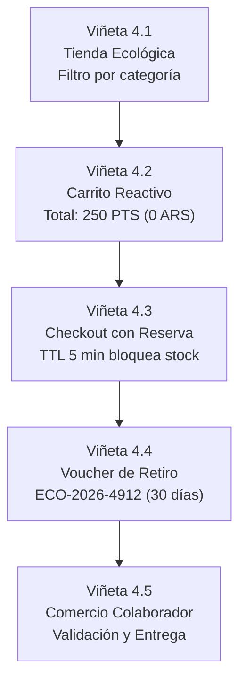

#### 🖼️ Viñeta 4.3 y 4.4: Checkout y Voucher Digital
```
[ CHECKOUT CON RESERVA TEMPORAL ]             [ VOUCHER DE CANJE EMITIDO ]
+------------------------------------------+  +------------------------------------------+
| 🛍️ CONFIRMAR CANJE                       |  | 🎉 ¡CANJE EXITOSO!                       |
+------------------------------------------+  +------------------------------------------+
| 1x Botella Térmica Sustentable (250 PTS) |  | Código de Retiro Único:                  |
|                                          |  | 🏷️ ECO-2026-4912-K                       |
| Sucursal de Retiro:                      |  |                                          |
| (•) Palacio Municipal Pilar              |  | Comercio: EcoKiosko Pilar Centro         |
|                                          |  | Dirección: Calle Rivadavia 520           |
| ⏱️ Tiempo restante de reserva: 04:32     |  | Válido hasta: 28/11/2026 (30 días)      |
| (Tu unidad física está reservada)        |  |                                          |
|                                          |  | ℹ️ Presentá este código junto a tu DNI   |
| Saldo Actual:    300 PTS                 |  |    al momento de retirar el premio.      |
| Total a Debitar: 250 PTS                 |  |                                          |
| Saldo Final:      50 PTS                 |  |        [ VER EN MIS CANJES ]             |
|                                          |  +------------------------------------------+
|         [ CONFIRMAR CANJE ]              |
+------------------------------------------+
```

#### 🖼️ Viñeta 4.5: Panel de Entrega del Comercio Colaborador
* **Componente:** `CollaboratorHomeScreen.tsx`
```
+------------------------------------------+
| 🏪 PANEL DE ENTREGA MUNICIPAL    [👤 Sede]|
+------------------------------------------+
| Ingrese el Código de Retiro del Vecino:  |
| [ ECO-2026-4912-K                      ] |
|              [ BUSCAR PEDIDO ]           |
|                                          |
| ---------------------------------------- |
| Titular: Carlos Alberto Gómez (DNI: 38.M)|
| Producto: 1x Botella Térmica Sustentable |
| Estado: PENDIENTE DE RETIRO              |
| Fecha Emisión: 28/10/2026                |
|                                          |
|       [ 📦 CONFIRMAR ENTREGA PRESENCIAL ]|
+------------------------------------------+
*(Al confirmar: El canje pasa a ENTREGADO con timestamp y operador, impidiendo dobles entregas)*
```
* **Trazabilidad:** [`HU-08-TIE`](02_CATALOGO_HU_RF_CRITERIOS_BDD.md#hu-08-tie), [`RF-COL-01`](02_CATALOGO_HU_RF_CRITERIOS_BDD.md#rf-col-01), [`RF-TIE-05`](02_CATALOGO_HU_RF_CRITERIOS_BDD.md#rf-tie-05), [`RF-TIE-06`](02_CATALOGO_HU_RF_CRITERIOS_BDD.md#rf-tie-06) · Casos: [`CP-RF-TIE-05-01`](04_CASOS_DE_PRUEBA_DETALLADOS.md#cp-rf-tie-05-01), [`CP-RF-TIE-05-02`](04_CASOS_DE_PRUEBA_DETALLADOS.md#cp-rf-tie-05-02) (Fix [`BUG-102`](05_PLANILLA_EJECUCION_Y_PROGRESO.md#bug-102)), [`CP-RF-COL-01-01`](04_CASOS_DE_PRUEBA_DETALLADOS.md#cp-rf-col-01-01).

---

## 🎬 5. STORYBOARD N° 5: Alta de Personal Municipal con Foto de Cámara Obligatoria

### Escenario:
El Administrador da de alta a un nuevo Agente de Campo tomando su foto en vivo con la cámara del dispositivo; el sistema rechaza fotos de galería y valida la firma JPEG.

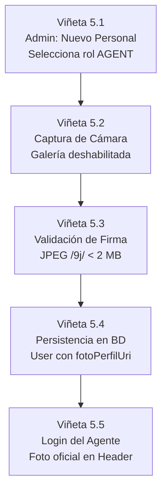

#### 🖼️ Viñeta 5.1 y 5.2: Formulario de Alta con Captura Nativa
```
+------------------------------------------+
| 👥 ALTA DE PERSONAL MUNICIPAL    [Cerrar]|
+------------------------------------------+
| Nombre Completo:                         |
| [ Marcos Ramos                         ] |
| Correo Electrónico Oficial:              |
| [ marcos.ramos@pilar.gob.ar            ] |
| Rol Operativo:                           |
| (•) Agente de Campo  ( ) Colaborador     |
| Contraseña Provisoria (mín. 8 chars):    |
| [ ••••••••••••                         ] |
|                                          |
| Fotografía de Identificación Oficial:    |
| +--------------------------------------+ |
| | [ 📷 Previsualización Foto Rostro ]  | |  <-- Sensor nativo obligatorio
| |                                      | |      (Selector de galería bloqueado)
| +--------------------------------------+ |
| [ 🔄 Volver a tomar foto con cámara ]   |
|                                          |
|       [ CREAR CUENTA DE PERSONAL ]       |
+------------------------------------------+
```
* **Trazabilidad:** [`HU-ADM-01`](02_CATALOGO_HU_RF_CRITERIOS_BDD.md#hu-adm-01), [`HU-ADM-02`](02_CATALOGO_HU_RF_CRITERIOS_BDD.md#hu-adm-02) · [`RF-ADM-08`](02_CATALOGO_HU_RF_CRITERIOS_BDD.md#rf-adm-08), [`RF-ADM-09`](02_CATALOGO_HU_RF_CRITERIOS_BDD.md#rf-adm-09) · Casos: [`CP-RF-ADM-08-01`](04_CASOS_DE_PRUEBA_DETALLADOS.md#cp-rf-adm-08-01), [`CP-RF-ADM-08-03`](04_CASOS_DE_PRUEBA_DETALLADOS.md#cp-rf-adm-08-03) (Negativo por foto ausente), [`CP-RF-ADM-09-01`](04_CASOS_DE_PRUEBA_DETALLADOS.md#cp-rf-adm-09-01).

---

## 📊 Matriz de Mapeo: Storyboards $\leftrightarrow$ HUs $\leftrightarrow$ Casos de Prueba

| Storyboard | Pantalla Principal | Historias de Usuario (HU) | Requisitos Funcionales | Casos de Prueba Clave |
| :--- | :--- | :--- | :--- | :--- |
| **Storyboard 1** | Onboarding & Home Invitado | [`HU-008-01`](02_CATALOGO_HU_RF_CRITERIOS_BDD.md#hu-008-01), [`HU-INV-01`](02_CATALOGO_HU_RF_CRITERIOS_BDD.md#hu-inv-01), [`HU-INV-02`](02_CATALOGO_HU_RF_CRITERIOS_BDD.md#hu-inv-02), [`HU-INV-03`](02_CATALOGO_HU_RF_CRITERIOS_BDD.md#hu-inv-03) | [`RF-AUT-06`](02_CATALOGO_HU_RF_CRITERIOS_BDD.md#rf-aut-06), [`RF-AUT-07`](02_CATALOGO_HU_RF_CRITERIOS_BDD.md#rf-aut-07), [`RF-AUT-08`](02_CATALOGO_HU_RF_CRITERIOS_BDD.md#rf-aut-08) | [`CP-RF-AUT-06-01`](04_CASOS_DE_PRUEBA_DETALLADOS.md#cp-rf-aut-06-01), [`CP-RF-AUT-08-01`](04_CASOS_DE_PRUEBA_DETALLADOS.md#cp-rf-aut-08-01), [`CP-RNF-09-01`](04_CASOS_DE_PRUEBA_DETALLADOS.md#cp-rnf-09-01) |
| **Storyboard 2** | Creación de Reporte y Cámara | [`HU-03`](02_CATALOGO_HU_RF_CRITERIOS_BDD.md#hu-03), [`HU-VEC01`](02_CATALOGO_HU_RF_CRITERIOS_BDD.md#hu-vec01) | [`RF-REP-01`](02_CATALOGO_HU_RF_CRITERIOS_BDD.md#rf-rep-01), [`RF-REP-02`](02_CATALOGO_HU_RF_CRITERIOS_BDD.md#rf-rep-02), [`RF-REP-03`](02_CATALOGO_HU_RF_CRITERIOS_BDD.md#rf-rep-03) | [`CP-RF-REP-01-01`](04_CASOS_DE_PRUEBA_DETALLADOS.md#cp-rf-rep-01-01), [`CP-RF-REP-02-01`](04_CASOS_DE_PRUEBA_DETALLADOS.md#cp-rf-rep-02-01) ([`BUG-101`](05_PLANILLA_EJECUCION_Y_PROGRESO.md#bug-101)), [`CP-RNF-10-01`](04_CASOS_DE_PRUEBA_DETALLADOS.md#cp-rnf-10-01) |
| **Storyboard 3** | Triaje, Bolsa y Saneamiento | [`HU-05`](02_CATALOGO_HU_RF_CRITERIOS_BDD.md#hu-05), [`HU-08`](02_CATALOGO_HU_RF_CRITERIOS_BDD.md#hu-08), [`HU-09`](02_CATALOGO_HU_RF_CRITERIOS_BDD.md#hu-09), [`HU-10`](02_CATALOGO_HU_RF_CRITERIOS_BDD.md#hu-10), [`HU-11`](02_CATALOGO_HU_RF_CRITERIOS_BDD.md#hu-11), [`HU-07`](02_CATALOGO_HU_RF_CRITERIOS_BDD.md#hu-07) | [`RF-ADM-01`](02_CATALOGO_HU_RF_CRITERIOS_BDD.md#rf-adm-01), [`RF-AGE-02`](02_CATALOGO_HU_RF_CRITERIOS_BDD.md#rf-age-02), [`RF-ADM-04`](02_CATALOGO_HU_RF_CRITERIOS_BDD.md#rf-adm-04), [`RF-ADM-07`](02_CATALOGO_HU_RF_CRITERIOS_BDD.md#rf-adm-07) | [`CP-RF-ADM-01-01`](04_CASOS_DE_PRUEBA_DETALLADOS.md#cp-rf-adm-01-01), [`CP-RF-AGE-02-01`](04_CASOS_DE_PRUEBA_DETALLADOS.md#cp-rf-age-02-01), [`CP-RF-ADM-04-01`](04_CASOS_DE_PRUEBA_DETALLADOS.md#cp-rf-adm-04-01), [`CP-RF-ADM-07-01`](04_CASOS_DE_PRUEBA_DETALLADOS.md#cp-rf-adm-07-01) |
| **Storyboard 4** | Tienda, Carrito y Retiro | [`HU-08-TIE`](02_CATALOGO_HU_RF_CRITERIOS_BDD.md#hu-08-tie), [`HU-008-03`](02_CATALOGO_HU_RF_CRITERIOS_BDD.md#hu-008-03), [`RF-COL-01`](02_CATALOGO_HU_RF_CRITERIOS_BDD.md#rf-col-01) | [`RF-TIE-01`](02_CATALOGO_HU_RF_CRITERIOS_BDD.md#rf-tie-01), [`RF-TIE-03`](02_CATALOGO_HU_RF_CRITERIOS_BDD.md#rf-tie-03), [`RF-TIE-05`](02_CATALOGO_HU_RF_CRITERIOS_BDD.md#rf-tie-05), [`RF-COL-01`](02_CATALOGO_HU_RF_CRITERIOS_BDD.md#rf-col-01) | [`CP-RF-TIE-02-01`](04_CASOS_DE_PRUEBA_DETALLADOS.md#cp-rf-tie-02-01), [`CP-RF-TIE-05-01`](04_CASOS_DE_PRUEBA_DETALLADOS.md#cp-rf-tie-05-01), [`CP-RF-TIE-05-02`](04_CASOS_DE_PRUEBA_DETALLADOS.md#cp-rf-tie-05-02) ([`BUG-102`](05_PLANILLA_EJECUCION_Y_PROGRESO.md#bug-102)), [`CP-RF-COL-01-01`](04_CASOS_DE_PRUEBA_DETALLADOS.md#cp-rf-col-01-01) |
| **Storyboard 5** | Alta de Personal con Foto | [`HU-ADM-01`](02_CATALOGO_HU_RF_CRITERIOS_BDD.md#hu-adm-01), [`HU-ADM-02`](02_CATALOGO_HU_RF_CRITERIOS_BDD.md#hu-adm-02), [`HU-ADM-03`](02_CATALOGO_HU_RF_CRITERIOS_BDD.md#hu-adm-03) | [`RF-ADM-08`](02_CATALOGO_HU_RF_CRITERIOS_BDD.md#rf-adm-08), [`RF-ADM-09`](02_CATALOGO_HU_RF_CRITERIOS_BDD.md#rf-adm-09), [`RF-ADM-10`](02_CATALOGO_HU_RF_CRITERIOS_BDD.md#rf-adm-10) | [`CP-RF-ADM-08-01`](04_CASOS_DE_PRUEBA_DETALLADOS.md#cp-rf-adm-08-01), [`CP-RF-ADM-08-03`](04_CASOS_DE_PRUEBA_DETALLADOS.md#cp-rf-adm-08-03), [`CP-RF-ADM-09-01`](04_CASOS_DE_PRUEBA_DETALLADOS.md#cp-rf-adm-09-01), [`CP-RF-ADM-10-02`](04_CASOS_DE_PRUEBA_DETALLADOS.md#cp-rf-adm-10-02) |
